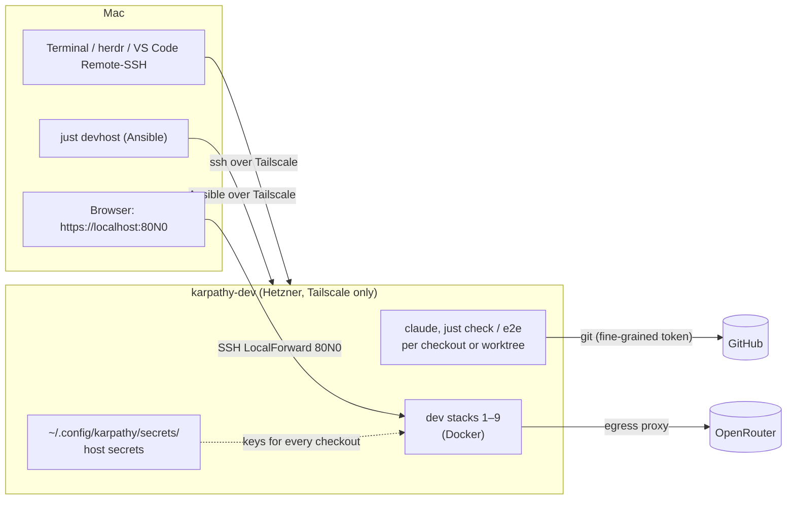

# Working on the dev server

How to develop on `karpathy-dev`, our remote dev host: what runs where, how you connect, and the daily routine.
Booking and provisioning the server are in [deploy/README.md › Dev server](../deploy/README.md#dev-server).

## The picture

`karpathy-dev` is an always-on Hetzner server (CAX41: ARM, 16 vCPU, 32 GB, Ubuntu 24.04) that does what the Mac does
for development: checkouts, worktrees, dev stacks, `just check`, `just e2e`, Claude Code. It is separate from prod
(`karpathy`) and holds no prod data. No port is open to the internet: you reach it only over Tailscale.



| Piece | Where | What it is |
|---|---|---|
| Server setup | `deploy/ansible/dev.yml`, `just devhost` | Ansible: hardening, Tailscale, Docker, the dev tools. Run from the Mac. |
| Server secrets | `deploy/ansible/inventories/dev/group_vars/all/vault.yml` | Encrypted: OpenRouter + Exa keys, GitHub token, Tailscale key. Password in the Mac's Keychain (`karpathy-ansible-dev`). Edit with `just secrets dev`. |
| Host secrets | `~/.config/karpathy/secrets/` on the server | The API keys, written by Ansible. `just dev up` copies a key missing in a checkout's `deploy/secrets/` from here, so new worktrees need no keys. |
| GitHub access | `~/.git-credentials` on the server | A fine-grained token for `karpathy.app`, `karpathy_demo_wiki`, `ingest_email` (1 year). Clone, pull and push just work. |
| Your login | `tgartner`, uid 1000, sudo, docker | The same name as on the Mac, so `ssh karpathy-dev` needs no user. |
| SSH entry | the Mac's `~/.ssh/config`, `Host karpathy-dev` | Tailscale host name, keepalive, `LocalForward` 8010…8090. |
| VS Code | the Mac's VS Code + Remote-SSH, `just code [worktree]`; `.vscode/` in the repo | An editor window on a checkout on the server: files, terminals, git and extensions run there. See [VS Code](#vs-code). |
| Browser editor | code-server on the server (role `code_server`), `https://karpathy-dev.tailab154c.ts.net/`, `just code-web [worktree]` | VS Code in the browser, for the iPad: the same files and terminals, from any of your tailnet devices. See [iPad: the browser editor](#ipad-the-browser-editor). |
| Tailnet policy | Tailscale admin console › Access controls; the text is in [Tailnet policy](#tailnet-policy) | Who may start connections to whom: your devices everything, the dev server prod, prod nothing. Servers are tagged `tag:server-dev` / `tag:server-prod`. |

## Connecting

Two parts: a **terminal** on the server, and **port forwards** so the Mac's browser reaches the server's stacks.

**The terminal: use herdr (or tmux), not a bare SSH shell.** Whatever runs in a plain SSH shell (`claude`,
`just check`, `just e2e`) dies when the connection drops. A herdr or tmux session keeps running on the server and you
attach again later.

```sh
herdr --remote karpathy-dev     # from the Mac: herdr's UI here, its panes on the server
```

- The first time, herdr offers to install itself on the server (`~/.local/bin/herdr`): say yes.
- Detach with `Ctrl+b`, then `q`; everything keeps running. The same command attaches again, also after the laptop
  slept or the network changed.
- Pasting images from the Mac's clipboard into the remote `claude` works in this mode.

Without herdr: `ssh karpathy-dev`, then `tmux new -s dev` (first time) or `tmux attach -t dev` (later). Detach with
`Ctrl+b`, `d`.

**The port forwards** come with every `ssh karpathy-dev` (the `LocalForward` lines). If https://localhost:80N0 doesn't
open while you work through herdr, keep a forward-only connection open in a Mac terminal tab:

```sh
ssh -N karpathy-dev             # no shell, only the forwards; Ctrl+C ends them
```

What survives a dropped connection:

| | Connection drops |
|---|---|
| `claude`, `just check`, `just e2e` in herdr / tmux | keep running |
| the same in a bare SSH shell | killed (the conversation itself stays: `just resume`) |
| dev stacks (`just dev up`) | keep running (Docker) |
| port forwards to the Mac | gone until you reconnect |

## Ports: one dev host at a time

Stack N listens on the server's `localhost:80N0`, and the forward maps it to the Mac's `localhost:80N0`. A stack running
**on the Mac** on the same port blocks that forward; ssh then warns `bind: Address already in use` and the server's
stack isn't reachable from the Mac. Either stop the Mac's stacks (`just dev down` in each checkout), or start the
server's stacks on numbers the Mac doesn't use: `just dev stacks` on the Mac shows which are taken, `just dev up 4` on
the server pins stack 4.

## VS Code

VS Code on the Mac edits the code on the server through **Remote-SSH**: the window is on the Mac, the files, terminals,
git, language servers and extensions run on `karpathy-dev`. It uses the same SSH entry as a terminal, so it comes over
Tailscale and brings the `LocalForward`s along.

**Once, on the Mac:**

1. Install VS Code and the extension **Remote - SSH** (`ms-vscode-remote.remote-ssh`).
2. Command Palette › *Shell Command: Install 'code' command in PATH*, so `just code` can start it.
3. In the user settings: `"remote.SSH.remotePlatform": { "karpathy-dev": "linux" }`, so VS Code doesn't ask every time.

**Opening a window:** one window per checkout, like one stack per checkout.

```sh
just code                       # on the Mac: a window on ~/karpathy.app on the server
just code <name>                # a window on ~/karpathy.app/.worktrees/<name>
```

`KARPATHY_DEVHOST` and `KARPATHY_DEVHOST_CHECKOUT` change the host and the checkout path (defaults `karpathy-dev` and
`/home/$USER/karpathy.app`). `just code` refuses to run on the server itself: in a VS Code terminal there,
`code .worktrees/<name>` opens a new window and `code <file>` opens a file in this one.

The first connect installs the VS Code Server on the server (`~/.vscode-server/`, about a minute); VS Code keeps it up
to date itself. The window then offers the recommended extensions (`.vscode/extensions.json`): ESLint, Playwright
Test, Vitest, Claude Code, Ansible, `just` syntax. They install on the server side. The Claude Code extension uses the
same login as the `claude` CLI there.

**Ports:** the repo's `.vscode/settings.json` tells VS Code to leave the nine stack ports 8010…8090 alone: the SSH
entry's `LocalForward` serves them, so a stack opens on the Mac at the same number and Vite's live reload works. Any
other port a process on the server opens, VS Code forwards itself, at the same number if it is free on the Mac:
`just prodtest` on 80N5 and the `just site` preview on 8099 thus reach the Mac's browser from a VS Code window (not
from herdr, whose SSH entry doesn't forward them). The Ports view shows what VS Code forwards.

**Long runs stay in herdr or tmux.** A VS Code terminal survives a short drop (the window reconnects by itself), but
not a laptop that slept overnight. Run `claude` and `just e2e` in herdr or tmux; a VS Code window and herdr side by
side are fine. If the conversation was in a VS Code terminal, `just resume` picks it up again.

**File watching:** `.vscode/settings.json` keeps VS Code from watching and indexing `.worktrees/`, `tmp/`,
`node_modules/` and the build outputs; each worktree gets its own window instead. `just devhost` raises the server's
inotify limits (`fs.inotify.max_user_instances` = 1024, `fs.inotify.max_user_watches` = 1048576; Ubuntu's default of
128 instances runs out with a few windows plus Vite, `tsc` and ESLint).

## iPad: the browser editor

The iPad has no VS Code with Remote-SSH. Instead the server runs **code-server**, VS Code in the browser: the same
checkouts, terminals, git and extensions as a VS Code window, in Safari. It listens only on the server's loopback
(`127.0.0.1:8080`); `tailscale serve` publishes it to the tailnet with a real certificate at
**https://karpathy-dev.tailab154c.ts.net/**. There is no password: only your own tailnet devices get through
([Tailnet policy](#tailnet-policy)). Background: [the iPad research](../specs/research/ipad-dev/ipad-dev-report.md).

**Opening it:**

```sh
just code-web                   # the main clone ~/karpathy.app
just code-web <name>            # a worktree: .worktrees/<name>
```

On the Mac it opens the default browser. On the server (herdr, tmux, SSH) it prints the URL and a **QR code**: scan it
with the iPad's camera and Safari opens the editor on that checkout. The URL itself works anywhere in the tailnet,
also typed by hand: `https://karpathy-dev.tailab154c.ts.net/?folder=/home/tgartner/karpathy.app/.worktrees/<name>`.
The editor remembers the last folder. `KARPATHY_DEVHOST_URL` changes the address (e.g. after moving to another
tailnet).

**Once, on the iPad:**

1. The Tailscale app, logged in with your account (the iPad is then an *own device*).
2. Open the editor, then Safari › Share › **Add to Home Screen**. Started from the home screen it runs full screen, and
   shortcuts like Cmd+W and Cmd+P go to the editor instead of Safari.
3. Install the extensions it offers (`.vscode/extensions.json`, from Open VSX) and sign in to the Claude Code
   extension once.
4. Keyboard: Claude Code interrupts with **Esc**. Older Magic Keyboards for iPad have none: Settings › General ›
   Keyboard › Hardware Keyboard › Modifier Keys › Caps Lock → Escape.

**Good to know:**

- One editor for all checkouts: the folder is in the URL, not a separate server per worktree. Its user settings
  (theme, font size, keybindings) are its own, separate from the Mac's VS Code; `.vscode/settings.json` applies to
  both.
- The Mac's VS Code window and the browser editor may be open on the same checkout at once. Both reload files that
  change on disk.
- Long runs (`claude`, `just e2e`) still belong in herdr or tmux: an editor terminal ends when Safari drops the page.
- Updates: bump `code_server_version` in `deploy/ansible/roles/code_server/defaults/main.yml`, then `just devhost`.
  `code_server_enabled: false` in the dev inventory turns it off.

## Tailnet policy

Who may **start** a connection to whom in the tailnet. Replies to a connection always flow, so prod still answers
your browser and your deploys. The policy isn't managed as code: this text is the source, pasted into the Tailscale
admin console › **Access controls**.

```jsonc
{
  "tagOwners": {
    "tag:server-prod": ["autogroup:admin"],   // karpathy (prod)
    "tag:server-dev":  ["autogroup:admin"]    // karpathy-dev
  },
  "grants": [
    // your own devices (Mac, iPad, iPhone) reach everything
    { "src": ["autogroup:member"], "dst": ["*"],               "ip": ["*"] },
    // the dev server deploys to prod (just deploy, Ansible)
    { "src": ["tag:server-dev"],   "dst": ["tag:server-prod"], "ip": ["*"] }
    // tag:server-prod has no grant: prod starts nothing on the tailnet
  ],
  "tests": [
    { "src": "tag:server-prod", "deny":   ["tag:server-dev:22", "tag:server-dev:443", "tag:server-dev:8010"] },
    { "src": "tag:server-dev",  "accept": ["tag:server-prod:22"] }
  ]
}
```

| From → to | Allowed |
|---|---|
| your devices → dev server, prod | yes |
| dev server → prod | yes |
| prod → dev server (editor, SSH, stacks), prod → your devices | no |

The admin console runs the `tests` on every save and refuses a policy that breaks them: a later edit can't quietly
let prod reach the dev server again. Every server carries its own tag; `just devhost` and `just deploy` stop if it
carries another (the `tailscale` role checks `tailscale_tag` from the inventory). A rebuilt server gets its tag from
its auth key ([deploy/README.md](../deploy/README.md)).

**Rolling it out** (once, in this order, so the editor without a password never runs while prod can reach it):

1. Access controls: copy the current policy as a backup, then add only the two new tags to its `tagOwners` (keep
   `tag:server` and the rest) and save. A tag can only be assigned once `tagOwners` lists it.
2. Admin console › Machines › *Edit ACL tags*: `karpathy` → `tag:server-prod`, `karpathy-dev` → `tag:server-dev`.
3. Access controls: replace the whole text with the policy above (no `acls` allow-all rule, no `tag:server`, no `ssh`
   block: Tailscale SSH is off) and save; its tests must pass. Locked out? The admin console is a website: paste the
   backup back.
4. Prove it from prod; both must fail (time out):

   ```sh
   ssh karpathy 'nc -zw5 karpathy-dev 22'; ssh karpathy 'nc -zw5 karpathy-dev 443'
   ssh karpathy-dev 'nc -zw5 karpathy 22'      # must succeed: the dev server still reaches prod
   ```

5. Admin console › DNS: turn on **HTTPS Certificates** (needed by `tailscale serve`; it puts the machine names into
   the public Certificate Transparency logs).
6. `just devhost` from the Mac: installs code-server and publishes it. `curl -sf
   https://karpathy-dev.tailab154c.ts.net/healthz` from the Mac answers; a second `just devhost` reports `changed=0`.
7. `just deploy hetzner` still works: the tag check passes on prod.

## Daily routine

```sh
herdr --remote karpathy-dev     # or: ssh karpathy-dev, tmux attach -t dev
cd ~/karpathy.app               # or a worktree: ~/karpathy.app/.worktrees/<name>
git pull
just dev up                     # this checkout's stack; prints the URL and the token
claude                          # or: just resume (continues this checkout's last session)
```

Open the printed URL (`https://localhost:80N0`) in the Mac's browser. Accept the dev certificate warning once per port
(Caddy's internal CA, as on the Mac).

**Several agents in parallel:** one worktree each, as on the Mac.

```sh
git worktree add .worktrees/<name> -b <branch>
cd .worktrees/<name> && just install && just dev up     # the next free stack; keys come from the host secrets
```

The stack rules from `CLAUDE.md` › Parallel dev stacks apply unchanged. When done: `just dev down`, then
`git worktree remove .worktrees/<name>`.

## First time on a fresh server

After `just devhost --bootstrap <ip>` (see [deploy/README.md](../deploy/README.md#dev-server)):

```sh
ssh karpathy-dev
git clone https://github.com/tillg/karpathy.app
cd karpathy.app && just install
claude                          # log in with the subscription once; the project plugins install in this session
just check                      # proves the server: lint, tests, the playbook test
```

## Keeping the server up to date

From the Mac:

```sh
just devhost --check            # what would change
just devhost                    # apply (e.g. after a change to roles/devtools); changed=0 when nothing to do
```

Ubuntu security updates install themselves (unattended upgrades). Claude Code updates itself.

**Secrets:** `just secrets dev` on the Mac (Enter keeps a value), then `just devhost`. The GitHub token expires after a
year: regenerate it on GitHub (same repos and permissions), put it in with `just secrets dev`, run `just devhost`.

## When something goes wrong

| Symptom | Cause and fix |
|---|---|
| `-bash: /usr/bin/just: No such file or directory` | Your shell cached the old path after `just` moved. `hash -r`, or open a new shell. |
| `git clone`/`pull` hangs: `Failed to connect to github.com port 443` | Seen once: one GitHub address didn't answer from Hetzner for a few minutes. Retry; `curl -sS -o /dev/null -w '%{http_code}\n' https://github.com` should print 200. |
| `bind: Address already in use` on connect | A Mac stack uses that port: see [Ports](#ports-one-dev-host-at-a-time). |
| https://localhost:80N0 doesn't load | Is the forward up (an `ssh karpathy-dev` or `ssh -N karpathy-dev` running)? Is the stack up (`just dev ps` on the server)? |
| `ssh karpathy-dev` times out | Is Tailscale on, on the Mac? `tailscale status` lists `karpathy-dev`. The Hetzner console shows whether the server runs. |
| `just dev up`: `no OpenRouter key` | Neither the checkout nor `~/.config/karpathy/secrets/` has it: `just secrets dev` + `just devhost` on the Mac. |
| `just check` refuses: Docker doesn't answer | `sudo systemctl restart docker`. |
| VS Code: "Visual Studio Code is unable to watch for file changes" | The inotify limits are the defaults: `sysctl fs.inotify.max_user_instances` on the server should print 1024. Run `just devhost` from the Mac. |
| https://localhost:80N0 stopped loading after closing VS Code or herdr | The forward belongs to the SSH connection that came first; closing it drops the forward. Reconnect, or keep `ssh -N karpathy-dev` open. |
| VS Code opens a window but can't find the folder | The worktree doesn't exist on the server (`just code` doesn't check): `git worktree list` there. |
| `just devhost` fails: "the tailnet's HTTPS certificates are off" | Tailnet HTTPS isn't on yet: admin console › DNS › HTTPS Certificates, then run again. |
| `just devhost` / `just deploy` fails: "This server carries tag:…, not tag:server-…" | The node has the wrong tag (an old key, the old shared `tag:server`): admin console › Machines › *Edit ACL tags*, as the message says. |
| The browser editor loads but keeps saying "reconnecting" | Its WebSocket is refused. Is `trusted-origins` in `~/.config/code-server/config.yaml` the server's tailnet name? `just devhost` writes it; `systemctl status code-server@$USER` on the server shows whether it runs. |
| https://karpathy-dev.tailab154c.ts.net/ doesn't load | Is Tailscale on, on this device, and logged in as you? `tailscale serve status` on the server should list it. |
| `just code-web <name>` opens an empty folder | The worktree doesn't exist on the server (like `just code`, it doesn't check): `git worktree list` there. |
| VS Code's Ports view shows 80N0 forwarded to another port | VS Code didn't read `.vscode/settings.json` (an old checkout without it?). As a fallback, put the same `remote.portsAttributes` into the remote settings: Command Palette › *Preferences: Open Remote Settings*. |

## Costs and limits

- About €59/month (server €49, backups €10, IPv4 €0.60), billed in its own Hetzner project (separate from prod).
- Daily Hetzner backups of the whole disk: unpushed work is covered for 7 days. Push anyway.
- arm64, like the Mac: `just prodtest` there tests arm64 images; prod (x86) is covered by CI and the release build.
- No monitoring: an outage shows when you connect.
- The iPad works as a second device: the browser editor ([iPad](#ipad-the-browser-editor)) and any SSH client. Still
  out of scope: the iPad as the only device (the app preview needs the Mac's browser and its port forward, and
  `just devhost` / `just secrets` the Mac's Keychain), several developers on one server.
