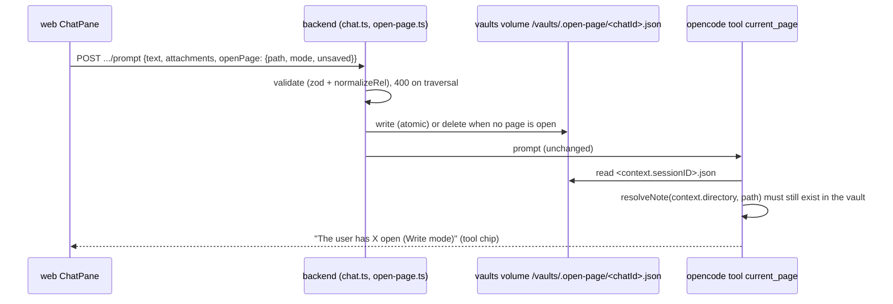

# Architecture: current_page tool

## Flow

## Decisions

1. **A tool, not prompt injection.** The issue asks for a tool. It also keeps the prompt free of a changing line on
   every turn (history stays cache-friendly) and the model asks only when the user says "this note". The hidden
   per-turn instruction path (`PromptInput.instructions`) stays for skills.
2. **Hand-over by a file on the shared vaults volume**, `/vaults/.open-page/<chatId>.json`, next to the clones and
   outside every git clone (precedent: `/vaults/.preflight`), so it can never show up as an untracked vault file.
   The opencode session id equals the chat id, and the tool gets it as `context.sessionID`: no vault id, no
   model-chosen path, no new network hop, no extra opencode-visible secret. Alternatives: an HTTP endpoint on the
   backend (needs the bearer token inside opencode, which must not hold app secrets); a file in the vault (would be
   uncommitted noise); an MCP server (new moving part).
3. **Written when the prompt is accepted** (the `POST .../prompt`), not when the turn starts: a chat has at most one
   turn queued or running, so the file belongs to exactly one turn; queue persistence (`config.queued`) needs no
   schema change, the file survives a backend restart on the volume. Omitting `openPage` deletes the file, so a
   stale page from an earlier prompt is never reported. Deleting a chat removes its file.
4. **Validation at both ends.** Backend: `path` via `normalizeRel` (no `..`, absolute, `.git`), `mode` enum,
   `unsaved` boolean; 400 otherwise. Tool: the file is read by a session id matching `^[A-Za-z0-9_-]+$`, and the path
   is re-checked with `resolveNote` against `context.directory` (inside the vault root, exists, no dot segment, no
   symlink escape), so a hand-edited file can't point the AI outside the vault. A page that was deleted since gives
   "the open page no longer exists".
5. **Names and wiring.** `deploy/opencode/tools/current_page.ts` (the description carries the usage hint),
   `deploy/opencode/lib/open-page.ts` (read + format; helpers can't live in `tools/`), COPY already covers both
   directories; the Dockerfile bake waits for the tool id too. `opencode.json`: `current_page: allow` for `vault` and
   `vault-readonly`. `harness/map.ts` needs no change: the call is a plain chip (no path input, `opens: false`).
6. **Shared types.** `OpenPage { path; mode: 'read' | 'write'; unsaved: boolean }` in `packages/shared`; `api.prompt`
   gets an optional fourth argument; ChatPane passes the open note and its mode.

## Security

The value is user-supplied but only ever echoed to the model after the vault check. The tool reads one file whose
name is the session id; the directory is outside the vaults and the AI's `read` tool is already denied outside the
session directory. No new network access, no new secret.

## Tests

Real directories for the tool helper (like `open-note-tool.test.ts`), the real opencode container for the tool id
and permissions (`opencode-tools.test.ts`) and the route (`chat.test.ts`), a web unit test for the request body, an
`@llm` backend test and an e2e spec (the dev model is a small Ollama model, so those tolerate "model did not call
the tool" as inconclusive, like the `open_note` tests).
