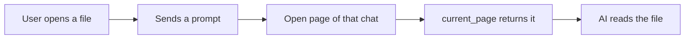

# Domain: open page

| Term | Meaning |
|---|---|
| **Open page** | The file the user has open in the note pane when a prompt is sent: vault-root-relative path, the view mode it shows in (`read` / `write`) and whether it has unsaved edits. At most one; none while the pane is empty. It is a snapshot taken at send time, per chat; moving to another file mid-turn doesn't update it. |
| **Page request** | One call of the AI's `current_page` tool. It answers with the open page of the chat's latest prompt, or "no page is open". It reads and changes nothing in the vault; like an **open request** (`open_note`) it is not a consulted or changed file. |

Unsaved edits are not on disk: the AI reads the saved text. The tool says so when `unsaved` is true.
