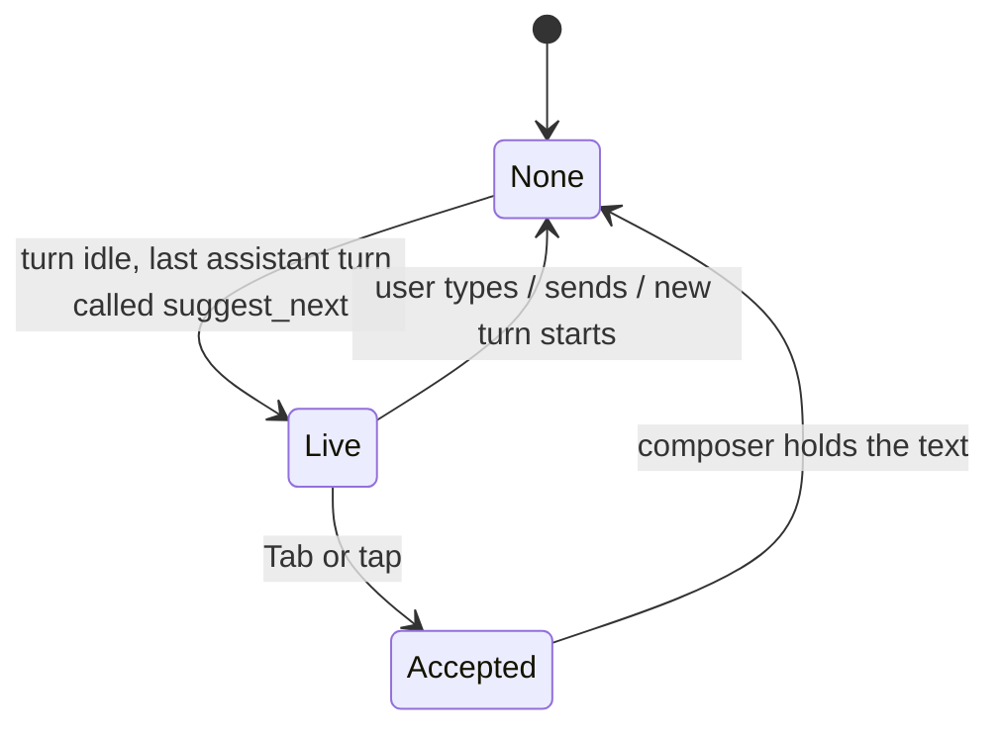

# Domain: next-prompt suggestion

| Term | Meaning |
|---|---|
| **Suggestion** | One short prompt the AI proposes as the user's next message, in the user's language. At most one is live per chat: the latest completed `suggest_next` call after the last user message. *Avoid:* hint, autocomplete. |
| **Ghost text** | The suggestion shown greyed out in the empty composer. Typing, sending, accepting or a new turn removes it. |
| **Accept** | Copies the suggestion into the composer (Tab, or a tap on "Tap to use"). Sends nothing; Enter sends. |

A suggestion is not a tool chip: the call is hidden from the chip row, because the ghost text is its presentation.
It is not an open request or a link offer either: it moves nothing in the UI.

