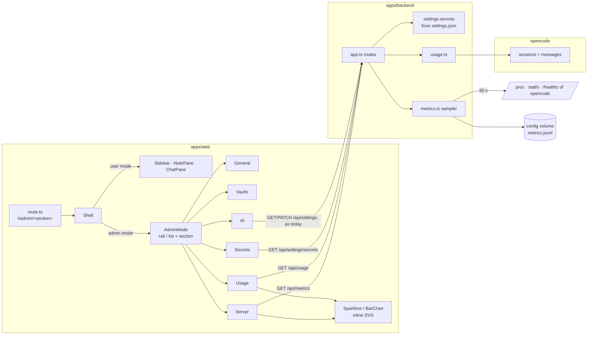
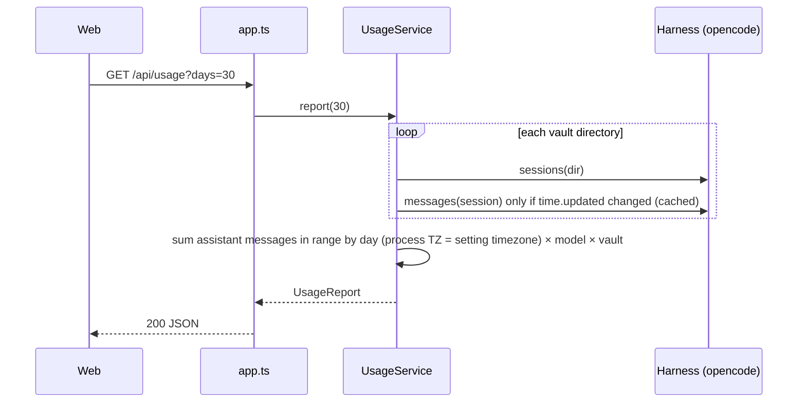

# Architecture: admin mode

## Overview



The existing settings routes (`GET/PATCH /settings`, `/settings/github-token`, `/ingest/instagram/*`, `/vaults`)
stay as they are. Admin mode reuses the forms that call them.

## Web app

### Routing and the mode switch

- `lib/route.ts` gets an admin form of the hash: `#admin` and `#admin/<section>`. These never match the vault route,
  because a vault route always starts with `#/`. `parseRoute` returns `{ admin: AdminSection | null, vault, path }`;
  an unknown section falls back to `general`.
- Store: `adminOpen` (`false | {view:'vaults', vault?} | {view:'settings'}`) is replaced by `admin: { section,
  vault? } | null`, derived from the route. `openAdmin(section, vault?)` saves the open note, remembers the current
  user-mode hash and pushes `#admin/<section>` (`#admin` on the phone). **Done** restores the remembered hash, so
  the user lands where they came from (vault, note, pane); after a reload straight into `#admin/…`, with nothing
  remembered, it goes to the last vault.
- History: on wide screens and tablets, moving between sections replaces the entry, so one Back (or **Done**) leaves
  admin mode. On the phone the navigation is a strict two-level stack: the list `#admin` → a section
  `#admin/<section>` is a push, and Back or "‹ Admin" returns to the list. **Done** exists only on the list, so admin
  mode is left from its top level only.
- `Shell` renders either the user-mode panes or `<AdminMode/>`. Background work keeps running in admin mode: the vault
  event stream stays connected, and a reply that is streaming keeps streaming.
- Vault details are a sub-view of the Vaults section, as in the dialog today (no extra route segment). **Edit vault**
  opens `#admin/vaults` with that vault preselected.

### Layout

| Width | Layout |
|---|---|
| wide (≥ 1024) | `nav.admin-rail` (232 px: brand + **ADMIN** pill, icon + label per section) on the left; the section on the right, max 780 px wide; header bar with the section title + **Done** |
| tablet (700–1023) | The same rail, 76 px: icon + short label |
| phone (≤ 699) | `#admin` shows the section list (**ADMIN** pill, **Done**, large title, full-width rows with icon, label, one-line summary such as "5 of 6 set · Instagram expired"); a section shows a header with "‹ Admin" and the section title, and **no Done**. The bottom tab bar of user mode is hidden. |

On the phone `#admin` (no section) is the list. On wider screens it opens General. The draft of every layout is in
[ui.md](ui.md).

The vault switcher stays in the user-mode sidebar and is not shown in admin mode: switching vaults is user work,
managing them admin work (ready for the User and Admin roles, see [domain.md](domain.md)).

### Sections

| Section | Component | Source |
|---|---|---|
| General | `GeneralSection`: threshold field + Save (from `SettingsForm`), `Versions` | `GET/PATCH /settings`, `/health` |
| Vaults | `VaultsSection`: today's `VaultsDialog` body (list, details, add, help) without the `Modal` | `/vaults` |
| Secrets & keys | `SecretsSection`: `GitHubTokenForm`, `InstagramSettings`, `SecretTable` | `/settings/github-token`, `/ingest/instagram`, `GET /settings/secrets` |
| AI | `AiSection`: today's model field (free text, "Default: …", **Use default**), Web access switch, Save | `GET/PATCH /settings` |
| Usage | `UsageSection`: range 7 d / 30 d; totals row; stacked bar chart per day (input, output, cache); tables per model and per vault; note "Counts the chats that still exist." | `GET /usage?days=` |
| Server | `ServerSection`: range 1 h / 24 h / 7 d; sparklines for CPU %, memory, load, disk (vaults, config) with current value and max; opencode status, backend uptime; polls every 30 s while visible | `GET /metrics?range=` |

`SettingsForm` today saves threshold, model and web access in one `PATCH /settings`. Each section saves only its own
fields (the route already accepts partial bodies).

**Charts:** two small inline-SVG components (`Sparkline`, `StackedBars`) in `components/charts/`. No chart library:
the data is small (≤ 240 points), and the components only need axes for min/max, a hover value and light and dark
colors. The series colors are new tokens `--series-1…3` (light and dark), checked for color-vision deficiency; the
app's `--graph-*` colors failed that check. A table fallback (`<details>` "Show numbers") keeps them accessible.

## Backend

### Secret status: rendered, not probed

The backend can't see most secrets: provider keys and the Exa key go only into `opencode.env`. So the
**renderer** (`packages/settings/src/render.ts`), which resolves every secret reference anyway, writes a manifest into
the backend's `settings.json`:

```json
"secrets": [
  { "name": "openrouter_api_key", "component": "opencode", "purpose": "Gateway openrouter API key", "optional": false, "set": true },
  { "name": "exa_api_key", "component": "opencode", "purpose": "Web search (Exa)", "optional": true, "set": false }
]
```

- `purpose` comes from the setting's path (`gateways.<id>.api_key` → "Gateway `<id>` API key", `ai.web.exa_api_key` →
  "Web search (Exa)", `auth.bearer_token` → "App login token", and so on); a table in `render.ts` maps known paths,
  and any other path shows as its dotted path.
- `set` is true when the secret file was non-empty at render time. Only the secrets of the active gateway are
  listed.
- `GET /api/settings/secrets` returns the manifest; for `github_token` it adds today's `GitHubToken` view (source
  app or deployment, last 4).
- The backend's zod schema (`apps/backend/src/settings.ts`) accepts the new key. `secrets` defaults to `[]`, so an
  older `settings.json` still loads.

Trade-off: the status is as of the last render (deployment or `just dev up`). That is exactly when secrets change,
because the app never changes them. Probing opencode for its keys at runtime would add a call into opencode just
to read its environment, so the status is not probed.

### Usage: `usage.ts`



- Harness interface gets `sessionUsage(dir, sessionId)`. It returns per assistant message `{ created, model,
  tokens: {input, output, reasoning, cache:{read, write}}, cost }`, mapped in `harness/map.ts` (the only code that
  knows opencode's shapes).
- `UsageService` caches each session's per-message rows keyed by `time.updated`, like `context-cache.ts`, with
  concurrency 4. The first report after a start reads every session once. A deployment holds hundreds of sessions,
  not hundreds of thousands, so that is acceptable.
- `UsageReport`: `{ days: [{ date, input, output, reasoning, cacheRead, cacheWrite, cost }], byModel: [...],
  byVault: [...], total, costKnown: boolean }`. `costKnown` is false when every cost is 0. In that case the UI hides
  the cost column instead of showing $0.
- `days` ∈ {7, 30}; anything else is a 400.

### Metrics: `metrics.ts`

- `MetricsSampler` starts in `main.ts` and stops on shutdown. Every 30 s it takes a `MetricsSample`:
  - CPU % from the difference of `os.cpus()` times between two samples;
  - memory used = `os.totalmem() − os.freemem()`, refined with `MemAvailable` from `/proc/meminfo` when readable;
  - load from `os.loadavg()[0]`;
  - disk from `fs.statfs(VAULTS_DIR)` and `fs.statfs(CONFIG_DIR)`;
  - opencode up from the harness health check that `/api/health` already uses.
- In Docker without lxcfs, `/proc` and `os` report the **host** (the VM on a dev stack). That is the number wanted.
- Store: an in-memory array plus `CONFIG_DIR/metrics.jsonl`. Every sample is appended (one line, about 150 bytes,
  ~20 000 lines in 7 days ≈ 3 MB). On start the file is read and samples older than 7 days are dropped. Once an hour
  the file is rewritten atomically without the old samples. A torn last line, for example after a crash, is skipped.
- `GET /api/metrics?range=1h|24h|7d` returns `{ samples: MetricsSample[] (≤ 240, bucket-averaged; disk and memory
  totals from the last sample of the bucket), latest, uptime, intervalS: 30 }`.
- The clock and the `/proc` readers are injected, so tests run without timers or a real host.

### Routes added to `app.ts`

| Route | Returns |
|---|---|
| `GET /api/settings/secrets` | `{ secrets: SecretStatus[] }` |
| `GET /api/usage?days=7\|30` | `UsageReport` |
| `GET /api/metrics?range=1h\|24h\|7d` | `MetricsReport` |

All three sit behind the bearer token like every `/api` route. None of them writes anything.

## Key decisions

| Decision | Chosen | Rejected and why |
|---|---|---|
| Mode switch | Hash route `#admin/<section>` | Store-only state: lost on reload, no Back. A router library: one more dependency for a single extra route. |
| Phone navigation | Section list → pushed section | Bottom tabs: six sections don't fit next to user mode's tab bar. Horizontal tab strip: hides sections off screen. |
| Charts | Own inline SVG | Recharts or uPlot: ≥ 40 kB for two chart types with ≤ 240 points. |
| Secret status | Rendered manifest | Runtime probe of opencode's env: a new privileged opencode call for static facts. |
| Metrics source | Backend sampler + JSONL on the config volume | Beszel hub API: only on targets with monitoring, needs tailnet routing and hub credentials. Prometheus/Grafana: two more containers for one page. |
| Usage source | Aggregate opencode sessions | Own ledger: double bookkeeping, starts empty, needs hooks in every turn path. |

## Security

- No new secret leaves the server; the manifest carries names and booleans only (security.md's secrets table gets
  a "shown in admin mode" column at archive).
- Metrics reveal host size and load to the token holder, who is already the operator.
- The usage aggregation reads only message metadata (tokens, model, time), never message text.
- `metrics.jsonl` lives on the config volume, which is backend-only (opencode can't see it).

## Integration and migration

- No data migration: `config.json` is unchanged; `metrics.jsonl` starts empty.
- The release must re-render the settings, because of the new `secrets` key. Every deployment renders anyway, and
  the backend tolerates its absence.
- `e2e/admin.spec.ts` and the tests that open the dialogs (`data-testid="settings-dialog"`, `"admin"`) follow the
  new navigation. The tested behavior stays the same; only how a test reaches the form changes.
