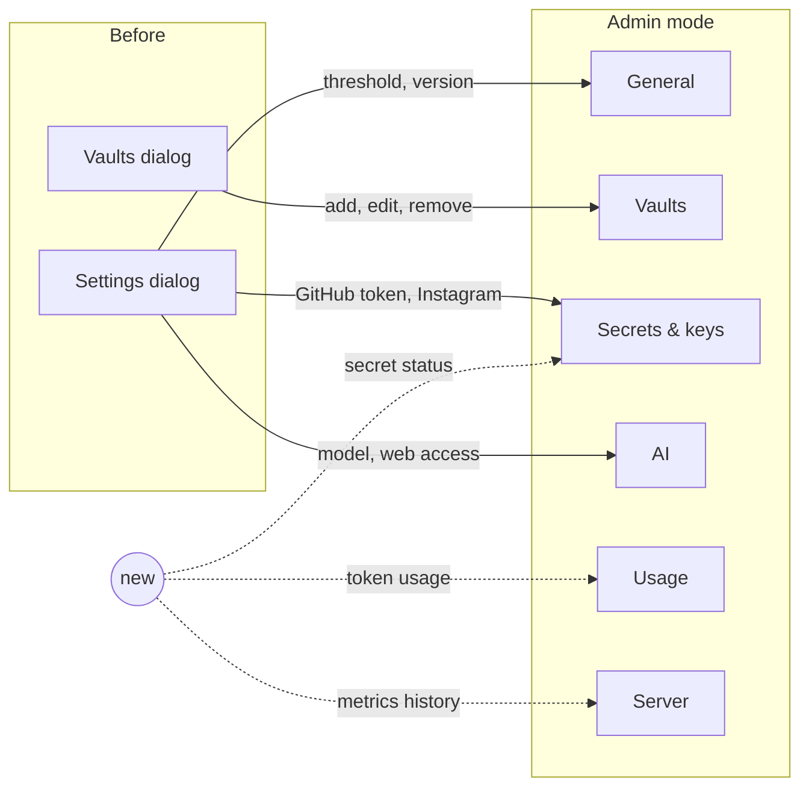
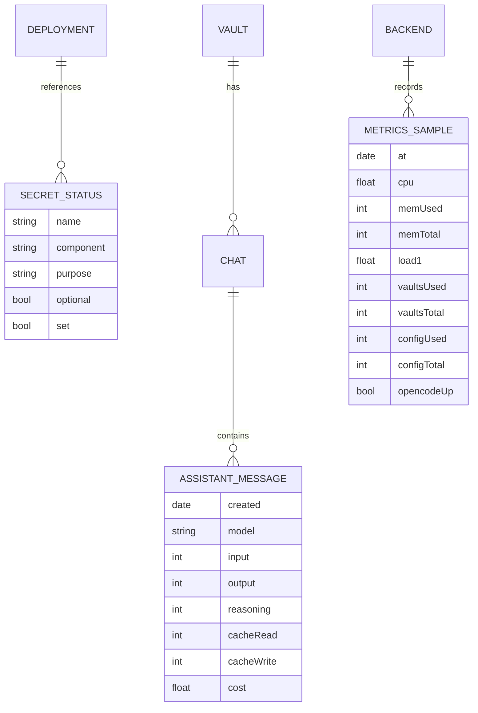
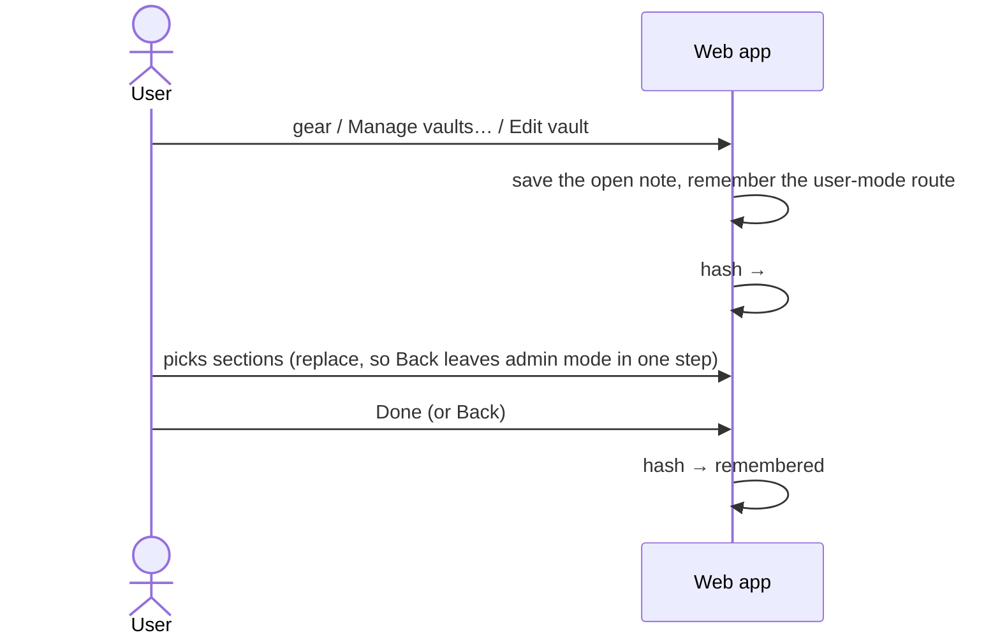

# Domain: admin mode

## New terms

| Term | Meaning | In code (planned) |
|---|---|---|
| **User mode** | The app as it is used day to day: file tree, note, search, chat, changes. The default. *Avoid:* main mode, normal view. | `Shell` |
| **Admin mode** | The full-screen view for configuring and watching the installation: six admin sections, no notes or chat. Entered from the gear and the vault entry points, left with **Done**. Replaces the Settings and Vaults dialogs. *Avoid:* settings dialog, admin area, configuration mode. | `AdminMode`, route `#admin/<section>` |
| **Admin section** | One page of admin mode: `general`, `vaults`, `secrets`, `ai`, `usage`, `server`. A rail entry on wide screens and tablets, a list row on the phone. *Avoid:* tab (the phone has none). | `AdminSection` |
| **Secret status** | For one secret the deployment references: its name, which component uses it, what it is for, whether it is optional, and whether a value is set. Computed when the settings are rendered; never contains the value or a part of it. The GitHub token adds where its value comes from (app or deployment) and its last four characters, as today. | `SecretStatus`, `secrets` in `settings.json` |
| **Role** (planned) | Who someone is to the installation: **User** (works in user mode: notes, chat, switching between the vaults they have access to) or **Admin** (may also enter admin mode). Not enforced yet: the one bearer token is both. This change only splits the UI along that line. | — |
| **Token usage** | The tokens the AI used, summed from the assistant messages stored in opencode's sessions: input, output, reasoning, cache read, cache write, and cost when the provider reports one. Grouped by day, model and vault. Not the context fill (#140), which is the size of one chat's last request. *Avoid:* consumption, context. | `UsageReport`, `usage.ts` |
| **Metrics sample** | One reading of the server taken by the backend every 30 s: CPU %, memory used and total, load average, disk used and total for the vaults volume and the config volume, opencode up or down. | `MetricsSample`, `metrics.ts` |
| **Metrics history** | The samples of the last 7 days, kept in memory and on the config volume so a restart keeps them. Older samples are dropped. Read in three ranges (1 h, 24 h, 7 d), downsampled to at most 240 points each. | `metrics.jsonl`, `GET /api/metrics?range=` |

## Changed terms

| Term | Before | After |
|---|---|---|
| **Settings dialog**, **Vaults dialog** | Two modals ("Vaults and settings (two dialogs)" in `functional.md`). | Gone; their content lives in the General, Vaults, Secrets & keys and AI sections. |
| **Model override** | Typed as free text in the Settings dialog. | Typed the same way, in the AI section. Unchanged otherwise. |
| **Switch vault** | Vault menu, user-facing. | Unchanged and stays in user mode: a user action, always available. Only managing vaults (add, edit, remove) is admin work. |
| **Runtime state** (`config.json`) | Vaults, settings, tokens, stamps, queued prompts. | Unchanged; the metrics history is a separate file next to it (`metrics.jsonl`), not part of `config.json`. |

## Where things move

## Entities

## Processes

### Enter and leave admin mode

### Take a metrics sample

Every 30 s the backend reads CPU times and memory from the host kernel (what the container sees in `/proc`), the
free space of the vaults and config volumes and whether opencode answers, appends the sample in memory and to
`metrics.jsonl`, and drops samples older than 7 days (the file is rewritten at most once an hour).

### Report token usage

On request the backend lists every vault's opencode sessions, reads the assistant messages of sessions that changed
since the last read (cached by `time.updated`, like the context cache) and sums them by day (in the deployment's
timezone), model and vault, for the asked range (7 d or 30 d).

## Rules

- No secret value, and no part of one, leaves the server, except the GitHub token's last four characters (as today).
- Admin mode shows nothing per vault outside the Vaults section; usage names vaults only as grouping.
- Everything a user needs stays in user mode, switching vaults included, so restricting admin mode to an admin role
  later takes nothing away from users.
- Usage numbers are what opencode stored: a deleted chat no longer counts. The Usage section says so.
- Metrics describe the machine the backend container runs on (on a dev stack: Rancher Desktop's VM).
