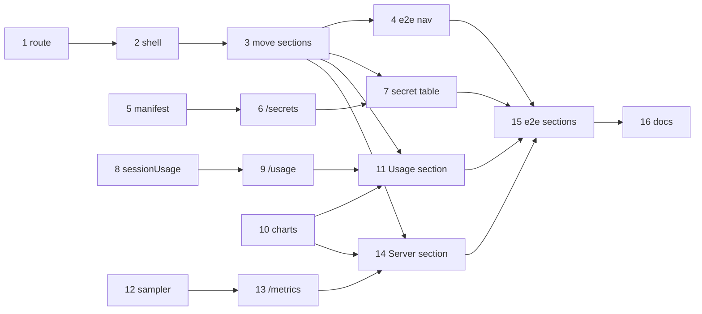

# Plan: admin mode

Three tracks can run side by side: the admin-mode shell (web), the backend data sources (secrets, usage, metrics)
and the charts. The UI follows the draft in [ui.md](ui.md). They meet in the sections. Workspace test commands: `npm test -w apps/web -- <file>`,
`npm test -w apps/backend -- <file>`, `npm test -w packages/settings -- <file>`; full suite `just check`; e2e
`just e2e` against this checkout's dev stack (`just dev up`).

## Admin mode shell (web)

- [x] Parse and format the admin route `#admin` / `#admin/<section>`
  - Depends on: none
  - Test first: `apps/web/src/lib/route.test.ts` › "admin routes": `parseRoute('#admin/usage')` gives `{ admin: 'usage', vault: null, path: null }`, `#admin` gives `admin: ''` (list), an unknown section gives `general`, `#/admin/x` stays a vault route; `formatAdminRoute('ai')` gives `#admin/ai`. Fails today: no admin form exists.
  - Verify: `npm test -w apps/web -- route` → green; `npm test -w apps/web` → all green
- [x] Switch the shell between user mode and admin mode (rail on wide and tablet, section list on the phone, Done)
  - Depends on: 1
  - Test first: `apps/web/src/components/AdminMode.test.tsx` › "gear opens admin mode on General, Done returns to the note": `#/v/a.md` → gear → hash `#admin/general`, `nav.admin-rail` lists six sections, the note pane is gone; Done → hash `#/v/a.md`. › "phone: the section list has Done, a row pushes the section, the section has '‹ Admin' and no Done, Back returns to the list, Done on the list returns to `#/v/a.md`" (`useMedia` phone). › "switching sections replaces the history entry". › "the vault switcher stays in user mode and switches vaults as before; admin mode shows none". Fails today: the gear opens a modal.
  - Verify: `npm test -w apps/web -- AdminMode Shell` → green; `npm test -w apps/web` → all green
- [ ] Move the dialogs' content into the General, Vaults, Secrets & keys and AI sections and remove `SettingsDialog`, `VaultsDialog` and `adminOpen`
  - Depends on: 2
  - Test first: `apps/web/src/components/AdminMode.test.tsx` › "sections hold the moved forms": General has the threshold and the versions, Vaults has the vault list and **Add vault**, Secrets has the GitHub token form and Instagram, AI has the model field and Web access; "Manage vaults…" opens `#admin/vaults`; "Edit vault" opens that vault's details; each section's Save sends only its own fields (`fake-api` records the `PATCH /api/settings` body). Fails today: the sections are empty.
  - Verify: `npm test -w apps/web` → all green; `npm run typecheck` → 0 errors; `grep -rn "adminOpen\|SettingsDialog\|VaultsDialog" apps/web/src` → no match
- [ ] Bring every e2e that reaches the dialogs to the new navigation
  - Depends on: 3
  - Test first: the dialog helpers in `e2e/helpers.ts` open admin mode (`#admin/<section>`) instead of `data-testid="admin"` / `"settings-dialog"`; the specs that use them or the test ids (`admin`, `settings-split`, `version`, `web-access`, `instagram`, `git`, `mobile`, `commands`, `a11y`, `a11y-keyboard`, `fix-16`, `fix-22`, `fix-24`) keep their assertions and change only how they get there. New cases: "reload on `#admin/vaults` stays in admin mode", and in `a11y-keyboard.spec.ts` "entering admin mode focuses the section heading, Escape or Done returns focus to the gear". They fail today because admin mode doesn't exist. This rewrites existing tests for a requested behavior change, keeping what they assert; `/spec:apply` asks for the user's OK before touching them.
  - Verify: `just e2e` → all green on desktop, ipad and iphone projects; `grep -rn 'settings-dialog\|testid="admin"' e2e` → no match

## Data sources (backend, settings)

- [ ] The renderer writes the secret manifest into the backend's `settings.json`
  - Depends on: none
  - Test first: `packages/settings/test/render.test.ts` › "settings.json lists every referenced secret of the active gateway with component, purpose, optional and set, never a value": a fixture store with `openrouter_api_key` set and `exa_api_key` empty → `set: true` / `false`; the rendered JSON contains neither secret value. Fails today: no `secrets` key.
  - Verify: `npm test -w packages/settings` → all green; `just settings check` → ok
- [ ] `GET /api/settings/secrets` returns the manifest plus the GitHub token's source
  - Depends on: 5
  - Test first: `apps/backend/test/settings.test.ts` › "settings.json without `secrets` loads as []" and `apps/backend/test/api.test.ts` › "GET /settings/secrets returns the manifest; github_token carries source and last4 from GitHubToken". Fails today: unknown key and 404.
  - Verify: `npm test -w apps/backend -- settings api` → green; `npm test -w apps/backend` → all green
- [ ] Secret status table in the Secrets & keys section
  - Depends on: 3, 6
  - Test first: `apps/web/src/components/SecretTable.test.tsx` › "one row per secret: purpose, name, component, Set / Missing / Not set (optional)", › "a missing required secret is flagged", › "the phone list row summarizes 'N of M set'". Fails today: no component.
  - Verify: `npm test -w apps/web -- SecretTable` → green; `npm test -w apps/web` → all green
- [ ] Harness maps a session's assistant messages to usage rows
  - Depends on: none
  - Test first: `apps/backend/test/harness-map.test.ts` › "usageRows: assistant messages give created, model id, input/output/reasoning/cache read/write and cost; user messages and messages without tokens are skipped". Fails today: no `usageRows`.
  - Verify: `npm test -w apps/backend -- harness-map` → green; `npm test -w apps/backend` → all green
- [ ] `UsageService` sums usage by day, model and vault; `GET /api/usage?days=7|30`
  - Depends on: 8
  - Test first: `apps/backend/test/usage.test.ts` › "sums by day in the process timezone (`TZ`, rendered from the `timezone` setting), by model and by vault", › "re-reads only sessions whose time.updated changed", › "costKnown is false when every cost is 0", and `api.test.ts` › "GET /usage?days=5 is 400". Fails today: no module, no route.
  - Verify: `npm test -w apps/backend -- usage api` → green; `npm test -w apps/backend` → all green

## Charts

- [ ] `Sparkline` and `StackedBars` as inline-SVG components with a numbers table fallback
  - Depends on: none
  - Test first: `apps/web/src/components/charts/charts.test.tsx` › "Sparkline draws one path over the points, labels min/max and the latest value", › "StackedBars draws one stack per day with one rect per series", › "both render a `
` table with the same numbers", › "empty data shows 'No data yet'". Fails today: no components.
  - Verify: `npm test -w apps/web -- charts` → green; `npm test -w apps/web` → all green
- [ ] Usage section: range switch, totals, per-day bars, per-model and per-vault tables
  - Depends on: 3, 9, 10
  - Test first: `apps/web/src/components/UsageSection.test.tsx` › "7 d / 30 d refetch with ?days=", › "totals in short numbers (29K, 1.2M)", › "cost column only when costKnown", › "shows 'Counts the chats that still exist.'". Fails today: no section.
  - Verify: `npm test -w apps/web -- UsageSection` → green; `npm test -w apps/web` → all green

## Server metrics

- [ ] `MetricsSampler` takes a sample every 30 s and keeps 7 days in memory and `metrics.jsonl`
  - Depends on: none
  - Test first: `apps/backend/test/metrics.test.ts` (injected clock and readers, temp dir): › "CPU % from the difference of two cpu-time readings", › "appends one JSON line per sample", › "on start drops samples older than 7 days and skips a torn last line", › "hourly compaction rewrites the file without the old samples", › "range 24h is bucket-averaged to at most 240 points". Fails today: no module.
  - Verify: `npm test -w apps/backend -- metrics` → green; `npm test -w apps/backend` → all green
- [ ] `GET /api/metrics?range=1h|24h|7d`, sampler started and stopped in `main.ts`
  - Depends on: 12
  - Test first: `apps/backend/test/api.test.ts` › "GET /metrics?range=24h returns samples, latest, uptime and intervalS", › "range=2d is 400". Fails today: 404.
  - Verify: `npm test -w apps/backend` → all green; on the dev stack `curl -sk -H "Authorization: Bearer $(cat deploy/secrets/bearer_token)" https://localhost:80N0/api/metrics?range=1h` → JSON with ≥ 1 sample after 30 s
- [ ] Server section: range switch, sparklines for CPU, memory, load and both disks, opencode status, uptime, 30 s polling while visible
  - Depends on: 3, 10, 13
  - Test first: `apps/web/src/components/ServerSection.test.tsx` › "one sparkline per metric with the latest value", › "disk shows used / total and %", › "polls every 30 s only while the section is shown" (fake timers), › "opencode down shows a warning". Fails today: no section.
  - Verify: `npm test -w apps/web -- ServerSection` → green; `npm test -w apps/web` → all green

## End to end and docs

- [ ] E2E per section on desktop and iPhone, with a screenshot check
  - Depends on: 4, 7, 11, 14
  - Test first: `e2e/admin-mode.spec.ts` › "every section opens from the rail (desktop) and from the list (iphone) and shows its heading", › "AI: the model field, Use default and Web access behave as in the old Settings dialog", › "Secrets: the dev stack's secrets show Set", › "Server: CPU sparkline appears after the first sample", › "Usage: after one chat turn today's bar is non-zero". Fails today: no admin mode on the stack.
  - Verify: `just check` → all green; `just e2e` → all green; Playwright screenshots of every section at 1× on desktop and iphone saved to `tmp/admin-mode/`, read and compared with the draft in `ui.md`, including the last rows of the usage tables and the bottom of the section list
- [ ] README feature list and the demo run book chapter "Admin mode"
  - Depends on: 15
  - Test first: none — docs only
  - Verify: `grep -n "Admin mode" README.md` matches; `grep -n "Admin mode" ~/git/karpathy_demo_wiki/"Karpathy Demo.md"` matches, with a *Try it* step and a bumped `updated` (pushed only after the release)

System docs are updated at `/spec:archive`.
