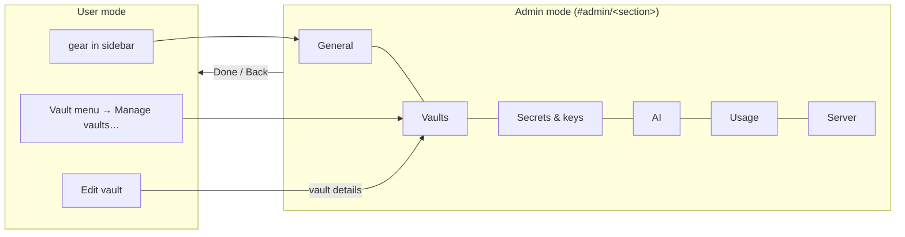

# Proposal: admin mode

**Issue:** [#150](https://github.com/tillg/karpathy.app/issues/150)

## Why

Configuration lives in two modal dialogs today: **Vaults** (vault list, details, add) and **Settings**, a mix of
GitHub token, Instagram login, commit threshold, a free-text model field, the web access switch and the version.
The Settings dialog has grown into a grab bag, and two things an operator wants to see have no home at all:

- which **secrets and keys** the deployment has (only the GitHub token is visible);
- how many **LLM tokens** the app has used, and the **server's state** (CPU, memory, disk over time). Today that
  needs SSH or Beszel on the tailnet.

The issue asks for a separate **admin mode**: the whole app is either in its normal user mode (notes, chat) or in
admin mode, with sections in a left rail (desktop) and a phone-friendly equivalent.

This is a first step towards **two roles, User and Admin**. User mode is what a user does: notes, chat, and
switching between the vaults they have access to. Admin mode is what an admin does: configure and watch the
installation. Roles themselves (who may enter admin mode) come later; today the one bearer token is both.

## What changes

The two dialogs are replaced by **admin mode**, a full-screen view of its own with six sections:

| Section | Content | New or moved |
|---|---|---|
| **General** | Commit reminder threshold; version (server, PWA, Built, Deployed) | moved from Settings |
| **Vaults** | Vault list, details, add, "What is a vault?" | moved from the Vaults dialog |
| **Secrets & keys** | GitHub token (as today), Instagram login (as today), and a read-only status of every deployment secret: name, purpose, set or missing. No values. | status is new |
| **AI** | Model field as today (free text `provider/model`, default, **Use default**), Web access switch | moved from Settings |
| **Usage** | LLM tokens over time: per day, per model, per vault; input / output / cache split; cost where the provider reports it | new |
| **Server** | CPU, memory, load and disk (vaults, config) as small time-series charts over 1 h / 24 h / 7 d; opencode up or down; uptime | new |

- **Layout.** Wide and tablet: a left rail with the six sections and the open section beside it. Phone: the section
  list fills the screen (like iOS Settings); tapping one pushes that section with a back arrow to the list.
- **Address.** Admin mode has its own hash route `#admin/<section>`, so reload, Back and a bookmarked link work.
  **Done** returns to the note and chat that were open before.
- **Vault switching stays in user mode.** The vault menu keeps switching vaults as today, always available; only
  adding, editing and removing vaults moves to admin mode.
- **Entry points** stay where users know them: the gear opens General, **Manage vaults…** opens Vaults, **Edit
  vault** opens that vault's details, "Reconnect in Settings" opens Secrets & keys.

## Decisions taken with the user (2026-10-15)

- **The model field stays as it is** (free text, default, Use default); it only moves to the AI section. No
  model list or picker.
- **Two roles ahead:** user mode keeps everything a user needs, including switching vaults; admin mode holds only
  admin work, so a later change can restrict it to an admin role.
- **Secrets stay read-only** except the two app-set credentials that already exist (GitHub token, Instagram
  session). Provider keys, the Exa key, the bearer token and the DNS token are still set per deployment
  (`deploy/settings/` + secret store); the app only shows whether each is set. No new attack surface.
- **Server metrics come from the backend's own sampler**, not from Beszel: works the same in dev, prodtest and on
  every target, and needs no path from the compose network into the tailnet. Beszel keeps doing the alerting.
- **Token usage is aggregated from opencode's stored sessions**; no own ledger. Deleting a chat removes its tokens
  from the totals; throwaway sessions (commit-message proposals) count only while they exist.

## Scope

In scope: the admin mode shell and routing; moving the existing settings and vault UI into it unchanged in
behavior; the secret status; the usage aggregation and its API; the metrics sampler, its store
and API; the charts.

Out of scope:

- editing provider keys or any deployment secret in the app;
- per-container metrics, alerts or thresholds in the app (Beszel and healthchecks.io stay the alerting path);
- budgets, quotas or cost limits; switching the gateway (`ai.gateway`) at runtime;
- multiple users or roles (who may enter admin mode, which vaults a user sees): a later change; the single bearer
  token still is both user and admin;
- a model list or picker: the model field stays free text.

## Expected outcome

- One place for everything configurable or observable, reachable from the same entry points as today.
- User and admin work are separated in the UI, ready for roles.
- An operator sees on the phone whether all secrets are set, how many tokens the app burned this week and whether
  the server's disk is filling up, without SSH or tailnet.
- No behavior of the moved settings changes (same API, same validation, same texts).

## Impact

| Area | Change |
|---|---|
| `apps/web` | New `AdminMode` (rail / list, sections); `Admin.tsx` dialogs become section components; store `adminOpen` → admin route; charts |
| `apps/backend` | New `metrics.ts` (sampler + store), `usage.ts` (aggregation over sessions), routes `GET /settings/secrets`, `/usage`, `/metrics` |
| `packages/settings` | Renderer adds a secret manifest (names, purpose, set or missing; never values) to the backend's `settings.json` |
| `packages/shared` | Types `SecretStatus`, `UsageReport`, `MetricsSeries` |
| `e2e` | `admin.spec.ts` follows the new navigation; new specs per section on desktop and iPhone |
| UI draft | [ui.md](ui.md) with the clickable mockup and screenshots |
| Docs | `specs/system/*` at archive; README feature list; demo run book chapter "Admin mode" |
