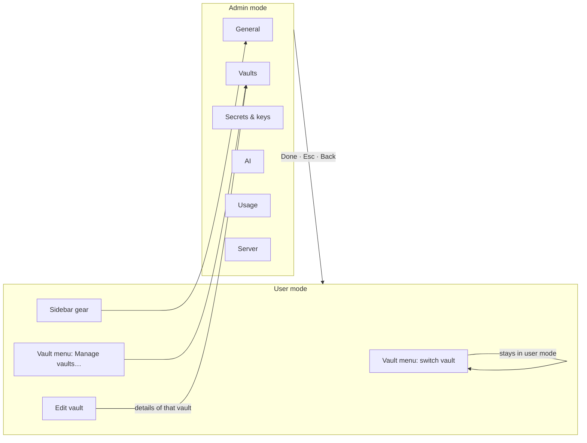
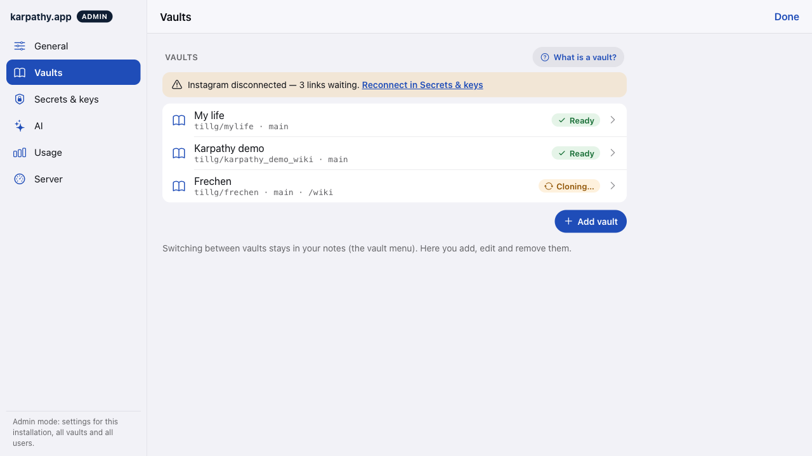
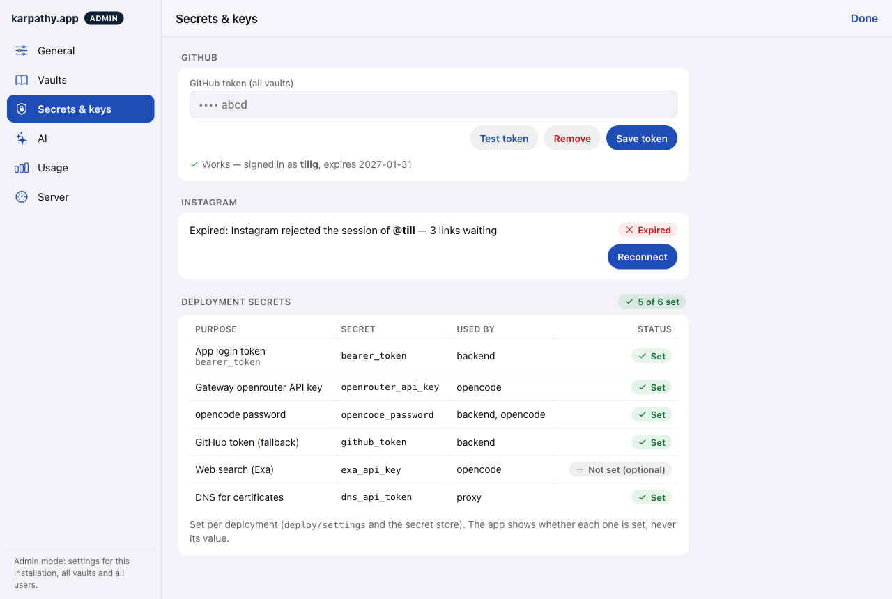
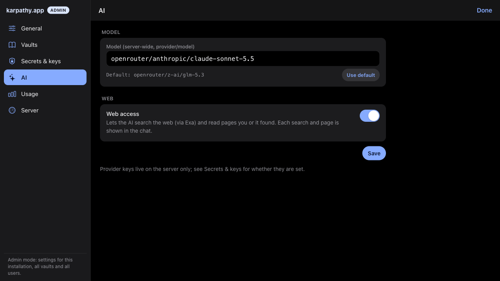
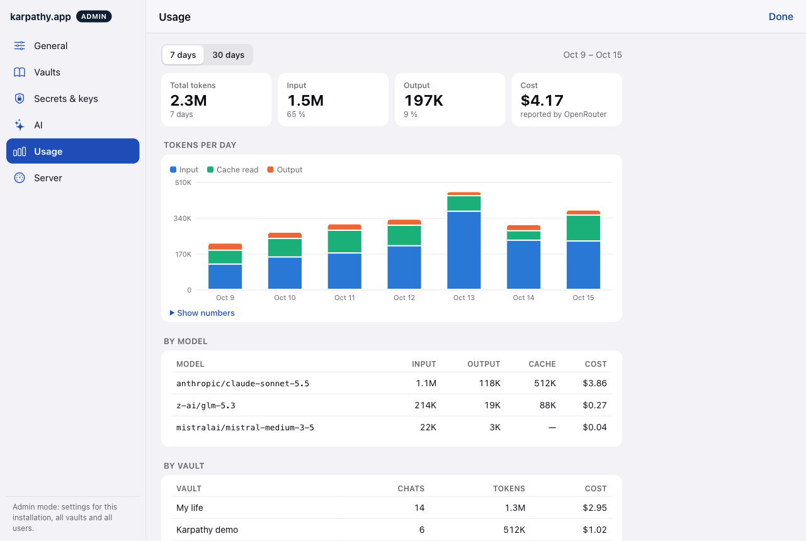
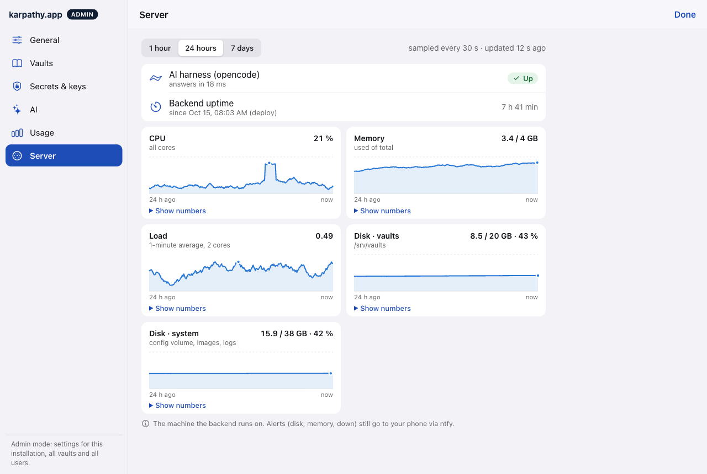
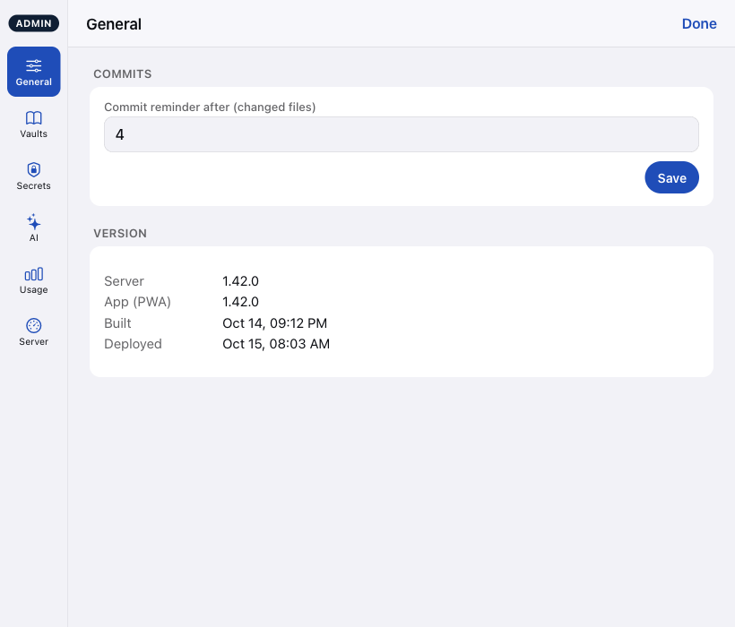
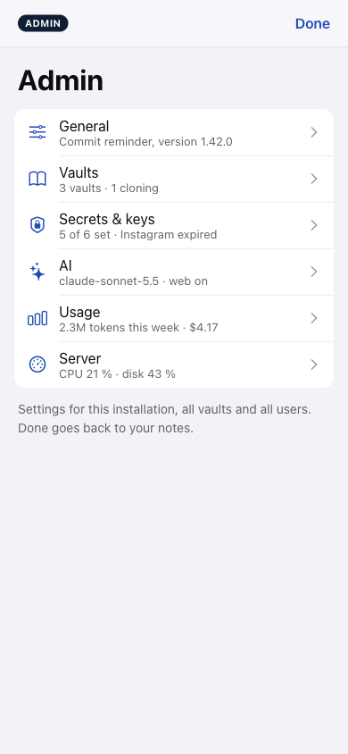
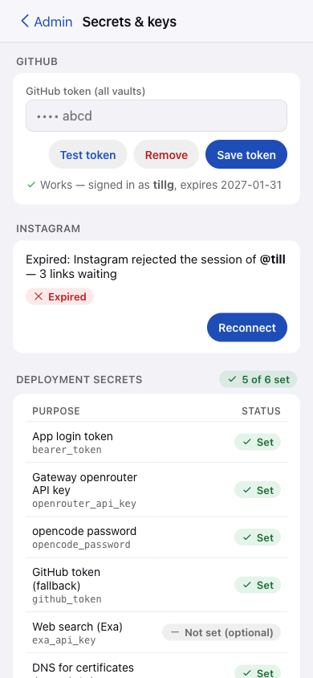
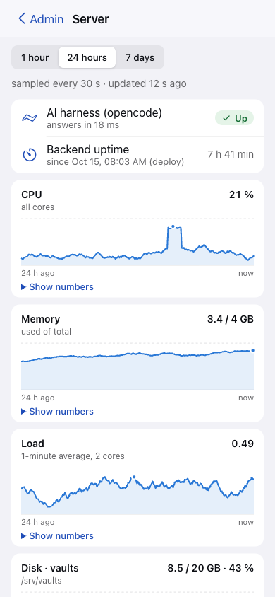

# UI: admin mode draft

A clickable draft with sample data: [admin-mockup.html](ui/admin-mockup.html). Resize the window to see the three
layouts. It uses the app's own tokens (`apps/web/src/styles.css`), icons (Framework7) and light and dark themes.
It's a throwaway: the components are built in `apps/web` as the plan says. The screenshots below come from it.

## Two roles, one step at a time

This change is a step towards two roles, **User** and **Admin**. Today one bearer token is both. The UI already
splits along that line, so a later change can give the admin entry points only to the admin role:

| | User mode (role User) | Admin mode (role Admin) |
|---|---|---|
| What | Notes, search, graph, chat, changes, commit | Configure and watch the installation |
| Vaults | **Switch** between the vaults you have access to (vault menu), always, in user mode | **Add, edit, remove** vaults |
| Model | Uses the model the admin set | Sets the model (free-text field, as today) |
| Entry | The app opens here | Gear, "Manage vaults…", "Edit vault", "Reconnect in Settings" |

The vault switcher stays in the user-mode sidebar, unchanged. Admin mode has none, because it isn't about one
vault.

## Layout

| Width | Navigation | Shown in |
|---|---|---|
| wide ≥ 1024 | Rail with icon + label, brand "karpathy.app" and an **ADMIN** pill; the section beside it, max 780 px wide; **Done** top right | Figures 1–5 |
| tablet 700–1023 | Narrow rail: icon + short label | Figure 6 |
| phone ≤ 699 | Strict hierarchy. The section list (large title "Admin", one summary line per section) is admin mode's top level and the only place with **Done**. A tap opens the section, whose bar has only "‹ Admin" back to the list: no Done inside a section | Figures 7–9 |

**Done** always goes back to where admin mode was entered from in user mode: the same vault, note and pane.

The **ADMIN** pill and the rail make the mode obvious at a glance, so nobody mistakes admin mode for a vault view.

## Sections

### General

Commit reminder threshold (own **Save**) and the version block, both moved from the Settings dialog. See figure 6.

### Vaults

The Vaults dialog's list, details, Add vault and "What is a vault?", as today. The Instagram notice now links to
Secrets & keys. A line says that switching vaults stays in user mode.

*Figure 1: Vaults*

### Secrets & keys

GitHub token and Instagram as today, plus **Deployment secrets**: purpose, secret name, component, status (Set ·
Missing · Not set (optional)), with an "N of M set" summary in the heading. On the phone the secret name moves
under the purpose, and the component column is hidden.

*Figure 2: Secrets & keys*

### AI

The model field stays as it is today: free text `provider/model`, "Default: …", **Use default**. The section also
has the Web access switch and **Save**. No model list or picker.

*Figure 3: AI (dark theme)*

### Usage

Range **7 days / 30 days**. Four tiles: total, input, output, cost (only when the provider reports one). Tokens per
day as stacked bars (input, cache read, output; legend, hover tooltip, "Show numbers" table). Tables by model and by
vault. The footnote says that deleted chats drop out.

*Figure 4: Usage*

### Server

Range **1 hour / 24 hours / 7 days**, "sampled every 30 s · updated N s ago". The AI harness status (up or down
with latency) and the backend's uptime. One sparkline card each for CPU, memory, load, disk (vaults) and disk
(system), showing the current value and the total. Each card has a crosshair tooltip, its peak marked and "Show
numbers". The footnote says that alerts still come via ntfy.

*Figure 5: Server*

### Tablet

*Figure 6: General on a tablet (narrow rail)*

### Phone

*Figure 7: Section list*

*Figure 8: Secrets & keys*

*Figure 9: Server*

## Chart rules

- One series per sparkline, in the first categorical color. Usage bars use three fixed slots (input, cache read,
  output), checked for color-vision deficiency in light and dark with the dataviz validator. The app's
  `--graph-*` colors failed that check, so the charts get their own `--series-1…3` tokens.
- One y-axis per chart, recessive grid, values in text colors, never in the series color.
- Every chart has a hover tooltip and a "Show numbers" table, so color is never the only carrier.
- Status pills (Set, Up, Expired, Cloning…) always pair an icon with a word.

## Review decisions (2026-10-15)

- **Done** returns to where admin mode was entered from in user mode.
- The rail footer text ("settings for this installation, all vaults and all users") stays.
- Phone navigation is strict: Done only on the Admin list; inside a section only "‹ Admin". Admin mode is a level of
  its own, so the user-mode bottom tab bar is hidden there.
