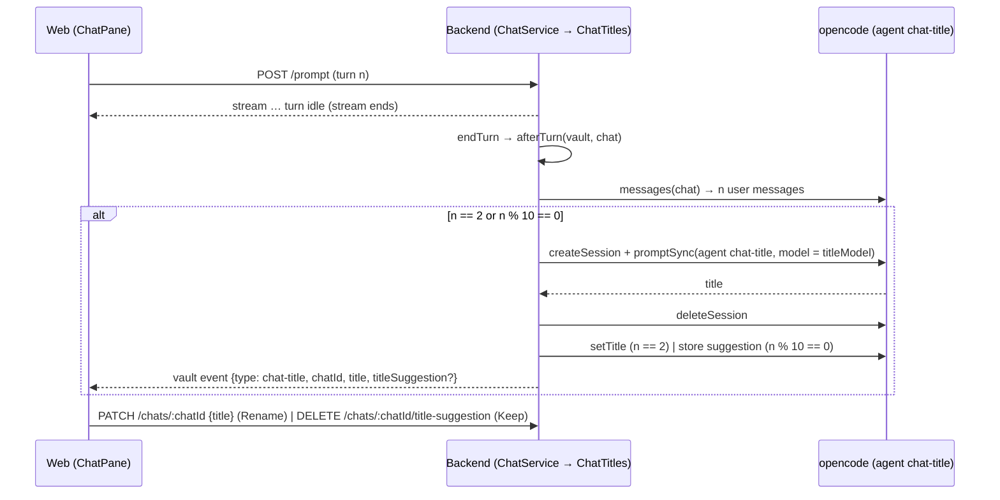

# Architecture: AI-generated chat titles

## Overview

## Settings

- `packages/settings` schema: `ai.title_model` optional string. Cross-field: when set, it is `<ai.gateway>/<model>`
  and (non-built-in kind) listed under that gateway's `models`, like `ai.model`.
- `renderBackendSettings` writes `ai: { model, title_model (only when set: unset = follow the chat model in
  effect, an Admin override included), vision_model (without its gateway prefix), vision_gateway, web_access }`.
  `vision_gateway` = `visionGatewayId(s)`.
- `renderOpencodeEnv` adds `VISION_MODEL_OPTIONS`: JSON `{ "<model id>": options }` of every model of the vision
  gateway that has `options` (absent when none). `VISION_REQUEST_OPTIONS` stays (the default model's options).
- `settings.yaml`: a commented `title_model` line under `ai`.

## Backend

- `settings.ts`: `backendSettingsSchema.ai` gains `title_model`, `vision_model`, `vision_gateway` (all optional, so an
  older settings.json still loads: title falls back to `model`, vision to none). `BackendSettings` gains
  `defaultTitleModel`, `defaultVisionModel`, `visionGateway`.
- `ConfigStore`: `Settings` gains `titleModel` and `visionModel`; stored like `model` (`titleModelOverride`,
  `visionModelOverride`, only while different from their defaults). `ConfigStore.open(dir, defaults)` takes the three
  defaults. New `titleSuggestions: Record<vaultId, Record<chatId, string>>`.
- `GET /settings` (`SettingsView`): adds `defaultTitleModel`, `titleModelOverridden`, `defaultVisionModel`,
  `visionModelOverridden`, `visionGateway`. `PATCH /settings`: `titleModel` (string or null = default) checked
  against `harness.models()` like `model` (`unknown-model`); `visionModel` (string or null) must start with
  `<visionGateway>/` and have a model part (`400 bad-vision-model`).
- **Vision file** (`vision-model.ts`): `writeVisionModel(vaultsDir, model | null)` writes `<vaults>/.vision.json`
  `{ "model": "<id without gateway prefix>" }` atomically, or removes it for the default. Called after a PATCH that
  touches `visionModel` and at startup (so the file always matches the store).
- **Title job** (`chat-title.ts`, `ChatTitles`), shaped like `OpencodeCommitMessages`:
  - `afterTurn(vaultId, chatId, endedAt)`: called (not awaited) from `ChatService.endTurn` after `finish`. Reads the
    chat's messages up to `endedAt` (a queued prompt already sent doesn't count); `n` = user messages. `n === 2` →
    generate; `n >= 10 && n % 10 === 0` → drift check; else nothing.
  - Prompt text: the conversation as `User:` / `AI:` blocks of text parts (each cut at 1 500 chars, total at
    12 000, oldest dropped first) and "Write the title of this conversation." A drift check sends only the last ten
    turns and compares the fresh title with the current one in code: no shared significant word (4+ letters, first
    five compared) = drifted. (Asking the model "does the title still fit?" got `KEEP` from the dev model even after a
    complete change of topic.)
  - Before writing, the title is read again: renamed or deleted meanwhile → nothing.
  - Runs in a throwaway session of the vaults dir itself (`/vaults`; a vault's chat list shows only sessions of its
    own dir, so the job never appears there): `createSession('/vaults', 'chat title')`,
    `promptSync(…, { agent: 'chat-title', model: settings.titleModel || settings.model })`, 30 s timeout, abort +
    delete after. Its tokens don't show in Admin › Usage (which sums the vault dirs).
  - `clean`: first non-empty line, strip quotes/`Title:`/trailing period, cap 120 chars; empty → nothing.
    Drift: a fresh title sharing a significant word with the current one → nothing.
  - Result: `n === 2` → `harness.setTitle`; drift → store suggestion. Then `emit(vaultId, { type: 'chat-title',
    chatId, title, titleSuggestion? })` through the vault event emitter (after the throwaway session is gone).
  - Never throws; a failure is logged once with `console.warn`.
- `opencode.json`: agent `chat-title`, `mode: primary`, `permission { "*": "deny" }`, prompt: "You name chats. …
  Reply with only the title: at most 8 words, in the language of the conversation, no quotes, no trailing period." `HarnessAgent` union gains it.
- Chat API: `ChatSummary.titleSuggestion?` and `ChatDetail.titleSuggestion?` from the store.
  `PATCH /vaults/:id/chats/:chatId { title }` (1–500 chars, trimmed) → `setTitle`, clears the suggestion, emits
  `chat-title`. `DELETE /vaults/:id/chats/:chatId/title-suggestion` → clears it, emits `chat-title`. Deleting a chat
  or a vault drops its suggestions.
- `VaultEvent` gains `{ type: 'chat-title'; chatId: string; title: string; titleSuggestion?: string }`.

## Vision tool

`deploy/opencode/lib/look-at-image.ts`: `visionConfig(env, overrideFile)` → `{ model, options }`: the file's `model`
when the file exists and parses, else `VISION_MODEL`; options = `VISION_MODEL_OPTIONS[model]` if the map has it, else
`VISION_REQUEST_OPTIONS` when `model === VISION_MODEL`, else none. `describeImage` takes the file path
(`/vaults/.vision.json`, a literal like `OPEN_PAGE_DIR`) and uses it.

## Web

- `Admin.tsx` AI section: **Title model** and **Vision model** fields under **Model**, each with "Default: …" and
  **Use default**, saved with **Save settings** (`titleModel`, `visionModel`; the default value is sent as `null`).
  The vision field's hint: "A model of the `<gateway>` gateway that reads images (used by look_at_image)."
- `ChatPane`: a **title suggestion bar** above the composer when the open chat has `titleSuggestion`:
  "Rename this chat to “<suggestion>”?" **Rename** · **Keep**. The chat list shows the new title.
- `store.tsx` `onEvent`: `chat-title` → bumps a `chatTitlesNonce` (chat list reload) and passes the event to the open
  chat (title and suggestion update in place).

## Tests

- Unit: settings schema/render, config store overrides and suggestions, `ChatTitles` with a fake harness (turn 2,
  turn 10 drift / shared word, other turns nothing, failure → nothing, cleaning), app routes, `look-at-image` config,
  Admin and ChatPane components.
- LLM (`npm run test:llm`): `chat-title.llm.test.ts` — a 2-turn chat with the real test model gets a short title
  that is not the first prompt.
- e2e: Admin AI section shows and saves the title and vision model (and **Use default**); `@llm`: after two turns
  the chat list shows a title that is not the first prompt. The suggestion bar is covered by component tests (ten
  real turns are too slow for e2e).

## Risks

- Small dev models may answer with more than a title: `clean` takes the first line and caps it.
- Title calls are not in the usage report.
