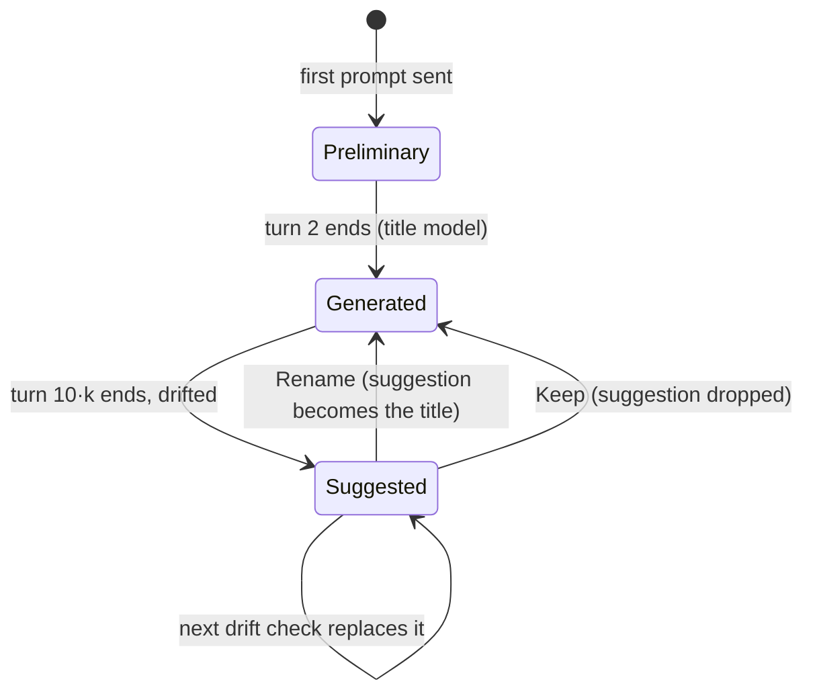

# Domain: AI-generated chat titles

## New and changed terms

| Term | Meaning | In code |
|---|---|---|
| **Turn** | One user message of a chat and the AI's reply to it. A chat's turn count = its number of user messages. | `messages.filter(m => m.role === 'user').length` |
| **Preliminary title** | The chat's first title: its first prompt (or the first attachment's name), set when the prompt is sent. Unchanged. | `titleFromFirstPrompt` |
| **Title model** | The model that writes chat titles. Deployment default `ai.title_model` (absent = `ai.model`), Admin may override it. Must be a model of `ai.gateway`. | `ai.title_model`, `Settings.titleModel` |
| **Generated title** | The title the title model writes after turn 2; replaces the preliminary title. | `ChatTitles.afterTurn` |
| **Drift check** | After turn 10, 20, 30, …: the title model answers `KEEP` or a new title. | `ChatTitles.afterTurn` |
| **Title suggestion** | A drift check's new title, kept per chat until the user answers: **Rename** (it becomes the title) or **Keep** (it is dropped). | `ChatSummary.titleSuggestion`, `ConfigData.titleSuggestions` |
| **Vision model** *(changed)* | Now also selectable in Admin mode › AI: an override on the deployment's vision gateway. | `Settings.visionModel`, `/vaults/.vision.json` |

## Lifecycle of a chat's title

A failing or slow title model never shows an error: the chat keeps its title.
