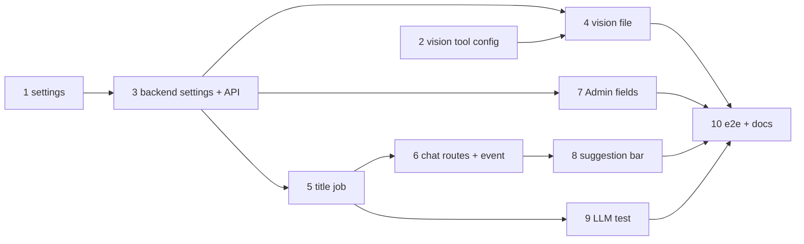

# Plan: AI-generated chat titles

Workspace test commands: `npm test -w packages/settings`, `npm test -w apps/backend -- <file>`,
`npm test -w apps/web -- <file>`; full suite `npm test`; LLM tests `npm run test:llm`; e2e `just e2e` against this
checkout's dev stack (`just dev up`).

## Settings and vision

- [ ] `ai.title_model` in the settings package: optional, on `ai.gateway`; rendered into the backend's settings.json with `vision_model` and `vision_gateway`; `VISION_MODEL_OPTIONS` in opencode.env
  - Depends on: none
  - Test first: `packages/settings/test/schema.test.ts` › "title_model is optional and must be on ai.gateway" (`ollama/qwen` on an openrouter gateway → error naming `ai.title_model`); `render.test.ts` › "backend settings carry title_model (default ai.model), vision_model and vision_gateway" and "opencode.env lists the vision gateway's model options". Fail today: no such key or field.
  - Verify: `npm test -w packages/settings` → all green
- [ ] `look_at_image` uses the override file's model and that model's options
  - Depends on: none
  - Test first: `apps/backend/test/look-at-image-tool.test.ts` › "an override file picks the model and its options from VISION_MODEL_OPTIONS", "a model without options gets none", "a missing or broken file keeps VISION_MODEL". Fail today: the env is the only source.
  - Verify: `npm test -w apps/backend -- look-at-image` → green
- [ ] Backend: title and vision model defaults from settings.json, Admin overrides in the config store, `GET/PATCH /settings` with validation
  - Depends on: 1
  - Test first: `apps/backend/test/settings.test.ts` › "reads title_model, vision_model and vision_gateway; an old settings.json falls back"; `config-store.test.ts` › "title and vision model are stored only as overrides"; `api.test.ts` › "PATCH titleModel checks the harness models; null resets", "PATCH visionModel must be on the vision gateway", "GET /settings shows the defaults and overridden flags". Fail today: no such settings.
  - Verify: `npm test -w apps/backend -- settings config-store api` → green; `npm test -w apps/backend` → all green
- [ ] The backend keeps `/vaults/.vision.json` in step with the vision override (startup and PATCH)
  - Depends on: 2, 3
  - Test first: `apps/backend/test/vision-model.test.ts` › "writes the model without the gateway prefix, removes the file for the default"; `api.test.ts` › "PATCH visionModel writes the vision file, null removes it". Fail today: no file.
  - Verify: `npm test -w apps/backend -- vision-model api` → green

## Titles

- [ ] `ChatTitles`: title after turn 2, drift suggestion after turn 10·k, via the tool-less `chat-title` agent and the title model
  - Depends on: 3
  - Test first: `apps/backend/test/chat-title.test.ts` (fake harness) › "turn 2 sets a generated title with the title model", "turn 10 stores a suggestion", "KEEP or the same title stores none", "turns 1, 3, 11 do nothing", "a failing or slow model keeps the title", "cleans quotes, a Title: prefix and extra lines", "the throwaway session is deleted before the event"; `opencode-config.test.ts` (or the existing opencode.json test) › "chat-title agent denies every tool". Fail today: no title job.
  - Verify: `npm test -w apps/backend -- chat-title` → green; `npm test -w apps/backend` → all green; `npm run test:llm` (step 9)
- [ ] Chat API: suggestions in list and detail, `PATCH /chats/:chatId {title}`, `DELETE /chats/:chatId/title-suggestion`, vault event `chat-title`; `endTurn` runs the job
  - Depends on: 5
  - Test first: `apps/backend/test/chat.test.ts` › "a turn's end runs the title job", "PATCH renames and clears the suggestion", "DELETE title-suggestion clears it", "deleting a chat drops its suggestion"; `api.test.ts` › "PATCH title validates 1–500 chars". Fail today: no routes.
  - Verify: `npm test -w apps/backend` → all green
- [ ] Admin › AI: Title model and Vision model fields with Default and Use default
  - Depends on: 3
  - Test first: `apps/web/src/components/Admin.test.tsx` (or the AI section's test) › "title and vision model show their defaults, Use default resets, Save sends titleModel/visionModel (null for the default)". Fails today: no fields.
  - Verify: `npm test -w apps/web` → all green
- [ ] Chat: suggestion bar (Rename / Keep) and live title updates from the `chat-title` event
  - Depends on: 6
  - Test first: `apps/web/src/components/ChatPane.test.tsx` › "a chat with a titleSuggestion shows the bar; Rename PATCHes the title; Keep DELETEs the suggestion", "a chat-title event updates the list title". Fail today: no bar.
  - Verify: `npm test -w apps/web` → all green
- [ ] LLM test: a two-turn chat gets a generated title from the real test model
  - Depends on: 5
  - Test first: `apps/backend/test/chat-title.llm.test.ts` › "after two turns the title is short and not the first prompt". Fails before step 5's wiring into a real opencode (agent missing from the image).
  - Verify: `npm run test:llm -- chat-title` → green
- [ ] e2e, README and demo run book
  - Depends on: 4, 7, 8, 9
  - Test first: `e2e/admin-mode.spec.ts` › "AI: title and vision model save and reset"; `e2e/chat.spec.ts` › "@llm after two turns the chat gets a generated title". Fail today: no fields, no job in the stack.
  - Verify: `just e2e admin-mode chat` → green (`@llm` red only where the dev model fails it on the commit before too); `grep -n "Title model" README.md` and `grep -n "title" ~/git/karpathy_demo_wiki/"Karpathy Demo.md"` match

System docs are updated at `/spec:archive`.
