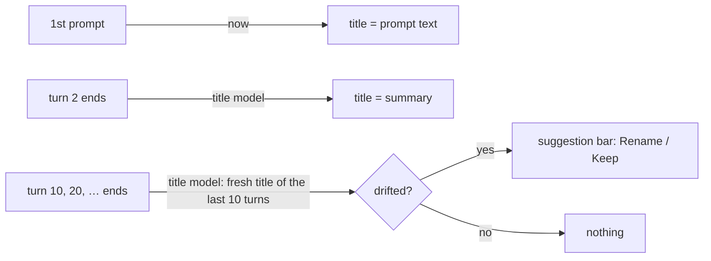

# Proposal: AI-generated chat titles

**Issue:** [#148](https://github.com/tillg/karpathy.app/issues/148)

## Why

A chat is named after its first prompt (`titleFromFirstPrompt`, `apps/backend/src/chat.ts`). That is often a
command (`/research …`), a greeting or a pasted wall of text, and it never follows where the chat went. The chat
list is hard to scan.

## What

- **Preliminary title** as today: the first prompt, set when it is sent.
- **After the 2nd turn** the chat gets a title the **title model** writes from what has been discussed (short, in the
  chat's language). It replaces the preliminary title.
- **Every 10 turns** (10, 20, 30, …) the title model checks whether the chat drifted away from its title. If so, the
  app **suggests** a new one: a bar above the composer "Rename this chat to “…”?" with **Rename** and **Keep**. The
  suggestion stays until answered (also after a reload, on any device).
- **Title model** (new): its own setting. `deploy/settings/` `ai.title_model`, optional, defaults to the chat model
  (`ai.model`). Admin mode › AI gets a **Title model** field with "Default: …" and **Use default**, like the chat model.
- **Vision model in the app:** Admin mode › AI also gets a **Vision model** field (the model of `look_at_image`, #146),
  with "Default: …" and **Use default**. It may name another model on the deployment's vision gateway.

## Scope

In: the title job, the suggestion bar and its two answers, the title-model and vision-model settings (deploy +
Admin), README and the demo run book.

Out: a free "rename chat" action; titles for chats older than this change before their next multiple of 10;
a vision model on a gateway other than the deployed vision gateway (still a deploy-settings change); opencode's own
first-message auto-title (`small_model`) stays as is.

## Outcome

Chat lists read like a table of contents. The models that do side jobs (titles, images) can be changed from the
app without a redeploy.
