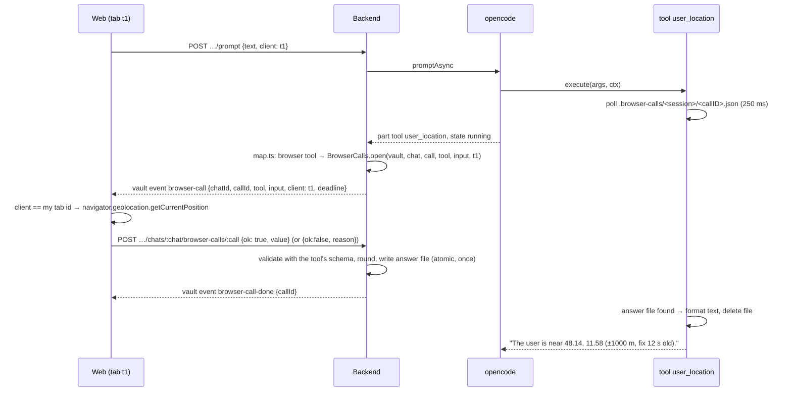

# Architecture: browser tools

## Overview

```mermaid
flowchart LR
  subgraph OC[opencode container]
    T[tools/local_time.ts<br/>tools/user_location.ts] --> L[lib/browser-call.ts<br/>wait for answer file]
  end
  subgraph V[(vaults volume)]
    A[.browser-calls/&lt;session&gt;/&lt;call&gt;.json]
  end
  subgraph BE[backend]
    H[harness/map.ts<br/>BROWSER_TOOLS] --> BC[browser-calls.ts<br/>pending calls, deadline]
    BC --> EV[vault event stream]
    R[POST …/browser-calls/:call] --> BC
  end
  subgraph W[web, answering tab]
    VE[vault events handler] --> BT[lib/browser-tools.ts<br/>handlers]
  end
  L -. polls .-> A
  BC -->|writes answer| A
  EV -->|browser-call| VE
  BT -->|result| R
```

No new network path: opencode stays on the internal network and talks to nobody new. The tool and the backend meet on
the shared vaults volume, as `current_page` already does (`.open-page`). The backend reaches the browser over the
vault event stream that is open whenever the app shows the vault, and the browser answers with an ordinary
authenticated request.

## Flow



### Tool side (opencode image)

- `deploy/opencode/lib/browser-call.ts` (import-free, so backend tests load it, like `open-page.ts`):
  `waitForAnswer(dir, sessionID, callID, { timeoutMs, abort })` polls `<dir>/<sessionID>/<callID>.json` every 250 ms,
  returns the parsed answer or `null` on timeout, stops on `abort`, deletes the file it read. The dir is the literal
  `/vaults/.browser-calls` (same reasoning as `OPEN_PAGE_DIR`). Session and call ids are checked against
  `^[A-Za-z0-9_-]+$` before they become path segments.
- `tools/local_time.ts`: `args: {}`. Waits up to 15 s (no permission prompt involved). Formats the answer as
  "Local time of the user: Thursday 2026-10-15 23:41 (Europe/Berlin, UTC+02:00), locale de-DE." No answer →
  "The user's device did not answer. Server time: 2026-10-15T21:41Z (UTC); the user's time zone is unknown."
- `tools/user_location.ts`: `args: {}`. Waits up to 90 s (the user may be reading the permission prompt). Formats
  "The user is near 48.14, 11.58 (accuracy ±1000 m, fix 12 s old)." or "The user did not share their location." /
  "No position is available on the user's device." / "The user's device did not answer."
- Tool descriptions tell the model when to call: `local_time` for "today", "now", dates in note names, scheduling;
  `user_location` only when the user's request depends on where they are ("near me", "here", local weather), never
  on its own initiative.
- Spike first: the tool needs its own call id. opencode 1.18.25's `ToolContext` is expected to carry `callID`
  next to `sessionID` and `messageID`; if it doesn't, the key is `<messageID>-<tool>` (one call per tool per message
  is enough for these two tools) and the backend derives the same key from the part.

### Backend

- `harness/map.ts`: `BROWSER_TOOLS = new Set(['local_time', 'user_location'])` sets `ToolCall.browser = true`. Tool
  names stay in the harness only.
- `browser-calls.ts` — `BrowserCalls`:
  - `open(call)`: called from the chat turn when a mapped part of a browser tool enters `running`. Stores
    `{ vaultId, chatId, sessionId, callId, tool, input, client, deadline }` in memory, emits `browser-call` on the
    vault's event stream. Idempotent per call id (parts update several times).
  - `answer(vaultId, chatId, callId, body)`: `404` unknown call, `409` already answered or expired, `400` when the
    body fails the tool's schema (`packages/shared`). Rounds a position to two decimals and raises accuracy to at least
    1000 m (the browser's value is never stored unrounded). Writes `<vaults>/.browser-calls/<sessionId>/<callId>.json`
    with `O_EXCL` + rename (once), emits `browser-call-done`.
  - Close: on the part leaving `running` (completed, error), on abort, on deadline (+5 s grace) → drop the call, emit
    `browser-call-done`, remove a stale answer file. Deleting a chat or vault removes its `.browser-calls/<session>/`.
  - `pending(vaultId)`: what a newly connected vault event stream receives first, so a reload mid-call still answers.
- Prompt body (`app.ts`): `client: z.string().regex(/^[A-Za-z0-9-]{8,64}$/).optional()`, stored on the queued `Turn`
  (`config.json` `queued`) and on the running turn. A turn without `client` (old PWA, command) → `browser-call`
  carries `client: null` and no tab answers; the tool times out with the plain fallback.
- Route `POST /api/vaults/:id/chats/:chatId/browser-calls/:callId`, bearer-guarded like every route.

### Web

- `lib/tab-id.ts`: a random id in `sessionStorage` (`karpathy.tab`), created on first use; sent as `client` with every
  prompt.
- `lib/browser-tools.ts`: `handlers: Record<string, (input) => Promise<BrowserCallResult>>`.
  - `local_time`: `new Date()`, `Intl.DateTimeFormat().resolvedOptions().timeZone`, `navigator.language`, offset
    from `getTimezoneOffset()`.
  - `user_location`: `navigator.geolocation.getCurrentPosition({ enableHighAccuracy: false, maximumAge: 600_000,
    timeout: 60_000 })`. `PERMISSION_DENIED` → `{ ok: false, reason: 'denied' }`, `POSITION_UNAVAILABLE` / timeout →
    `no-position`, no `navigator.geolocation` → `unsupported`.
- The vault event handler answers a `browser-call` whose `client` is this tab's id and whose tool has a handler, once
  per call id; an unknown tool is answered `unsupported`. Runs no matter which chat is on screen, so the user can
  switch chats while a turn runs.
- Chips (`toolLabel`): `local_time` → "checked your local time"; `user_location` → "used your location (±1 km)",
  "location not shared" when the output says so; while pending, "waiting for your location…".
- iOS: geolocation needs a secure context (given, HTTPS; `localhost` in dev) and works in the installed PWA. The
  permission prompt names the site. No `Permissions-Policy` header restricts `geolocation` today
  (`deploy/proxy/Caddyfile`); the change adds `Permissions-Policy: geolocation=(self)` to keep it to the app.

## Decisions

| Decision | Alternatives | Why |
|---|---|---|
| Live round-trip | position and time sent with every prompt (like `openPage`) | The user's choice: the AI asks only when it needs it, the position isn't sent for prompts that don't need it, and the channel serves future browser tools that act, not just report. |
| Answer file on the shared volume | tool calls the backend over HTTP on the internal network; opencode's permission `ask` | No new path from opencode (which reads untrusted vault content) to the backend's API. The permission reply carries no data. Same pattern as `.open-page`. |
| Announce on the vault event stream | on the chat stream | The vault stream is open whenever the vault is shown; the chat stream only while that chat is on screen. |
| Only the tab that sent the prompt answers | any connected tab, first wins | "Where am I?" must be answered by the device in the user's hand, not by a laptop at home. |
| Round to ~1 km in the backend | send exact coordinates; round in the browser only | Enough for "near me" and weather; the backend enforces it whatever a client sends. |
| No app setting, browser permission only | an opt-in switch in Settings | The user's choice. The site permission is the switch; declining is an ordinary answer. |
| Timeout returns text, not a tool error | throw | The model continues with what it has (server UTC, or asks the user) instead of retrying. |

## Security

- **Exposure.** The position reaches the model provider as tool output, and is stored in the opencode session (chat
  history) until the chat is deleted. The browser's permission prompt is the user's consent; each use shows as a chip.
- **Prompt injection.** A hostile page in the vault could tell the AI to call `user_location` and put the result into
  a `websearch` query. Limits: the browser asks before the first share; the tool description restricts use to
  requests that depend on the user's place; web access is off by default; the position is rounded. Listed as a
  known gap in `security.md`, not mitigated further here.
- **Answer endpoint.** Bearer-guarded; accepts only announced, pending calls of that vault and chat; schema-validated;
  write-once. The answer file is outside every git clone (`.browser-calls` next to `.open-page`).
- **Paths.** Session and call ids are validated before they become file names, on both sides.
