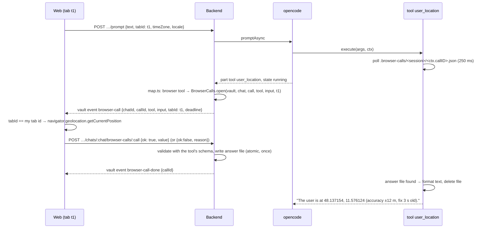

# Architecture: browser tools

## Overview

Two independent parts:

- **Local time** rides with the prompt: the browser sends its time zone and locale, the backend turns them into a
  hidden line with the current local time when it sends the turn to opencode. No tool, no round-trip.
- **Position** is a **browser tool** (`user_location`) on a general browser-call channel:

```mermaid
flowchart LR
  subgraph OC[opencode container]
    T[tools/user_location.ts] --> L[lib/browser-call.ts<br/>wait for answer file]
  end
  subgraph V[(vaults volume)]
    A[.browser-calls/&lt;session&gt;/&lt;call&gt;.json]
  end
  subgraph BE[backend]
    H[harness/map.ts<br/>BROWSER_TOOLS] --> BC[browser-calls.ts<br/>pending calls, deadline]
    BC --> EV[vault event stream]
    R[POST …/browser-calls/:call] --> BC
  end
  subgraph W[web, answering tab]
    VE[vault events handler] --> BT[lib/browser-tools.ts<br/>handlers]
  end
  L -. polls .-> A
  BC -->|writes answer| A
  EV -->|browser-call| VE
  BT -->|result| R
```

No new network path: opencode stays on the internal network and talks to nobody new. The tool and the backend meet on
the shared vaults volume, as `current_page` already does (`.open-page`). The backend reaches the browser over the
vault event stream that is open whenever the app shows the vault, and the browser answers with an ordinary
authenticated request.

## Local time

- Web: every prompt body (plain and slash commands, same route) carries `timeZone`
  (`Intl.DateTimeFormat().resolvedOptions().timeZone`) and `locale` (`navigator.language`).
- Backend: `promptBody` (`app.ts`) gains `timeZone: z.string().max(64)` (must be a zone `Intl` accepts, else dropped)
  and `locale: z.string().max(35)`, both optional; stored on the queued `Turn` like `openPage`. The locale reaches
  the line only if `Intl.getCanonicalLocales` accepts it (it is free text from the browser).
- `harness/opencode.ts` → `promptParts` adds a `synthetic: true` text part (as command instructions already do;
  `map.ts` hides synthetic parts) built by `localTimeLine(now, timeZone, locale)` when the turn is sent, **first**,
  before the user's text, so the request is what the model reads last:
  "User's local time: Thursday 2026-10-15 23:41, Europe/Berlin (UTC+02:00), locale de-DE. (Context from the app, not
  part of the user's message: use it for 'today', 'now' and dates in note names instead of the server date; do not
  mention it unless asked.)" Worded as context because the small dev model answered the plain line instead of the
  question. The web keeps the pending bubble until the user message has a visible part (`userCount`), since the
  hidden part arrives first.
- No `timeZone` (headless ingest runner, an old PWA): the existing `timezone` setting from `deploy/settings/`
  (Europe/Berlin on hetzner and local), which already reaches the backend as its `TZ`; the backend reads its own
  zone via `Intl`. Locale omitted.

## Browser-call flow



### Tool side (opencode image)

- `deploy/opencode/lib/browser-call.ts` (import-free, so backend tests load it, like `open-page.ts`):
  `waitForAnswer(dir, sessionID, callID, { timeoutMs, abort })` polls `<dir>/<fileKey(sessionID)>/<fileKey(callID)>.json`
  every 250 ms, returns the parsed answer or `null` on timeout, stops on `abort`, deletes the file it read. The dir is
  the literal `/vaults/.browser-calls` (same reasoning as `OPEN_PAGE_DIR`). `fileKey` = base64url of the id, on both
  sides: any id a provider sends (`functions.user_location:0`) works, and none becomes a path (review 2026-10-15; a
  plain-id check threw inside the harness event loop and ended the turn with a false "AI service restarted").
- The call id is `context.callID`: opencode 1.18.25 sets it from the model's tool call id (`callID: toolCallId` in
  the tool context), and the tool part the backend maps carries the same `callID`. Verified in the binary
  (grill 2026-10-15); a test keeps it true across opencode upgrades.
- `tools/user_location.ts`: `args: {}`. Waits up to 90 s (`BROWSER_CALL_TIMEOUT_MS`; the backend's `TIMEOUT_MS` is the
  same value, the images share no code) (the user may be reading the permission prompt or the GPS
  may need a fix). Formats "The user is at 48.137154, 11.576124 (accuracy ±12 m, fix 3 s old)." or "The user did not
  share their location." / "No position is available on the user's device." / "The user's browser cannot share a
  location." / "The user's device did not answer. Ask the user where they are if you need it."
  The description tells the model to call it only when the user's request depends on where they are ("near me",
  "here", local weather), never on its own initiative.
- Allowed for the `vault` and `vault-readonly` agents; the image bake waits for eight tools.

### Backend

- `BROWSER_TOOLS` (`packages/shared`): the one list of browser tools. `harness/map.ts` sets `ToolCall.browser = true`
  (plus `callId`) for them; the web's handlers are a `Record<BrowserTool, …>`, so a tool without a handler fails the
  typecheck.
- `browser-calls.ts` — `BrowserCalls`:
  - `open(call)`: called from the chat turn when a mapped part of a browser tool enters `running`. Stores
    `{ vaultId, chatId, callId, tool, input, tabId, deadline }` in memory (`chatId` = the part's session), emits
    `browser-call` on the vault's event stream. Idempotent per vault + chat + call id (parts update several times;
    providers may reuse ids like `call_0` across chats). `input` is `{}` today: `ToolCall` carries no tool input, so a
    browser tool with arguments would also map its input in `harness/map.ts`.
  - The tab: the vault's running turn's `tabId`, also when the tool runs in a subagent (`task`) session, since a vault
    runs one turn at a time. An adopted turn (backend restart) has none.
  - `answer(vaultId, chatId, callId, body)`: `404` unknown or expired call (an expired call is dropped), `409` already answered, `400` when the
    body fails the tool's schema (`packages/shared`). Writes `<vaults>/.browser-calls/<fileKey(chat)>/<fileKey(call)>.json`
    (temp file + rename), once: an in-memory flag, reset when the write fails so the tab can try again; emits
    `browser-call-done`. The position is passed on as the browser gave it.
  - Close: on the part leaving `running` (completed, error), on deadline (+5 s grace) → drop the call, emit
    `browser-call-done`, remove a stale answer file. The turn's end (abort included) closes every call of the vault
    (`closeVault`: subagent sessions too); an adopted turn's end, deleting a chat or the vault remove that session's
    calls and folder.
  - `pending(vaultId)`: what a newly connected vault event stream receives first, after `status` and the replayed
    `agents-move` (`app.ts` events route), so a reload or a PWA back in the foreground still answers.
- Prompt body: `tabId: z.string().regex(/^[A-Za-z0-9-]{8,64}$/).optional()`, stored on the queued `Turn`
  (`config.json` `queued`) and on the running turn. A turn without `tabId` (old PWA, ingest runner) →
  `browser-call` carries `tabId: null` and no tab answers; the tool times out.
- Route `POST /api/vaults/:id/chats/:chatId/browser-calls/:callId`, bearer-guarded like every route.

### Web

- `lib/client-context.ts`: the tab id, a random id (`crypto.getRandomValues`: works without a secure context, e.g. a dev
  stack over plain http) in `sessionStorage` (`karpathy.tab`), created on first use; a page-lifetime id when storage
  is blocked, so prompts never fail over it. `clientContext()` = `{ tabId, timeZone, locale }`, sent with every prompt.
- `lib/browser-tools.ts`: `browserTools: Record<BrowserTool, (input) => Promise<BrowserCallResult>>`.
  - `user_location`: `navigator.geolocation.getCurrentPosition({ enableHighAccuracy: true, maximumAge: 60_000,
    timeout: 60_000 })`. `PERMISSION_DENIED` → `{ ok: false, reason: 'denied' }`, `POSITION_UNAVAILABLE` / timeout →
    `no-position`, no `navigator.geolocation` → `unsupported`.
- The vault event handler answers a `browser-call` whose `tabId` is this tab's id and whose tool has a handler, once
  per call id; an unknown tool is answered `unsupported`. Runs no matter which chat is on screen, so the user can
  switch chats while a turn runs. Only the shown vault's event stream is open: a call while the user looks at another
  vault is answered only if they switch back before the deadline (the pending replay); otherwise the tool times out.
- Chips (`toolLabel`): while running, "open the app to share your location"; when done, the title the tool set with
  `context.metadata({ title })` (`locationTitle`: "used your location (±12 m)", "location not shared", "no location
  available", "no answer from your device"). `ToolCall` carries no output, so the tool names its own chip.
- iOS: geolocation needs a secure context (given, HTTPS; `localhost` in dev) and works in the installed PWA. The
  permission prompt names the site; with iOS "Precise Location" off the device gives only an approximate position,
  which the tool reports with its accuracy. No `Permissions-Policy` header restricts `geolocation` today
  (`deploy/proxy/Caddyfile`); the change adds `Permissions-Policy: geolocation=(self)` to keep it to the app.

## Decisions

| Decision | Alternatives | Why |
|---|---|---|
| Live round-trip for the position | position sent with every prompt (like `openPage`) | The user's choice: the AI asks only when it needs it, the position isn't sent for prompts that don't need it, and the channel serves future browser tools that act, not just report. |
| Answer file on the shared volume | tool calls the backend over HTTP on the internal network; opencode's permission `ask` | No new path from opencode (which reads untrusted vault content) to the backend's API. The permission reply carries no data. Same pattern as `.open-page`. |
| Announce on the vault event stream | on the chat stream | The vault stream is open whenever the vault is shown; the chat stream only while that chat is on screen. |
| Only the tab that sent the prompt answers | any connected tab, first wins | "Where am I?" must be answered by the device in the user's hand, not by a laptop at home. |
| No app setting, browser permission only | an opt-in switch in Settings | The user's choice. The site permission is the switch; declining is an ordinary answer. |
| Timeout returns text, not a tool error | throw | The model continues with what it has (asks the user) instead of retrying. |
| Local time is computed on the server from the time zone sent with the prompt (grill 2026-10-15) | live browser round-trip | No wait, no failure path: works with the phone locked, the tab closed and for a queued turn (time at run, not at queueing). A time zone is no privacy concern. `user_location` stays the only browser tool. |
| No `local_time` tool: every prompt carries a hidden line with the user's local time (grill) | a `local_time` tool reading a per-chat file (like `.open-page`) | opencode's system prompt already states the server's date, so the model would rarely think to call a tool and "today" would stay wrong. The hidden line (a `synthetic` text part, as command instructions already are; `map.ts` hides it) costs ~30 tokens and fixes note names and "today" without a tool call. |
| Turns without a time zone use the existing `timezone` setting (grill; at apply: reused instead of a new `default_time_zone`) | UTC; a new `default_time_zone` setting | Headless turns (ingest runner) and old PWAs still date notes in the user's usual zone. `timezone` (commit and log times) is already that zone and already the backend's `TZ`; a second setting would duplicate it. |
| A suspended tab: 90 s deadline, chip says "open the app to share your location" (grill) | keep the call pending up to ~10 min until the tab returns | A turn doesn't hang for minutes; the user learns why it waits. |
| No per-call in-app consent for the position (grill) | confirm per call; confirm once per chat | Browser permission + web access off by default + chip are enough for the MVP. Revisit if prompt injection shows up. |
| Full device precision, high accuracy, no rounding (grill) | ~1 km (2 decimals); ~100 m (3 decimals); 100 m default with a "precise" mode | The user's choice: as precise as the device can tell (GPS 5–20 m), for "nearest bakery", street and address questions. Costs a slower fix (up to ~30 s cold) and a more sensitive position (see *Security*). |
| Tool call key = opencode's `callID` (grill) | `<messageID>-<tool>` | Verified in opencode 1.18.25: the tool context and the part carry the same `callID`. |
| Field name `tabId`, not `client` (grill) | `client` | Matches the domain term *answering tab*. |
| A duplicated tab shares the tab id; first answer wins (grill) | rotate the id via BroadcastChannel | Both tabs are on the same device; the 409 for the second answer is harmless. |

## Security

- **Exposure.** The exact position (to ~10 m with GPS, i.e. the user's house) reaches the model provider as tool
  output and is stored in the opencode session (chat history) until the chat is deleted. The browser's permission
  prompt is the user's consent; each use shows as a chip with its accuracy.
- **Prompt injection.** A hostile page in the vault could tell the AI to call `user_location` and put the result into
  a `websearch` query or a note. Once the site permission is granted, the call needs no further click. Limits: the
  tool description restricts use to requests that depend on the user's place; web access is off by default; the chip
  shows every use. Listed as a known gap in `security.md`, not mitigated further here.
- **Answer endpoint.** Bearer-guarded; accepts only announced, pending calls of that vault and chat; schema-validated;
  write-once. The answer file is outside every git clone (`.browser-calls` next to `.open-page`).
- **Paths.** Session and call ids become file names only as base64url (`fileKey`), on both sides.
- **Time zone.** Validated against `Intl`; it only ever becomes text in a synthetic part, never a path.
