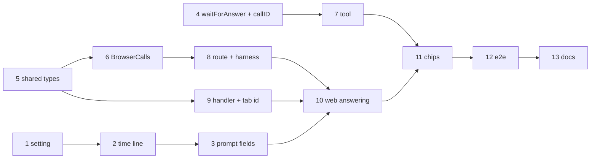

# Plan: browser tools

Three tracks meet in the end-to-end test: local time (prompt fields, hidden line, setting), the channel (tool wait,
backend calls, route, web answering) and the `user_location` tool with its handler. Workspace test commands:
`npm test -w apps/web -- <file>`, `npm test -w apps/backend -- <file>`; full suite `just check`; e2e `just e2e`
against this checkout's dev stack (`just dev up`).

## Local time

- [x] Fallback zone = the existing `timezone` setting (no new setting)
  - Depends on: none
  - Test first: none — `timezone` already exists and is rendered as the backend's `TZ` (`packages/settings/src/render.ts`); the fallback itself is tested in step 2.
  - Verify: `grep -n "TZ: \${TZ" deploy/compose.yml` → matches in the backend service; `grep -rn default_time_zone deploy packages apps` → no match
- [x] `localTimeLine` and the synthetic part
  - Depends on: 1
  - Test first: `apps/backend/test/local-time.test.ts` › "promptParts adds a synthetic part `User's local time: Thursday 2026-10-15 23:41, Europe/Berlin (UTC+02:00), locale de-DE…` for a fixed clock, before the text and the instructions" (first, so the model reads the user's request last; worded as app context: the small dev model otherwise answered the time instead of the question), "no timeZone → the backend's own zone (the `timezone` setting via `TZ`), no locale", "an invalid zone falls back to the backend's zone"; `harness-map.test.ts` › "a synthetic text part … is not shown in the chat" (already true; kept as a guard). Fails today: no line.
  - Verify: `npm test -w apps/backend -- local-time harness-map` → green
- [x] Prompt body `tabId`, `timeZone`, `locale`, kept on the queued turn; web sends them
  - Depends on: 2
  - Test first: `apps/backend/test/chat.test.ts` › "local time (#151)": the line in the prompt's zone, a `/command` turn carries it too, no zone → the backend's, "tabId, timeZone and locale are kept on the queued turn; a bad tabId or zone is a 400"; `apps/web/src/lib/client-context.test.ts` › the tab id (sessionStorage: same after reload, new per tab; moved here from step 9), the client context, "every prompt body carries the client context"; `chat.test.ts` › settlePending "keeps it while the server user message has no visible part yet". Fails today: fields stripped.
  - Verify: `npm test -w apps/backend -- chat` and `npm test -w apps/web` → green

## Channel

- [x] `waitForAnswer` polls for the answer file, times out, honors abort; tools see `callID`
  - Depends on: none
  - Test first: `apps/backend/test/browser-call-tool.test.ts` › "returns the answer written after 300 ms and deletes the file", "returns null after the timeout", "stops on abort", "rejects a session or call id with `/` or `..`". Fails today: no `deploy/opencode/lib/browser-call.ts`. (That the tool's `context.callID` equals the part's `callID` needs a model to call the tool: guarded by the `@llm` test in step 8 and the e2e in step 12, where the answer only arrives if both agree.)
  - Verify: `npm test -w apps/backend -- browser-call-tool` → green
- [x] Types and result schema in `packages/shared`
  - Depends on: none
  - Test first: `packages/shared/src/browser-call.test.ts` › `parseBrowserCallResult` (dependency-free; shared has no zod) accepts lat −90…90, lon −180…180, accuracy ≥ 0, age ≥ 0, unrounded, no extra keys; `{ ok: false, reason: 'denied' | 'no-position' | 'unsupported' }`. Fails today: types missing.
  - Verify: `npm run typecheck` → 0 errors
- [x] `BrowserCalls`: open, answer once, deadline, pending, cleanup
  - Depends on: 5
  - Test first: `apps/backend/test/browser-calls.test.ts` › "open emits browser-call once per call id", "answer writes the file once; a second answer is 409", "unknown call 404, wrong chat 404, bad body 400", "the position is written unrounded", "after the deadline the call is dropped, browser-call-done emitted, an answer is 404" (the call no longer exists), "pending(vault) lists open calls", "deleting the chat removes `.browser-calls/<session>`". Fails today: no module.
  - Verify: `npm test -w apps/backend -- browser-calls` → green
- [x] Tool `user_location` in the opencode image
  - Depends on: 4
  - Test first: `apps/backend/test/browser-call-tool.test.ts` › "formatLocation produces the texts in architecture.md for a position, a refusal, no position and no answer", `locationTitle` (the chip text, returned as `metadata.title`); `apps/backend/test/opencode-tools.test.ts` › "the image lists user_location and allows it for vault and vault-readonly", "user_location reads the answer file of its session and call id inside the container". Fails today: tool missing.
  - Verify: `npm test -w apps/backend -- browser-call-tool opencode-tools` → green; `docker build deploy/opencode` bakes eight tools
- [x] Harness marks browser tools; the turn opens and closes calls; route
  - Depends on: 6
  - Test first: `apps/backend/test/harness-map.test.ts` › "user_location maps as a browser tool with its opencode call id", "a completed browser tool shows the chip title from its metadata"; `apps/backend/test/api.test.ts` › "browser calls (#151)": "POST …/browser-calls/:call writes the answer once", "a stream connected mid-call gets it after status"; `apps/backend/test/chat.llm.test.ts` › "@llm user_location is announced for the prompting tab, and its answer reaches the tool (same callID on both sides)". The turn closes its calls when it ends (abort included) and on chat delete. Fails today: route missing.
  - Verify: `npm test -w apps/backend` → all green; `npm run test:llm -- -t "browser tools"` → green

## Web

- [x] Handler `user_location`
  - Depends on: 5
  - Test first: `apps/web/src/lib/browser-tools.test.ts` › "asks for high accuracy", "passes the position through unrounded", "maps PERMISSION_DENIED to denied, POSITION_UNAVAILABLE and TIMEOUT to no-position", "without a Geolocation API: unsupported" (no faked Geolocation: the real call is covered by the e2e). Fails today: module missing.
  - Verify: `npm test -w apps/web -- browser-tools` → green
- [x] Answer browser calls from the vault event handler
  - Depends on: 3, 8, 9
  - Test first: `apps/web/src/store.test.tsx` › "browser calls (#151)": "a browser-call for this tab posts the handler's result once", "a browser-call for another tab is ignored", "an unknown tool is answered unsupported", "a call arrives while another chat is on screen and is still answered". Fails today: event unknown.
  - Verify: `npm test -w apps/web` → all green
- [x] Chip labels and the waiting state
  - Depends on: 7, 10
  - Test first: `apps/web/src/lib/chat.test.ts` › `toolLabel`: "open the app to share your location" while running; when done, the title the tool set ("used your location (±12 m)", "location not shared").
  - Verify: `npm test -w apps/web -- chat` → green

## End to end, docs

- [x] E2E on desktop and iPhone
  - Depends on: 11
  - Test first: `e2e/browser-tools.spec.ts` (`@llm` where a model is needed, prompts name the tool): context with `timezoneId: 'Pacific/Auckland'` → any prompt → the opencode session's user message has a synthetic part containing `Pacific/Auckland`, the bubble shows only the user's text; `permissions: ['geolocation']`, `geolocation: { latitude: 48.137154, longitude: 11.576124 }` → "call user_location" → chip "used your location (±12 m)" and the tool output contains `48.137154, 11.576124` (desktop and `@iphone`); no permission granted → "location not shared" (Chromium only: WebKit would wait for a prompt). "Another tab does not answer" is covered by `store.test.tsx` (it needs a model-made call otherwise). Assertions check chips and parts, never the answer text.
  - Verify: `just e2e browser-tools.spec.ts` → green on desktop and iphone
- [x] Caddy `Permissions-Policy`, docs and demo run book
  - Depends on: 12
  - Test first: `e2e/browser-tools.spec.ts` › "the proxy keeps geolocation to the app itself" (skipped on the dev stack: its proxy sends no security headers) › response carries `Permissions-Policy: geolocation=(self)`.
  - Verify: `just prodtest` → green; README feature list; chapter "Time and place" in `Karpathy Demo.md` (push the demo vault only after release)

## Housekeeping

- [x] Remove the local Lima VM target (user, 2026-10-15: all tests run on plain docker compose stacks)
  - Depends on: none
  - Test first: none — removal of a deployment target; the remaining targets (dev stack, `just prodtest`, `hetzner`) keep their own tests.
  - Verify: `grep -rIn -i "lima\|limactl\|karpathy-vm\|just vm\|localhost:9444" --exclude-dir={node_modules,.git,tmp,.worktrees,dist} .` → only historical mentions (archived research, DECISIONS); `just --list` has no `vm` / `deploy-e2e`; `just check` → green

System docs are updated at `/spec:archive`.
