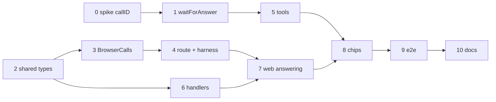

# Plan: browser tools

Two tracks meet in the end-to-end test: the channel (tool wait, backend calls, route, web answering) and the two tools
with their handlers. Workspace test commands: `npm test -w apps/web -- <file>`, `npm test -w apps/backend -- <file>`;
full suite `just check`; e2e `just e2e` against this checkout's dev stack (`just dev up`).

## Channel

- [ ] Spike: which id identifies a tool call in a custom tool
  - Depends on: none
  - Test first: `apps/backend/test/opencode-tools.test.ts` › "a custom tool sees the call id the part carries": a probe tool in the test container returns `context.callID`; the completed part's `callID` equals it. If `callID` is missing, record that and switch the key to `<messageID>-<tool>` in the architecture.
  - Verify: `npm test -w apps/backend -- opencode-tools` → green
- [ ] `waitForAnswer` polls for the answer file, times out, honors abort
  - Depends on: 0
  - Test first: `apps/backend/test/browser-call-tool.test.ts` › "returns the answer written after 300 ms and deletes the file", "returns null after the timeout", "stops on abort", "rejects a session or call id with `/` or `..`". Fails today: no `deploy/opencode/lib/browser-call.ts`.
  - Verify: `npm test -w apps/backend -- browser-call-tool` → green
- [ ] Types and result schemas in `packages/shared`
  - Depends on: none
  - Test first: `packages/shared` schema tests (or `apps/backend/test/browser-calls.test.ts` if shared has none): `localTimeResult` accepts `{ iso, timeZone, offsetMinutes, locale }` and refuses a time zone over 64 characters; `userLocationResult` accepts lat −90…90, lon −180…180, accuracy ≥ 0, age ≥ 0; `{ ok: false, reason: 'denied' | 'no-position' | 'unsupported' }` for both. Fails today: types missing.
  - Verify: `npm run typecheck` → 0 errors
- [ ] `BrowserCalls`: open, answer once, round, deadline, pending, cleanup
  - Depends on: 2
  - Test first: `apps/backend/test/browser-calls.test.ts` › "open emits browser-call once per call id", "answer writes the file once; a second answer is 409", "unknown call 404, wrong chat 404, bad body 400", "a position is rounded to two decimals and accuracy raised to 1000 before it is written", "after the deadline the call is dropped, browser-call-done emitted, answer 409", "pending(vault) lists open calls", "deleting the chat removes .browser-calls/<session>". Fails today: no module.
  - Verify: `npm test -w apps/backend -- browser-calls` → green
- [ ] Harness marks browser tools; the turn opens and closes calls; prompt `client`; route
  - Depends on: 3
  - Test first: `apps/backend/test/map.test.ts` › "local_time and user_location map with browser: true"; `apps/backend/test/api.test.ts` › "prompt accepts client and keeps it on the queued turn", "a running user_location part emits browser-call with the turn's client on the vault event stream", "POST …/browser-calls/:call writes the answer", "a vault stream connected mid-call gets the pending call first", "abort closes the call". Fails today: route and field missing.
  - Verify: `npm test -w apps/backend` → all green

## Tools and handlers

- [ ] Tools `local_time` and `user_location` in the opencode image
  - Depends on: 1
  - Test first: `apps/backend/test/browser-call-tool.test.ts` › "formatLocalTime / formatLocation produce the texts in architecture.md for an answer, a refusal and no answer (local_time adds server UTC)"; `apps/backend/test/opencode-tools.test.ts` › "the image lists local_time and user_location and allows them for vault and vault-readonly". Fails today: tools missing.
  - Verify: `npm test -w apps/backend -- browser-call-tool opencode-tools` → green; `docker build deploy/opencode` bakes nine tools
- [ ] Web handlers and the tab id
  - Depends on: 2
  - Test first: `apps/web/src/lib/browser-tools.test.ts` › "local_time reports the faked zone (`TZ=Europe/Berlin`) and offset", "user_location maps PERMISSION_DENIED to denied, POSITION_UNAVAILABLE and timeout to no-position, a missing navigator.geolocation to unsupported"; `tab-id.test.ts` › "same id after reload of sessionStorage, new id for a new storage". Fails today: modules missing.
  - Verify: `npm test -w apps/web -- browser-tools tab-id` → green
- [ ] Answer browser calls from the vault event handler; send `client` with prompts
  - Depends on: 4, 6
  - Test first: `apps/web/src/lib/chat.test.ts` (or the vault events test) › "a browser-call for this tab posts the handler's result once", "a browser-call for another tab is ignored", "an unknown tool is answered unsupported", "a call arrives while another chat is on screen and is still answered", "every prompt body carries client". Fails today: event unknown.
  - Verify: `npm test -w apps/web` → all green

## UI, end to end, docs

- [ ] Chip labels and the waiting state
  - Depends on: 5, 7
  - Test first: `apps/web/src/lib/chat.test.ts` › `toolLabel`: "checked your local time", "used your location (±1 km)", "location not shared", "waiting for your location…" while running.
  - Verify: `npm test -w apps/web -- chat` → green
- [ ] E2E on desktop and iPhone
  - Depends on: 8
  - Test first: `e2e/browser-tools.spec.ts` (`@llm`, prompts name the tool): context with `timezoneId: 'Pacific/Auckland'` → "call local_time" → the chip shows and the tool output contains `Pacific/Auckland`; `permissions: ['geolocation']`, `geolocation: { latitude: 48.137154, longitude: 11.576124 }` → output contains `48.14, 11.58`; no permission granted → "did not share"; a second page of the same user with another tab id does not answer. Assertions check tool events, never the answer text.
  - Verify: `just e2e` → green on desktop, ipad and iphone
- [ ] Caddy `Permissions-Policy`, docs and demo run book
  - Depends on: 9
  - Test first: `deploy/proxy` header check in `just prodtest` › response carries `Permissions-Policy: geolocation=(self)`.
  - Verify: `specs/system/{architecture,domain,functional,security}.md` updated at archive; README feature list; chapter "Time and place" in `Karpathy Demo.md` (push the demo vault only after release)
