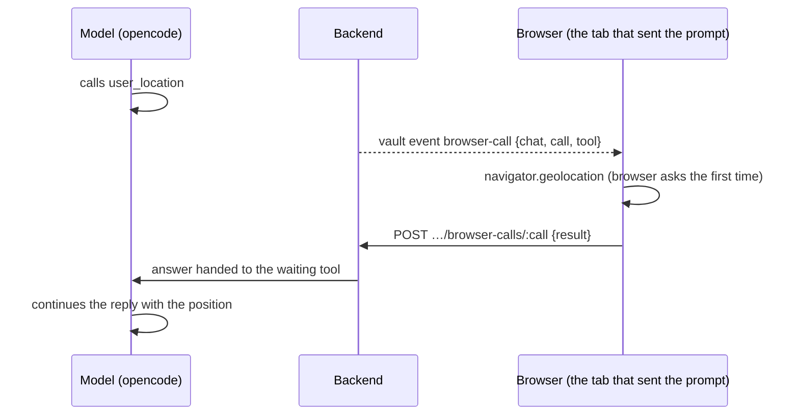

# Proposal: browser tools (local time and position)

**Issue:** [#151](https://github.com/tillg/karpathy.app/issues/151)

## Why

The AI runs in the opencode container on the server. All it knows about "now" is the server clock (UTC in every
deployment), and it knows nothing about where the user is. That shows up in everyday prompts:

- "What's on for today?", "Write today's journal entry", `/research` naming its note `Research/<YYYY-MM-DD>-…`:
  after 22:00 in Germany the server's date is already tomorrow's (or, in summer, two hours off in the other
  direction for an early morning prompt). The AI can't tell, so it guesses or uses UTC.
- "Find a good café near me", "What's the weather here?", "Add this place to my travel notes": the AI has to ask
  where "here" is.

The browser knows both: the device clock with its time zone, and, with the user's permission, the position. The issue
asks for tools the AI can call to get them, served by the browser, and for thoughts on other browser-side services.

## What changes

A new kind of tool, the **browser tool**: the AI calls it in opencode like any tool, but the answer comes from the
user's browser, live, while the tool call waits. Two browser tools ship with this change:

| Tool | Returns | Permission |
|---|---|---|
| `local_time` | The device's local date and time, weekday, IANA time zone and UTC offset, and the browser locale | none |
| `user_location` | Latitude and longitude rounded to about 1 km, accuracy in meters, age of the fix; or that the user declined / no position is available | the browser's own location prompt, the first time |

- **Who answers.** The browser tab that sent the turn's prompt. Not "any open device": a laptop at home must not
  answer "where am I?" for the phone in the user's pocket.
- **Live, not a snapshot.** The AI asks only when it needs it; nothing travels with prompts that don't need it.
- **When nobody answers** (the tab was closed, the phone locked, the user ignored the prompt for 90 s), the tool
  returns that the device did not answer; `local_time` adds the server's UTC time, so the AI still has a clock.
- **Visible.** Each call shows as a chip in the chat ("checked your local time", "used your location (±1 km)";
  "waiting for location permission…" while the browser prompt is open), like every other tool call.
- **The mechanism is general.** Adding the next browser tool means one handler in the web app, one result schema in
  `shared` and one small tool file in the opencode image. Nothing in the channel itself changes.

## Decisions taken with the user (2026-10-15)

- **Position: ask on first use.** No app setting. The first `user_location` call triggers the browser's own
  permission prompt; the browser remembers the answer (per site, and on iOS per app). Declining is a normal answer
  the AI gets ("the user did not share their location"), not an error.
- **Live round-trip**, not context sent with every prompt: the tool call waits for the browser's answer.
- **Coordinates and accuracy only**, rounded to about 1 km. No reverse geocoding: no third party sees the position. If
  web access is on, the model can look the place up itself.
- **Only time and position for now.** Other browser-side services wait until the mechanism exists. The user named
  client-side Instagram scraping as a candidate (see *Later*).

## Scope

In scope: the browser-call channel (tool waits, backend announces on the vault event stream, browser answers by
POST, backend hands the answer to the tool); the tools `local_time` and `user_location`; the web handlers and the chip
labels; e2e and docs.

Out of scope:

- an app setting to switch location sharing off (the browser's site permission does that);
- reverse geocoding, maps, place names;
- continuous tracking or a position sent with every prompt;
- any further browser tool (camera, clipboard, notifications, Instagram);
- answering from a device other than the one that sent the prompt.

### Later: other browser tools

Candidates the channel makes possible, each its own change:

| Idea | Note |
|---|---|
| Instagram download in the browser | Named by the user. Caveat: a page on the app's origin can't fetch `instagram.com` with the user's login (CORS and `SameSite` cookies), so plain `fetch` from the PWA won't see more than the server does. Needs its own research (share sheet, bookmarklet, extension). |
| Device and screen | Phone, tablet or desktop, so the AI can keep answers short on a phone. |
| Ask the user | A form the AI shows in the chat (choices, a date). opencode's `question` tool is denied today. |
| Clipboard, notifications, camera | Each needs a user gesture or permission; weigh separately. |

## Expected outcome

- "Write today's journal entry" at 23:30 in Munich uses today's Munich date.
- "Find a bakery near me" on the phone: the browser asks once for the location, the AI gets the position and (with
  web access) searches near it.
- The user sees every time or location lookup as a chip and can decline the location.
- The next browser tool is a small, local change.

## Impact

| Area | Change |
|---|---|
| `deploy/opencode` | New tools `local_time.ts`, `user_location.ts`; helper `lib/browser-call.ts` (wait for the answer file); allowed for `vault` and `vault-readonly` in `opencode.json`; bake step waits for nine tools |
| `apps/backend` | New `browser-calls.ts` (pending calls, answer files, timeout); `harness/map.ts` marks browser tools (`BROWSER_TOOLS`); vault event `browser-call` / `browser-call-done`; route `POST /vaults/:id/chats/:chatId/browser-calls/:callId`; prompt body gains `client` |
| `apps/web` | `lib/browser-tools.ts` (handlers: `local_time`, `user_location`), answering in the vault event handler, tab id in `sessionStorage`, chip labels |
| `packages/shared` | Types `BrowserCall`, `BrowserCallResult`, result schemas |
| `e2e` | `browser-tools.spec.ts` (fake time zone and geolocation through Playwright, decline, no answer) |
| Docs | `specs/system/*` at archive (architecture, domain, functional, security); README feature list; demo run book chapter "Time and place" |
