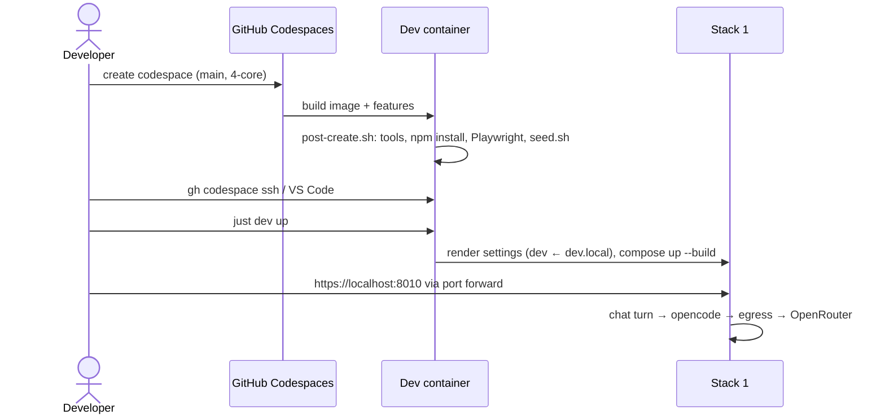

# Architecture: develop in a GitHub Codespace

## Files

| File | Role |
|---|---|
| `.devcontainer/devcontainer.json` | Image `mcr.microsoft.com/devcontainers/javascript-node:22-bookworm`. Features: `docker-in-docker:2`, `github-cli:1`, `ghcr.io/anthropics/devcontainer-features/claude-code:1.0`. `hostRequirements` (4 CPUs, 16 GB, 32 GB), port attributes for 8010–8090, `customizations.codespaces.repositories`, `secrets` (documents the Codespaces secrets in the create dialog), the VS Code extensions, `postCreateCommand`. |
| `.devcontainer/post-create.sh` | Runs once on create: apt `ripgrep`, `just` (from just.systems, into `/usr/local/bin`), `npm install`, Playwright Chromium with its system deps, then `seed.sh`. |
| `.devcontainer/seed.sh` | Seeding only, no network, no installs, so it's testable. Takes the repo root as an argument. Never overwrites an existing file. |
| `.devcontainer/seed.test.sh` | Shell test in the style of `deploy/stack.test.sh`, run by `just check`. |

## Decisions

### Docker-in-Docker, not Docker-outside-of-Docker

`compose.dev.yml` bind-mounts the sources (`../apps/...`) for hot reload. With Docker-in-Docker the daemon sees the
same filesystem as the shell, so those relative mounts resolve. Docker-outside-of-Docker would need path translation.
DinD also keeps stacks, images and volumes inside the codespace, with nothing shared on the host.

### Always OpenRouter, no settings of its own

Every model comes from OpenRouter, in dev as in prod and the tests, so the committed `dev` settings already work in a
codespace. `seed.sh` writes no settings, only the key: no `dev.local.yaml`, no new settings environment, and no
`CODESPACES` branch in `dev.sh`. A developer's own `dev.local.yaml` still applies, as on the Mac.

### Seeding rules

| Source (env) | Target | When the source is unset |
|---|---|---|
| `OPENROUTER_API_KEY` | `deploy/secrets/openrouter_api_key` | `seed.sh` prints a hint, and `just dev up` fails at render with the missing-secret error the Mac gives. |
| `EXA_API_KEY` | `deploy/secrets/exa_api_key` | A hint: the AI has no web search. |
| `NTFY_DEV_TOPIC` | `tmp/.ntfy_dev_topic` | A hint: no ntfy progress messages. The CLAUDE.md Keychain fallback is Mac-only. |
| `ANTHROPIC_API_KEY` | — (Claude Code reads it from the environment) | A hint: log in to `claude` once by hand. |

Files are written with mode 600, and existing files are left as they are. Hints go to stderr; `seed.sh` always exits 0.

### Resuming Claude after a reconnect

An SSH session ends with the connection, and `claude` with it. `just resume` runs `claude --continue`, which picks up
this checkout's last session. It works on the Mac too. Borrowed from ai-sandbox-manager's attach command.

### Reaching the app: localhost forward only

`Caddyfile.dev` serves `https://localhost` with the internal CA, and Vite's HMR client connects to `wss://<host>:80N0`.
A forward from the Mac's `localhost:8010` to the codespace's `8010` keeps both true, so nothing in the proxy or Vite
changes. `portsAttributes` labels 8010 `karpathy #1` with `protocol: https`. Other ports forward silently. The
`*.app.github.dev` URL is out of scope (see the proposal).

### Claude Code

The `claude-code` feature installs the CLI and the VS Code extension. The project's `SessionStart` hook already installs
the four plugins in the first session, which needs network access to the marketplaces on GitHub; a codespace has it.
Login: `claude` once per codespace (kept across stop/start, lost on rebuild), or an `ANTHROPIC_API_KEY` Codespaces
secret. Personal config comes from the user's dotfiles repo, not from this repo.

### Extra repositories

`customizations.codespaces.repositories` grants the codespace's token `contents: read` on `tillg/ingest_email`
(`deploy/ingest/fetch-source.sh` clones it on every `just dev up`) and `contents: write` on `tillg/karpathy_demo_wiki`
(run book updates). GitHub asks the user to authorize these on create.

## Sequence: first start

## Risks

- **Cost**: per core-hour plus storage. The default idle timeout (30 min) stops it; the docs say so.
- **Image size**: Playwright deps plus DinD images make the first create slow (~5–10 min). Prebuilds are the
  follow-up.
- **Plugin install on first session** depends on GitHub reachability of the marketplaces. That's the same as on the Mac.
