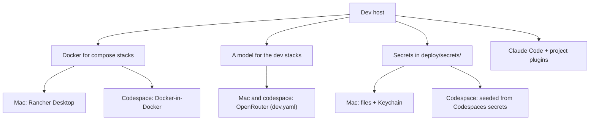

# Domain: develop in a GitHub Codespace

## New terms

| Term | Meaning |
|---|---|
| **Dev host** | The machine a checkout and its dev stacks run on. Until now always the Mac. Now also a codespace. Every dev host runs stacks with `just dev up` and owns stacks 1–9 on its own ports. Stacks on different dev hosts never collide. |
| **Codespace** | A dev host in the cloud: a GitHub-managed VM running this repo's dev container, with the repo checked out under `/workspaces/karpathy.app`. It survives stop/start. A rebuild keeps only `/workspaces`. |
| **Dev container** | The committed definition of a codespace's environment (`.devcontainer/devcontainer.json` + its scripts): image, tools, machine size, forwarded ports, extra repo access. |
| **Codespaces secret** | A per-user secret set in GitHub (Settings → Codespaces), exposed to the codespace as an environment variable. It's the codespace's source for what the Mac keeps in `deploy/secrets/` and the Keychain. |
| **Seeding** | The dev container's one-time copy of Codespaces secrets into the files the repo already reads. It never overwrites a file that exists, so the developer's own edits win. |
| **Port forward** | How a browser on the Mac or iPad reaches a codespace's stack: VS Code or `gh codespace ports forward` maps the codespace's 80N0 to the same localhost port. |

## What a dev host provides

## Unchanged

- Stack numbering, ownership (`tmp/dev/stack`) and the `just` commands.
- Settings layering: `settings.yaml` ← `dev.yaml` ← `dev.local.yaml`. The codespace writes none of them.
- Provider-agnostic AI: the gateway comes from settings, never from code. The codespace uses the same one as the Mac.
