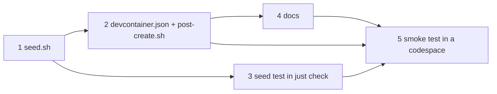

# Plan: develop in a GitHub Codespace

Seeding is the only logic, and it gets a shell test run by `just check`. The dev container and its install script have
no local runtime: they're checked mechanically here and proven in a real codespace (step 5).

- [x] Seed the Codespaces secrets (`.devcontainer/seed.sh <repo>`)
  - Test first: `.devcontainer/seed.test.sh` (temp repo dir) › "fresh: writes `deploy/secrets/openrouter_api_key` (mode 600) from `OPENROUTER_API_KEY`, and no `dev.local.yaml`" › "`EXA_API_KEY` → `exa_api_key`, `NTFY_DEV_TOPIC` → `tmp/.ntfy_dev_topic`" › "existing files are left as they are" › "no `OPENROUTER_API_KEY`: no key file, a hint on stderr, exit 0" › "dev renders: `just settings render dev` with the seeded secrets passes, and its model is on OpenRouter". Fails today: `seed.sh` doesn't exist.
  - Verify: `bash .devcontainer/seed.test.sh` → all ok
- [x] Dev container: image, features, machine size, ports, repo access, secrets, `post-create.sh`
  - Test first: none — config and an install script with no local runtime
  - Verify: `jq -e '.features and .hostRequirements and .postCreateCommand and .customizations.codespaces.repositories' .devcontainer/devcontainer.json` exits 0; `bash -n .devcontainer/post-create.sh`
- [x] Run the seed test in `just check`
  - Test first: none — wiring
  - Verify: `just --show check | grep -q devcontainer/seed.test.sh` and `bash .devcontainer/seed.test.sh` → ok
- [x] Document Codespaces in `README.md` (create, secrets, connect, forward, cost) and `CLAUDE.md` (a codespace is a dev host; the Keychain is Mac-only)
  - Test first: none — docs
  - Verify: `grep -q '## Codespaces' README.md && grep -qi codespace CLAUDE.md`
- [x] `seed.sh` names every missing secret and what goes without it
  - Test first: `.devcontainer/seed.test.sh` › "every secret set, no hints" › "no key: hint names `EXA_API_KEY` / `NTFY_DEV_TOPIC` / `ANTHROPIC_API_KEY`"
  - Verify: `bash .devcontainer/seed.test.sh` → all passed
- [x] `just resume`: continue the last Claude session after a reconnect
  - Test first: none — a one-line recipe
  - Verify: `just --dry-run resume` prints `claude --continue`
- [ ] Smoke test in a real codespace on this branch
  - Test first: none — needs GitHub Codespaces
  - Verify: in the codespace, `just check` green; `just dev up` prints stack 1; after `gh codespace ports forward 8010:8010` on the Mac, https://localhost:8010 loads and one chat turn is answered; `claude` lists the four project plugins after a restart; `just e2e` green; after reconnecting, `just resume` continues the session

System docs are updated at `/spec:archive`.
