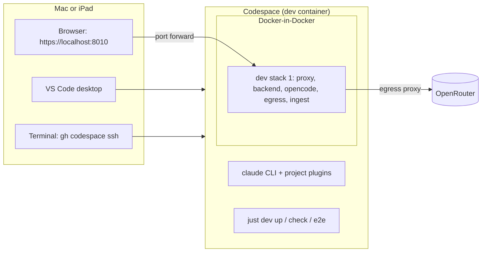

# Proposal: develop in a GitHub Codespace

## Why

Development needs the Mac today: dev stacks run in Rancher Desktop, the dev model is a native omlx on the Mac, and the
Claude Code setup (plugins, skills, `CLAUDE.md`) lives in the local clone. Away from the Mac there is only Claude Code on
the web, which has no shell or editor you can attach to and can't run a dev stack in its container.

A **GitHub Codespace** is a cloud VM with the repo checked out in a dev container. You can open it in VS Code (desktop or
browser) and SSH into it with `gh codespace ssh`. Claude Code runs inside it like on any Linux machine. With a dev
container that fits this repo, a codespace becomes one more checkout: start it, then `just dev up`, `just check`,
`just e2e` and `claude` work as they do on the Mac.

## What changes

- **A committed dev container** (`.devcontainer/`): Node 22, Docker-in-Docker (for the compose dev stacks), `just`,
  ripgrep, the GitHub CLI, Playwright's Chromium, and the Claude Code CLI. A 4-core / 16 GB machine is the minimum.
- **A hosted model instead of omlx.** omlx on the Mac can't be reached from the cloud. On create, the codespace writes
  `deploy/settings/dev.local.yaml` (the developer's own, gitignored overlay) to use the `openrouter` gateway. The key
  comes from a Codespaces secret. Nothing in the committed settings changes.
- **Secrets from Codespaces secrets**, copied once into the places the repo already reads:
  `OPENROUTER_API_KEY` → `deploy/secrets/openrouter_api_key`, `EXA_API_KEY` → `deploy/secrets/exa_api_key`,
  `NTFY_DEV_TOPIC` → `tmp/.ntfy_dev_topic`. `ANTHROPIC_API_KEY` is optional, for Claude Code.
- **Reach the app through a localhost port forward.** VS Code desktop forwards automatically; from a terminal it's
  `gh codespace ports forward 8010:8010`. https://localhost:8010 then works as on the Mac (Caddy's `localhost` site,
  Vite HMR).
- **Extra repos**: the dev container asks for read access to `tillg/ingest_email` (the ingest image's build context)
  and write access to `tillg/karpathy_demo_wiki` (the demo run book).
- **Docs**: a *Codespaces* section in `README.md` and a short note in `CLAUDE.md`.

## Out of scope

- The `*.app.github.dev` browser URL (no local VS Code or `gh`). Caddy's dev site answers only for `localhost`, and the
  HMR socket assumes the local port. A follow-up can add a host-agnostic dev site if iPad-only use matters.
- The `local` and `hetzner` deploy targets (Lima, Ansible), `just ollama`, and the omlx models: these stay Mac-only.
- Codespaces prebuilds. Add them later if create time hurts.
- Syncing personal `~/.claude/` (global `CLAUDE.md`, user skills, memory). That's the user's dotfiles repo, applied by
  Codespaces to every codespace.

## Expected outcome

From a fresh codespace on `main`: `just check` passes, `just dev up` starts stack 1, the app opens on the forwarded
https://localhost:8010, and a chat turn is answered by the hosted model. `claude` starts with the four project plugins
(after the first-session install), and `just e2e` passes.
