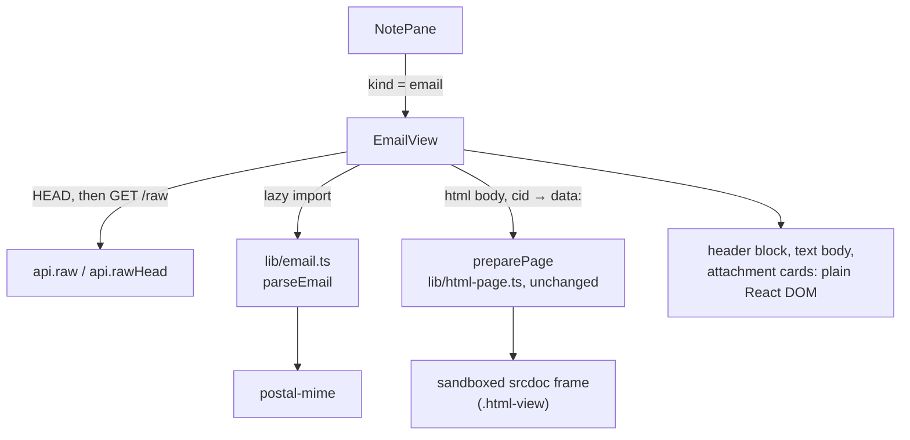

# Architecture: viewer for .eml files

Web app only. The backend, opencode and the shared media table stay as they are: an `.eml` keeps coming from
`GET /raw` as `application/octet-stream` with `Content-Disposition: attachment`, which a `fetch` ignores.

## Components



### File kind (`lib/lang.ts`)

- `FileKind` gains `'email'`. `fileKind(path, binary)`: media table → **`/\.eml$/i` → `email`** → `binary` →
  note / html / code. The email check comes before `binary` because `GET /file` reports a mail with Latin-1 or
  8-bit parts as `binary: true, content: ''`; the viewer never uses that content.
- `viewMode('email', …)` → `'read'` (emails have no mode; places and `openPage` record Read).
- `store.tsx` needs no change: `openNote` still calls `GET /file` first (version, existence, events), so file
  events, deletes and the back arrow work as for any file.

### Parsing (`lib/email.ts`, new)

`parseEmail(bytes: ArrayBuffer): Promise<ParsedEmail>` wraps **postal-mime** (MIT-0, no dependencies, browser
build, handles RFC 2047 headers, charsets incl. Latin-1/windows-1252, quoted-printable, base64, `multipart/*`).
Pinned to an exact version (`4.0.11`; the 4.0.x releases since 4.0.0 are bug fixes and hardening, e.g. limits on
part count and address nesting). Its own types are the source for the result shape; the wrapper reduces it to
what the view needs:

```ts
interface ParsedEmail {
  subject: string;                         // '' when missing
  from?: string; to: string[]; cc: string[]; replyTo: string[];   // "Name <address>" or the address
  date?: Date;                             // invalid / missing → undefined
  html?: string; text?: string;
  inline: Map<string, { type: string; bytes: ArrayBuffer }>;      // contentId without <> → image part
  attachments: { name: string; type: string; bytes: ArrayBuffer }[];
}
```

- **Inline vs attachment:** a part whose `contentId` the HTML body references as `cid:` is inline; every other
  non-body part (incl. a `message/rfc822` forward) is an attachment. An attachment without a file name is named
  `attachment-N` with an extension from its type when known.
- Address groups and display names come from postal-mime; the wrapper only formats.
- postal-mime doesn't throw on garbage (it returns an empty mail), so `parseEmail` throws when it finds no subject,
  no From and no body; the view then shows "This email can't be shown." (no partial render).

`postal-mime` and `lib/email.ts` are loaded with a dynamic `import()` from `EmailView`, so they land in their own
chunk: the main bundle and the PWA precache limits stay as they are.

### Showing it (`components/EmailView.tsx`, new)

- Mounted by `NotePane` for `kind === 'email'` in place of the editor/Read view, keyed by path and file version
  (a pull that changes the file re-renders it). Not `textual`: no mode toggle, outline, find, attach, properties,
  save footer. The header keeps Delete ("Delete file") as for other non-note files.
- **Bytes, without a second download:** a UTF-8 mail (most are: quoted-printable and base64 are ASCII) already
  came whole with `GET /file`, so the view parses `new TextEncoder().encode(currentText())`; valid UTF-8 round-trips
  byte-exact, CRLF included. Only a `binary: true` mail is fetched again: `rawHead` first, over
  `MAX_PREVIEW_BYTES` (50 MB) the file card with "Load anyway" as `MediaView` shows it, then `api.raw` →
  `arrayBuffer()`. Bytes are not put in the object-URL cache (parsed once, then dropped).
- **Title while parsing:** the file name; the subject replaces it once parsing is done (stays the file name when
  the subject is empty).
- **Title:** the subject (`h2.note-title`), else the file name.
- **Header block:** a definition list (`dl.email-head`, `data-testid="email-head"`), React text nodes only (no
  HTML from the mail reaches the app DOM). Date with `toLocaleString()` of the browser.
- **HTML body:** `src`/`background` values `cid:<id>` are replaced by `data:` URLs from `inline` first (same
  10 MB per image cap as HTML pages; over it the image is dropped, its alt text stays; a `background` attribute
  with a `data:` URL is then removed by DOMPurify, so such a background just doesn't show), then the string goes
  through the **unchanged** `preparePage` with the email's own path. `preparePage` matches `cid:` as a remote
  scheme, so the substitution must come first; it keeps `data:` images, turns remote images into links, gives
  remote links `target=_blank` and strips scripts, forms, frames, `meta`, `base`. The result shows in the same
  `iframe.html-view` with the same sandbox (`allow-popups allow-popups-to-escape-sandbox
  allow-top-navigation-by-user-activation`; no `allow-scripts`, no `allow-same-origin`) and therefore under the
  app's CSP.
- **Text body** (no HTML part): `<div class="email-text">` with `white-space: pre-wrap`, plain text node, not
  through `marked`.
- **Attachments:** a list of cards styled like `.file-card` (name, size via `human()`), each a `<a download>`
  with a `blob:` URL made on render and revoked on unmount. Not `mountEmbed`'s `fileCard`: that one takes a vault
  path, and attachments aren't vault files.

### Styling

`styles.css`: `.email-head` (two-column grid: label in `--label2`, value), `.email-text` (body font,
`pre-wrap`, `overflow-wrap: anywhere`), `.email-atts` (wrapping row of cards). Light and dark from the existing
tokens; the HTML body stays on the frame's white background like HTML pages.

## Key decisions

| Decision | Why | Considered |
|---|---|---|
| Parse in the browser | The bytes are already fetched for the view; no backend route, no server parsing of untrusted mail. | A backend route returning JSON: more API surface, same parser, bytes travel anyway for attachments. |
| postal-mime | Browser-native, no dependencies, handles charsets and encodings, maintained. | mailparser (Node only); own MIME parser (a lot of edge cases). |
| Reuse `preparePage` and the HTML-page sandbox | One way to render untrusted HTML; already covered by tests and the e2e CSP guard. | A second sanitizer profile for mail. |
| Email before the binary check | Mails with Latin-1 parts are common and must not end as "Binary file". | Changing the backend text check: affects every file. |
| Read-only, no source view | The issue asks to see mails; the raw source stays reachable for the AI and git. | Write/Read toggle like HTML pages: editing MIME by hand breaks mails. |
| `rawType` unchanged | `fetch` ignores `Content-Disposition`; `message/rfc822` would add nothing the view needs. | `message/rfc822` for `.eml`. |

## Security

Mail is untrusted input. Headers and the text body reach the app DOM only as text nodes. The HTML body reaches it
only inside the sandboxed `srcdoc` frame after DOMPurify (`preparePage`): no script runs, nothing can read the
token or storage, remote images and stylesheets never load (no tracking pixels: CSP `img-src 'self' data:
blob:`). Attachment downloads are `blob:` URLs of bytes from the vault, opened only on a tap.

## Tests

- Fixtures: small **synthetic** mails written for the tests (`apps/web/src/lib/fixtures/*.eml`, reused by e2e):
  `alternative.eml` (QP text + HTML), `related.eml` (HTML with a `cid:` PNG + a PDF attachment + a remote image),
  `plain.eml` (text only), `latin1.eml` (RFC 2047 subject with an umlaut, ISO-8859-1 8-bit body, not UTF-8). No
  real mails from any vault. Fixtures are read as bytes (`readFileSync`), never as `?raw` imports or strings, so
  `latin1.eml` stays non-UTF-8 in unit tests and in the e2e push.
- Unit: `lang.test.ts` (kind table), `email.test.ts` (parse results), `EmailView.test.tsx` (render with the fake
  API).
- e2e: `e2e/email.spec.ts` after `html-pages.spec.ts` (CSP guard, `@iphone`).
