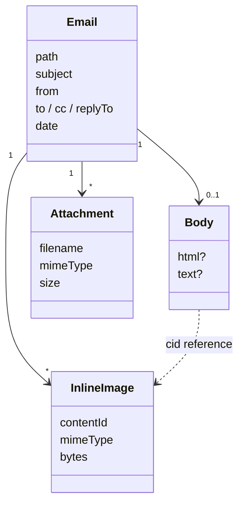

# Domain: email files

## New and changed terms

| Term | Meaning |
|---|---|
| **Email** (new file kind) | A vault file named `*.eml` (any case): one mail in MIME format (RFC 5322). Decided by name after the media table and **before** the text check, so it is an email whether its bytes are UTF-8 or not. Shown read-only in one view; the app never edits it. *Avoid:* mail file, message. |
| **Header block** (new) | The top of an opened email: From, To, Cc, Reply-To (each only if present) and the Date. Addresses show as `Name <address>`. The **subject** is the email's title. |
| **Body** (new) | What the mail says: its HTML part, rendered inert like an HTML page in Read mode, or, when there is no HTML part, its text part with its line breaks. |
| **Inline image** (new) | An image part the HTML body names by `cid:`. Shown in place in the body, not listed as an attachment. |
| **Attachment** (new) | Every other part with a file name or `Content-Disposition: attachment`, incl. a forwarded mail. Shown as a card with name and size; a tap downloads it. Not a vault file: it exists only inside the email. *Avoid:* attached file (a vault file attached to a note is a different thing, #66). |
| **File kind** (changes system term) | System today: note, HTML page, code file, media file, binary file. Now also email. |
| **Write mode / Read mode** (changes system term) | Emails, like code, media and binary files, have no mode. |

## File kinds (changed table)

| Name | Kind |
|---|---|
| `a.md`, `A.MD`, `a.markdown` | note |
| `a.html`, `a.htm` | HTML page |
| `a.eml`, `A.EML` (UTF-8 or not) | **email** (new) |
| `a.mdx`, `a.txt`, `a.py`, `Dockerfile`, `a.unknown` | code file |
| `a.svg`, `a.png` | media file |
| `a.pdf`, `a.zip`, text that isn't UTF-8 | binary file |

