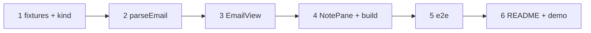

# Plan: viewer for .eml files

One track, each step builds on the one before. E2E steps run against this checkout's stack (`just dev up` first,
`just dev down` when done).

- [x] Synthetic `.eml` fixtures and the `email` file kind (`.eml` before the binary check; `viewMode` → read)
  - Test first: `apps/web/src/lib/lang.test.ts` › kind table rows `a.eml` and `A.EML` with `binary` false and true → `email`; `viewMode('email', 'write', 'write')` → `read` — fails today: `.eml` is `code` (or `binary`). Fixtures (`apps/web/src/lib/fixtures/*.eml`, synthetic) are always read as bytes (`readFileSync`), so `latin1.eml` stays non-UTF-8
  - Verify: `npm -w apps/web test -- lang` → green; `just check` → green
- [x] Add `postal-mime` (exact `4.0.11`) and `lib/email.ts` `parseEmail`
  - Test first: `apps/web/src/lib/email.test.ts` › "alternative: subject, from, to, date, html and text" · "related: the cid image is inline, the PDF is the only attachment" · "plain: text only, no html" · "latin1: umlaut subject and ISO-8859-1 body decode" · "garbage bytes still return a result or throw, never hang" — fails today: the module doesn't exist
  - Verify: `npm -w apps/web test -- email` → green; `just check` → green
- [x] `EmailView`: size check, header block, HTML body (`cid:` → `data:`, then `preparePage`) in the sandboxed frame, text body, attachment download cards, error state
  - Test first: `apps/web/src/components/EmailView.test.tsx` (fake API serving the fixtures) › "related: file name as title while parsing, then the subject; From/To in the header block, frame without allow-scripts, the cid image is a data: URL in srcdoc, the remote image is a link, one PDF card with download" · "a UTF-8 mail is parsed from the text, no GET /raw" · "a binary mail is fetched via HEAD + GET /raw" · "plain: text body keeps line breaks, no frame" · "unparseable: 'This email can't be shown.'" — fails today: the component doesn't exist
  - Verify: `npm -w apps/web test -- EmailView` → green; `just check` → green
- [ ] `NotePane` mounts `EmailView` for `email` (no mode toggle, outline, find, attach or save footer; Delete stays); styles; parser in its own chunk
  - Test first: `e2e/email.spec.ts` › "a .eml opens as a mail: subject, header block, body in a sandboxed frame, no mode toggle" — fails today: the raw MIME source shows in the code view
  - Verify: `just e2e email` → green; `npm -w apps/web run build` → exit 0 and `postal-mime` not in the entry chunk (the script `dist/index.html` references, checked by name after one build: no `PostalMime` in it, but in another chunk); `just check` → green
- [ ] E2E for the rest: inline image, remote image as link, attachment download, Latin-1 mail, phone
  - Test first: `e2e/email.spec.ts` › "the inline image shows and the remote one is a link" · "tapping an attachment downloads it" (Playwright `download` event, file name) · "a Latin-1 mail shows decoded, not 'Binary file'" · "@iphone a mail opens on the phone" — the CSP guard fails the spec on any violation; fails today if any piece is missing
  - Verify: `just e2e email html-pages media` → green (desktop and `@iphone`); `just check` → green
- [x] README (file kinds prose) and demo run book chapter with a synthetic sample mail in the demo vault
  - Test first: none — docs only
  - Verify: `grep -n '\.eml' README.md` matches; `grep -n 'eml' ~/git/karpathy_demo_wiki/'Karpathy Demo.md'` matches and its `updated` is today; the sample `.eml` exists in `~/git/karpathy_demo_wiki` (committed there, pushed only after release)

System docs are updated at `/spec:archive`.
