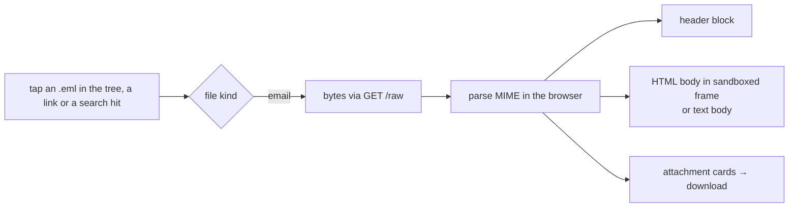

# Proposal: viewer for .eml files

**Issue:** [#166](https://github.com/tillg/karpathy.app/issues/166)

## Why

Vaults hold emails: every mail the ingest service takes in leaves an `original.eml` in its `Input/` item, and
users keep mails in their vaults (one vault has a folder of 138). The app shows images, PDFs and HTML pages
properly, but an `.eml` today opens as raw MIME source in the code view (quoted-printable, base64, boundaries),
or, when a part isn't UTF-8, only as the card "Binary file — can't be edited here". Neither shows the mail.

## What changes

- A new file kind, **email** (`*.eml`, any case), decided by name before the text check, so a mail with Latin-1
  or 8-bit parts gets the viewer too.
- Opening an email shows it the way a mail app does, read-only, in one view (no Write/Read toggle, no autosave):
  - **Subject** as the title (the file name when there is none).
  - A **header block**: From, To, Cc, Reply-To (only those present), Date in the browser's locale.
  - The **body**: the HTML part rendered in the same sandboxed, inert frame as an HTML page's Read mode; inline
    images (`cid:`) show in place; remote images stay links (as in notes and HTML pages); links open in a new tab.
    A mail without an HTML part shows its text part with its line breaks.
  - **Attachments** as cards (name, size); a tap downloads the file. Inline images that the body shows are not
    listed again.
- A mail that can't be parsed shows "This email can't be shown." and the file name, never a crash. A mail bigger
  than the preview limit (50 MB) asks first, as media files do.
- Nothing changes for the backend, the AI or git: the file stays as it is; the app never edits an `.eml`.

## Scope

- In: `.eml` files in any vault folder, on desktop and phone; the README and the demo run book.
- Out: `.msg` (Outlook) files; replying or forwarding; showing the raw source in the app (the AI and git still see
  it); editing; searching inside decoded mail bodies (vault search keeps searching the raw file); opening an
  attachment in the app instead of downloading it; nested forwarded mails (`message/rfc822` parts) beyond an
  attachment card.

## Outcome

Tapping `Input/mail-…/original.eml` or any other `.eml` shows subject, sender, recipients, date, the formatted
body with its inline images, and its attachments, on the phone as on the desktop.
