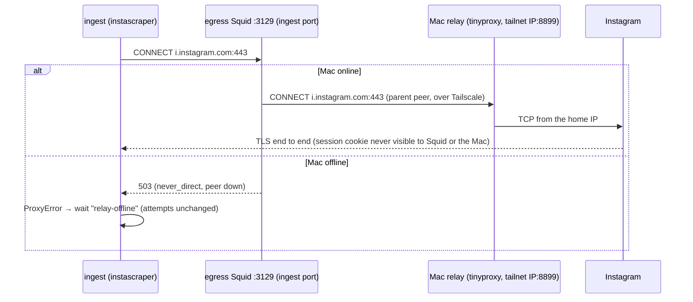

# Architecture: Instagram through the user's Mac

## Overview



The scraper, the session, the activity ledger and the vault writes don't move. Only the network path of the Instagram
hosts changes. That is the whole idea: the smallest change that gives Instagram a residential IP.

## Settings (`packages/settings`, `deploy/settings/`)

- Schema: `ingest.instagram_relay` optional, `z.strictObject({ address: IPv4 in 100.64.0.0/10, port: 1024–65535 })`.
  A tailnet IP, not a MagicDNS name: the egress container resolves through Docker's DNS, which doesn't know tailnet
  names, and a fixed IP keeps Squid's peer stable. Only `hetzner.yaml` (and a developer's own override for the dev
  stack) sets it. Settings test: `dev.yaml` and `prodtest.yaml` have none.
- Renderer: a new output **`egress.conf`**, a Squid include. Without a relay it holds only a comment. With one:

  ```
  acl instagram dstdomain .instagram.com .cdninstagram.com .fbcdn.net
  cache_peer 100.x.y.z parent 8899 0 no-query no-digest no-netdb-exchange connect-timeout=5 connect-fail-limit=2 name=mac
  cache_peer_access mac allow ingest_port instagram
  cache_peer_access mac deny all
  never_direct allow ingest_port instagram
  ```

  The host list comes from one file, `deploy/relay/instagram-hosts`, read by the renderer and by `relay.sh`.
- `.env` gains `INSTAGRAM_ROUTE=relay|direct` for the ingest container (server.py's status). `instagram_relay` shows
  in the settings manifest like other non-secret settings.
- Ansible role `app` writes `shared/egress.conf` next to `ingest.json` (0644, no secrets) and recreates `egress`
  when it changed. Dev and prodtest render it into `tmp/settings/<env>/`.

## Egress proxy (`deploy/egress`)

- `squid.conf` gains a second listening port **`http_port 3129 name=ingest`** and `acl ingest_port myportname ingest`,
  and `include /etc/squid/conf.d/*.conf` after the ACLs and before `http_access allow all`. Every existing rule
  (`internal_dst` deny and so on) applies to both ports unchanged. The relay rules only match `ingest_port`, so
  opencode's web fetches of instagram.com (port 3128) keep going direct and never use the user's Mac.
- `internal_dst` keeps refusing tailnet addresses as **destinations**: the peer address is not a request destination
  (Squid's `dst` ACL checks the requested host), so the relay is reachable only as the configured parent, never as a
  URL the AI or a mail could name.
- Compose: `egress` mounts `${SETTINGS_DIR}/egress.conf` read-only at `/etc/squid/conf.d/relay.conf`
  (`create_host_path: false`). The `ingest` service's `HTTP(S)_PROXY` becomes `http://egress:3129`. Squid 6.12
  (alpine pin) has `cache_peer`, `cache_peer_access`, `never_direct` and `myportname`.
- **Route to the tailnet:** the egress container is on the `egress` bridge; Docker masquerades its traffic and the
  host's Tailscale routes `100.64.0.0/10` through `tailscale0`. The Tailscale policy must let `tag:server` reach the
  Mac on the relay port (`ops` note; the default allow-all policy already does).

## The relay on the Mac (`deploy/relay/`)

- `tinyproxy.conf.tmpl`, rendered by `relay.sh`:

  ```
  Listen <mac tailnet IP>
  Port 8899
  Allow <server tailnet IP>
  ConnectPort 443
  Filter "<dir>/instagram-hosts.ere"
  FilterType ere
  FilterURLs Off
  FilterDefaultDeny Yes
  DisableViaHeader Yes
  LogLevel Notice
  MaxClients 20
  ```

  No `XTinyproxy` header, no `Via`: Instagram must see an ordinary client. The filter is generated from
  `instagram-hosts` (`(^|\.)instagram\.com$` …).
- `relay.sh install <target>`: `brew install tinyproxy` if missing; the Mac's IP from `tailscale ip -4`; the server's
  from `tailscale ip -4 <target host>` (`karpathy` for `hetzner`); renders into
  `~/Library/Application Support/karpathy/relay/`; writes and boots the LaunchAgent
  `~/Library/LaunchAgents/app.karpathy.instagram-relay.plist` (`tinyproxy -d -c …`, `KeepAlive`, `RunAtLoad`; a
  start before Tailscale is up fails to bind and launchd restarts it); prints the `ingest.instagram_relay` block for
  `hetzner.yaml`. `status`: agent loaded, port listening on the tailnet IP, last log lines. `uninstall`: bootout, remove.
  `just relay <action> [target]` calls it. macOS only: it refuses on Linux.
- No authentication beyond Tailscale: a tailnet source address is bound to the peer's WireGuard key, and `Allow`
  admits only the server's. A password on the peer would add a secret to sync between the Ansible vault and the Mac
  for no extra guarantee.

## ingest-email (`tillg/ingest_email`, then `deploy/ingest/ingest-email.ref`)

- `Outcome.wait(reason, login_hint=None)`: status `UNRESOLVED`, flag `counts=False`. `resolve_source` keeps a waiting
  link in `unresolved_links` with its old `attempts` and the new `reason`.
- `resolvers/instagram._classify`: a proxy failure (`requests.exceptions.ProxyError`, or a message containing
  `Tunnel connection failed: 503` / `ERR_CANNOT_FORWARD` / `Cannot connect to proxy`) → `wait("relay-offline")`;
  `night-block` and `no-session` → `wait(...)`. Everything else stays `retry` (counts).
- The humanizer's gate runs before the first request, so a night or a full day ceiling still costs no traffic. The
  first request after the Mac comes back is the session check, through the relay.
- Release a tag, bump `deploy/ingest/ingest-email.ref`.

## Ingest endpoint (`deploy/ingest/server.py`) and backend

- `status()` adds `route` (from `INSTAGRAM_ROUTE`, default `direct`) and `relayWaitingLinks` (links with reason
  `relay-offline`, the same scan as `waitingLinks`). `expired` keeps its meaning (`no-session` after the session file).
- `_error()`: a reason with `ProxyError` / `Tunnel connection failed` / `Cannot connect to proxy` →
  `503 {error: "relay-offline", message: "Your Mac is offline: wake it (Tailscale on) and connect again"}`. The
  backend's `callIngest` passes service errors through as `{ error, code }` already; `relay-offline` is new only to
  the web.
- Backend: no new route; the status type in `apps/backend/src/ingest.ts` (and the web's API type) gains the two
  fields.

## Web (`InstagramSettings.tsx`, Vaults list notice)

- Under the status line: "Fetched through your Mac" when `route === 'relay'`; while `relayWaitingLinks > 0`:
  "Mac offline — N links wait for it". The Connect error shows the service's message.
- The Vaults list's Instagram notice also appears for `relayWaitingLinks > 0` ("Your Mac is offline — N Instagram
  links wait for it"), linking to Secrets & keys.

## Decisions and tradeoffs

| Decision | Why | Rejected |
|---|---|---|
| Move the IP, not the scraper | One session, one ledger, one writer of `Input/`; the server's write rules (atomic renames, only open items) stay true; no vault token on a laptop | Mac runs ingest-email and uploads results (two states, a new write API, big uploads) |
| Squid parent peer, not a Tailscale exit node | Only Instagram hosts, only from the ingest port; an exit node would send all of the server's traffic (Gmail, OpenRouter, GitHub) through the Mac | Server-wide exit node; a Tailscale app connector (needs a Linux node with a public IP: the opposite direction) |
| Fail closed (`never_direct`) | A session hopping between home and data-centre IPs is the flag pattern; waiting is cheap | Fall back to direct when the Mac sleeps |
| Separate Squid port for the ingest service | The AI's `webfetch` of an Instagram page must not use the user's home IP | One port with a `src` ACL (container IPs aren't stable) |
| tinyproxy | In Homebrew, small, has `Listen`/`Allow`/`ConnectPort`/domain filter with default deny | Squid on the Mac (heavier); a hand-written proxy (code to maintain) |
| Tailnet IP in settings | Container DNS doesn't resolve MagicDNS names | Hostname |
| Waits don't count as attempts | A sleeping Mac or the night says nothing about the link | Raising `resolve_max_attempts` (still loses links over a weekend) |

## Risks

- **The Mac's IP changes** (travel, tethering): Instagram sees a session move like a phone does; acceptable. A Mac
  behind a corporate VPN would show the VPN's IP.
- **Mac rarely awake:** links wait; the count in the app makes it visible. Fallback without code change in this
  design: point `instagram_relay` at another always-on home device (a Raspberry Pi runs tinyproxy too) or, later, at a
  commercial residential peer.
- **macOS and the App Store Tailscale:** binding tinyproxy to the tailnet IP must work with the GUI Tailscale
  (Network Extension). The install step checks it with `status`; fallback `Listen 0.0.0.0` plus `Allow` and the macOS
  firewall.
- **Docker → tailnet route** on the Hetzner host (`tailscale0`, policy routing table 52, Docker's masquerade) is
  assumed, not yet tested: plan step 4 checks it on prodtest/dev before anything depends on it.
- **ToS:** unchanged by this design (see proposal); the account can still be flagged. instascraper's pacing stays on.

## Rollout

1. Release with the egress port, the empty include and the new ingest-email ref: behaviour unchanged.
2. On the Mac: `just relay install hetzner`; paste the printed block into `deploy/settings/hetzner.yaml`; deploy.
3. Secrets & keys › Instagram › Reconnect (Disconnect first if a session from the server's IP exists) so the session
   is minted through the Mac.
4. The cutover continues (`deployment.md` › Ingest cutover); its step 4 ("decide on the fallback") is this change.
