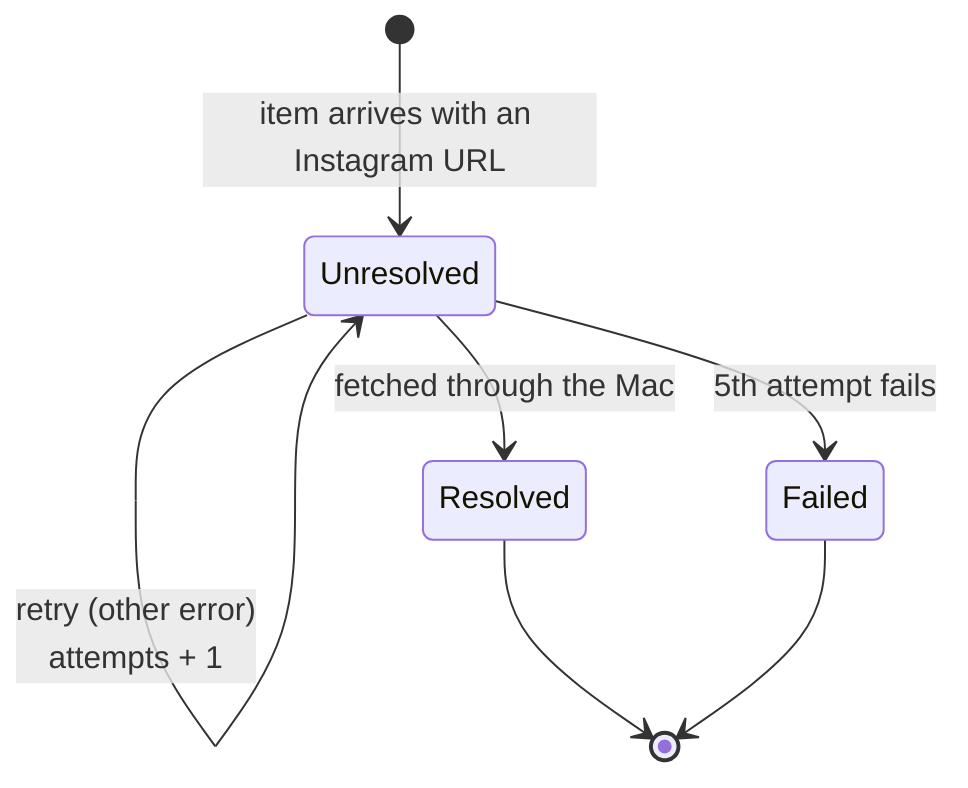
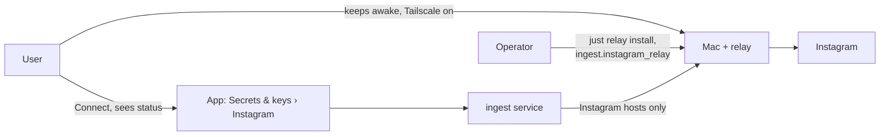

# Domain: Instagram through the user's Mac

## New and changed terms

| Term | Meaning | In code / config |
|---|---|---|
| **Instagram relay** | A forward proxy on the user's Mac that the server's Instagram traffic leaves through, so Instagram sees the Mac's (residential) IP. It forwards TLS tunnels only; it never sees cookies or content. | `deploy/relay/`, launchd agent `app.karpathy.instagram-relay` |
| **Relay address** | The Mac's tailnet IPv4 address and the relay's port, per target. Absent = no relay: Instagram goes out directly, as today. | `ingest.instagram_relay: { address, port }` in `deploy/settings/<target>.yaml` |
| **Instagram hosts** | The host names routed through the relay: `.instagram.com`, `.cdninstagram.com`, `.fbcdn.net` (API, login and media CDN). One list, used by Squid and by the relay's filter. | `deploy/relay/instagram-hosts` |
| **Mac online** | The Mac is awake, on the tailnet and its relay runs. Detected only by trying: a request to an Instagram host fails at once when it isn't. | Squid `503`, ingest-email reason `relay-offline` |
| **Waiting link** *(changed)* | An Instagram link in an item's `unresolved_links` that can't be fetched yet for a reason outside the post: `no-session` or, new, `relay-offline`. A waiting link keeps its attempt count: waiting is not trying. | ingest-email `Outcome.wait(reason)` |
| **Attempt** *(changed)* | A real try to fetch a link that failed for a reason of the link or of Instagram. After 5 attempts the link moves to `failed_links`. Waits no longer count. | `attempts` in `unresolved_links` |
| **Instagram connection** *(changed)* | Gains a **route**: `direct` or `relay`. With a relay, the login and every fetch go through it; Connect fails with `relay-offline` while the Mac is offline. | `GET /instagram/status` › `route`, `relayWaitingLinks` |

## A link's life with the relay

## Who is involved

In this single-user app the user and the operator are the same person; the roles differ in where they act (the app
versus the Mac's terminal and the deploy settings).

## Rules

- **Never direct when a relay is set.** If the Mac is offline, Instagram is not tried from the server's IP. A session
  that alternates between a home IP and a data-centre IP is the pattern Instagram flags.
- **A session is minted where it is used.** With a relay, Connect logs in through the relay. A session made earlier
  directly from the server is replaced by reconnecting once the relay is live.
- **The Mac holds no secrets of the app or of Instagram.** It forwards encrypted tunnels for a fixed host list to one
  tailnet peer.
- **Pacing stays with instascraper** on the server: daily ceilings, active hours (08:00–23:00, the container's
  timezone) and owed idle apply to the backlog the Mac's return releases.
