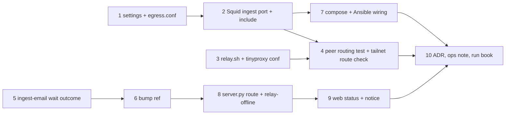

# Plan: Instagram through the user's Mac

Test commands: `npm test -w packages/settings`, `npm test -w apps/backend -- <file>`, `npm test -w apps/web -- <file>`;
shell tests `bash deploy/<…>.test.sh`; the ingest endpoint `bash deploy/ingest/server.test.sh`; ingest-email's own
suite `pytest` in its checkout (`tmp/ingest_email-src` or `~/git/ingest_email`); everything `just check`.

## Settings and egress

- [ ] `ingest.instagram_relay` in the settings schema (tailnet IPv4 + port), rendered into `egress.conf` (Squid include: ACL, `cache_peer`, `cache_peer_access`, `never_direct`, host list from `deploy/relay/instagram-hosts`) and `INSTAGRAM_ROUTE` in `.env`
  - Depends on: none
  - Test first: `packages/settings/test/schema.test.ts` › "instagram_relay takes a tailnet IPv4 and a port" (a public IP, a hostname and port 80 are errors naming `ingest.instagram_relay`), "dev and prodtest have no relay"; `render.test.ts` › "egress.conf is a comment without a relay", "with a relay it routes the Instagram hosts of instagram-hosts to the peer, ingest port only, never direct", ".env carries INSTAGRAM_ROUTE". Fail today: no such key or output.
  - Verify: `npm test -w packages/settings` → all green; `just settings check` → ok
- [ ] Squid: second port `3129 name=ingest`, `ingest_port` ACL, `include /etc/squid/conf.d/*.conf` before the final allow; the existing rules hold on both ports
  - Depends on: 1
  - Test first: `apps/backend/test/egress.test.ts` › "port 3129 refuses metadata, private and tailnet targets like 3128" and "an empty include changes nothing" (container started with an empty `relay.conf`). Fail today: nothing listens on 3129.
  - Verify: `npm test -w apps/backend -- egress` → green
- [ ] The relay on the Mac: `deploy/relay/relay.sh install|status|uninstall <target>`, `tinyproxy.conf.tmpl`, `instagram-hosts`, LaunchAgent `app.karpathy.instagram-relay`, `just relay`
  - Depends on: none
  - Test first: `deploy/relay/relay.test.sh` (stub `tailscale`, `brew`, `launchctl`, `uname` on `PATH`, `HOME` in a temp dir) › renders `Listen <mac ip>`, `Allow <server ip>`, `ConnectPort 443`, `FilterDefaultDeny Yes`, `DisableViaHeader Yes`, a filter matching `i.instagram.com` and `scontent-fra5-1.cdninstagram.com` but not `example.com` or `instagram.com.evil.net`; the plist runs `tinyproxy -d -c`; it prints the `ingest.instagram_relay` block; refuses on Linux. Fails today: no script.
  - Verify: `bash deploy/relay/relay.test.sh` → ok; added to `just check`
- [ ] Peer routing end to end: egress (rendered include pointing at a tinyproxy container built from the rendered relay config) sends Instagram hosts from port 3129 through the peer, other hosts and port 3128 direct; peer stopped → 503, nothing direct
  - Depends on: 2, 3
  - Test first: `apps/backend/test/egress-relay.test.ts` › "CONNECT i.instagram.com via 3129 shows in the relay's log" (online only), "example.com via 3129 does not touch the relay", "i.instagram.com via 3128 does not touch the relay", "relay stopped: 3129 answers 503 for i.instagram.com within 10 s and makes no direct connection" (offline-safe: a hosts entry pointing at a blackhole proves no direct try). Fail today: no peer rules.
  - Verify: `npm test -w apps/backend -- egress-relay` → green; on `karpathy-dev` a prodtest stack with the developer Mac's tailnet IP: `docker compose exec ingest python -c "import httpx; print(httpx.get('https://www.instagram.com/robots.txt').status_code)"` → `200` and the request shows in the Mac relay's log (records that Docker → tailnet routing works)

## ingest-email

- [ ] `Outcome.wait`: a waiting link keeps its attempts; Instagram's proxy failures become `relay-offline`, `night-block` and `no-session` wait too (in `tillg/ingest_email`)
  - Depends on: none
  - Test first: ingest-email `tests/test_resolve.py` › "a wait outcome keeps attempts and sets the reason", "five waits never move a link to failed_links"; `tests/test_instagram.py` › "_classify: ProxyError and 'Tunnel connection failed: 503' → wait relay-offline", "night-block and no-session → wait", "other errors → retry". Fail today: no `wait`, everything counts.
  - Verify: `pytest` in the ingest-email checkout → all green
- [ ] Release the ingest-email tag and bump `deploy/ingest/ingest-email.ref`
  - Depends on: 5
  - Test first: existing `deploy/ingest/run.test.sh` and `server.test.sh` pass before and after
  - Verify: `bash deploy/ingest/fetch-source.sh && bash deploy/ingest/run.test.sh && bash deploy/ingest/server.test.sh` → ok

## Wiring

- [ ] Compose and deploy: `egress` mounts `egress.conf` at `/etc/squid/conf.d/relay.conf`; `ingest` uses `http://egress:3129` and gets `INSTAGRAM_ROUTE`; role `app` writes `shared/egress.conf` and recreates `egress` on change; dev/prodtest render it
  - Depends on: 1, 2
  - Test first: `deploy/ingest/compose.test.sh` › "ingest's HTTP(S)_PROXY is egress:3129", "egress mounts relay.conf read-only, create_host_path false"; `apps/backend/test/ingest-egress.test.ts` › existing confinement cases pass on port 3129. Fail today: port 3128 and no mount.
  - Verify: `bash deploy/ingest/compose.test.sh && npm test -w apps/backend -- ingest-egress` → green; `just dev up` → stack healthy

## Status in the app

- [ ] server.py: `status` gains `route` and `relayWaitingLinks`; a login failing at the proxy answers `503 relay-offline`; backend and web status types gain the fields
  - Depends on: 6
  - Test first: `deploy/ingest/test_server.py` › "route comes from INSTAGRAM_ROUTE, default direct", "relayWaitingLinks counts relay-offline links only", "a ProxyError login → 503 relay-offline with the Mac message"; `apps/backend/test/ingest-routes.test.ts` › "relay-offline passes through as 503 with its code". Fail today: no fields, the error is `login-failed` 502.
  - Verify: `bash deploy/ingest/server.test.sh && npm test -w apps/backend -- ingest-routes` → green
- [ ] Secrets & keys › Instagram shows "Fetched through your Mac" and "Mac offline — N links wait for it"; the Vaults list notice covers relay waits
  - Depends on: 8
  - Test first: `apps/web/src/components/InstagramSettings.test.tsx` › "route relay shows the Mac line", "relayWaitingLinks shows the offline line", "Connect shows the relay-offline message"; the Vaults list test › "notice for relay-waiting links". Fail today: no such lines.
  - Verify: `npm test -w apps/web -- InstagramSettings` → green; `npm test -w apps/web` → all green

## Docs

- [ ] ADR 0006 "Instagram leaves through the user's Mac" (why the IP moves and the scraper doesn't, fail closed); `deployment.md`-bound ops note in `deploy/relay/README.md` (install, Tailscale policy, reconnect); demo run book chapter "Ingest from the inbox" gets the Mac line and a *Try it* step (pushed only after release)
  - Depends on: 4, 7, 9
  - Test first: none — documentation
  - Verify: `test -f docs/adr/0006-instagram-through-the-users-mac.md && grep -q "relay" ~/git/karpathy_demo_wiki/"Karpathy Demo.md"` → exit 0; `just check` → green

System docs are updated at `/spec:archive`.
