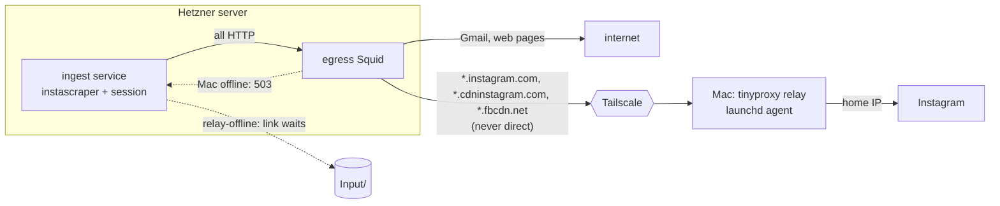

# Proposal: Instagram through the user's Mac

**Issue:** [#168](https://github.com/tillg/karpathy.app/issues/168)

## TL;DR

The browser can't fetch Instagram: CORS, the app's own CSP and Instagram's HttpOnly session cookie all stand in the
way. What actually needs to change is **the IP address Instagram sees**, not where the scraper runs. So the ingest
service keeps scraping on the server as it does today, and its Instagram traffic, and only that, leaves through a
tiny forward proxy on the user's Mac, reached over Tailscale. When the Mac is offline, Instagram links **wait**
instead of failing, and the app says so. Nothing new runs in the browser. The session, the pacing and the scraper
stay in one place on the server. The Mac gets one launchd agent and sees only host names, never cookies.

## Why

The ingest service resolves Instagram links with instascraper (instagrapi's private mobile API, a logged-in
session minted on the server). Instagram challenges and blocks logins and fetches from the Hetzner data-centre IP
(issue #168; listed as a known gap in `specs/system/functional.md` › Gaps › Ingest). Until the cutover, the Mac's
launchd agent (`com.tillg.ingest-email.all`) fetches Instagram from the home IP, and that works. The cutover plan
already names the fallback "only the Instagram resolver on the Mac" (`deployment.md` › Ingest cutover, step 4).
This change is that fallback, cut down to the one thing the Mac really contributes: its residential IP.

The issue asks for the scraping to run "in the client, which is the browser". The research below shows a browser tab
can't do it, and the browser-shaped alternatives (extension, Shortcut) cost far more for a worse result. The issue's
own condition, "only when the Mac is online", is exactly what the relay gives.

## Options considered

| Option | Works? | Effort | Reliability | Security | ToS / account risk | Fit with "browser is the client" |
|---|---|---|---|---|---|---|
| **Fetch from the PWA** (`fetch('https://www.instagram.com/…')`) | **No.** Cross-origin `fetch` can't read a response without CORS headers, and Instagram sends none for our origin. A credentialed request also needs an explicit `Access-Control-Allow-Origin` and third-party-cookie rules still apply (MDN). Our own CSP is `connect-src 'self'`. instagram.com's `sessionid` is HttpOnly on another origin. | — | — | — | — | perfect, but impossible |
| **(a) Mac helper runs the scraper** (ingest-email/instascraper on the Mac polls the backend for waiting links, scrapes, uploads the result) | Yes | **High.** A new backend API to list waiting links and to write items and media (Reels: tens of MB) into `Input/` under the ingest service's write rules; a second copy of ingest-email, ffmpeg and the session on the Mac | Two places hold state (session, activity ledger, retry counts); the Mac needs the vault-side rules too | The Instagram session and a token that writes into vaults live on a laptop | Same as today | Mac, not browser |
| **(a′) Mac relay** (recommended): the server's egress proxy forwards Instagram host names to a forward proxy on the Mac over Tailscale | Yes | **Low.** Squid `cache_peer` + `never_direct` lines, a tinyproxy config + launchd agent, one new "wait" reason in ingest-email | One scraper, one session, one ledger; links wait while the Mac sleeps | The session stays on the server; the Mac sees only TLS `CONNECT` host names; only the server's tailnet node may use the relay, only for Instagram hosts | Same as today (personal use, humanized pacing), now from a residential IP that matches the `de` geo profile | Mac, not browser; the browser keeps the UI (Connect, status) |
| **(b) Browser extension** with `host_permissions` for instagram.com, using the user's own web session | Yes, on desktop Chrome; Safari needs a native app wrapper (Xcode, App Store / TestFlight) | **Very high.** Port the scraper to JavaScript against Instagram's undocumented web GraphQL, download media, upload to the backend; maintain it as Instagram changes | Only while a browser with the extension is open; web endpoints change often | Runs as the user's **main** account with its real cookies | Highest: automated use of the user's own account | Closest to the browser |
| **(b′) iOS Shortcut / share sheet** fetching the post on the phone | Partly. Shortcuts' "Get Contents of URL" has no Instagram cookies, so it gets the logged-out page: a caption snippet and thumbnail, not the Reel. iOS has no Web Share Target for PWAs, so sharing into the app needs a Shortcut anyway | Medium | Poor content | Fine | Low | Phone, not browser |
| **(c) Residential proxy service** as the egress proxy's parent for Instagram | Yes, without the Mac | Low (same Squid lines, a paid peer) | Good, if the provider offers a sticky IP; rotating IPs make a session hop countries and addresses, a strong flag | A third party sees every Instagram host name; credentials for the provider on the server | Shared pool IPs often carry abuse reputation; the providers' own terms vary | Not the client at all |
| **(d) Official APIs** | **No.** Basic Display API ended on 4 Dec 2024. The Instagram Graph API only serves professional accounts' **own** media (plus Business Discovery for other professional accounts' basic data). oEmbed needs a Meta app, returns embed HTML, and using its content "for other purposes is strictly prohibited" | — | — | — | Compliant, but can't read other people's posts | — |
| **(e) Phone share sheet → app with the content** | Only by hand: the Instagram app shares a URL, not the media. A user can save a Reel (when the creator allows it) and attach the file in chat | None | Manual | Fine | None | Phone |

Cost of (c), for the record: residential bandwidth lists at about $8/GB pay-as-you-go (≈ $4/GB with current promos,
$2.50–3.50/GB on monthly plans). At the scraper's own ceiling of 50 posts a day with Reels around 10–30 MB each, the
worst case is tens of dollars a month. It is the fallback if the Mac turns out to be offline too often, and it plugs
into the same Squid peer line.

Every option except (d) is automated collection, which Instagram's Terms of Use forbid ("collecting information in
an automated way without our express permission"). That is already true of the ingest service and of instascraper,
which is why instascraper is deliberately not on PyPI. This change doesn't change that position. It only moves the
traffic to an address where the user's own use doesn't look like a data centre.

## What

- **Instagram relay:** a forward proxy (tinyproxy) on the user's Mac, started by a launchd agent, listening only on
  the Mac's tailnet address, allowing only the server's tailnet address, `CONNECT` to port 443 only, and only for
  `*.instagram.com`, `*.cdninstagram.com` and `*.fbcdn.net`. `just relay install|status|uninstall` sets it up.
- **Egress routing:** when a target sets `ingest.instagram_relay` (the Mac's tailnet address and port), the egress
  proxy sends the ingest service's requests for those host names to the relay and **never directly**. When the Mac
  is offline, such a request fails right away (Squid answers 503). Other traffic (Gmail, web pages, opencode) is
  unchanged.
- **Links wait for the Mac:** ingest-email classifies that failure as `relay-offline` and keeps the link open
  **without** counting an attempt, like a missing session. They are fetched within a minute or two of the Mac coming
  back, paced by instascraper as today.
- **Login through the Mac too:** Connect in admin mode › Secrets & keys › Instagram goes through the relay as well,
  so the session is minted on the residential IP. With the Mac offline, Connect says "Your Mac is offline: wake it
  (Tailscale on) and connect again".
- **Status in the app:** Secrets & keys › Instagram adds "Fetched through your Mac" when a relay is configured, and
  "Mac offline — N links wait for it" while links wait with `relay-offline`. The Vaults list's Instagram notice
  covers it too.

## Scope

**In (v1):** the settings key and its rendering into an egress include file; the Squid peer rules for the ingest
service; the relay config, launchd agent and `just relay` recipe on the Mac; ingest-email's `relay-offline` wait
(and the same no-count wait for `no-session`, a cutover prerequisite already listed, and for `night-block`, which
today burns a link's 5 attempts in 5 one-minute polls after 23:00); server.py's `relay-offline`
error and status count; the line in Secrets & keys; ADR 0006; the deployment ops note; the demo run book.

**Out:** running any scraping in the browser; a browser extension; iOS as the relay (an iPhone can't run a forward
proxy, and a Tailscale exit node would carry all of the server's traffic); a commercial residential proxy (a later
setting on the same peer line); routing YouTube or other blocked sites through the relay (the host list can grow
later); a fallback to direct traffic when the Mac is offline (on purpose: a session that hops between a home IP and a
data centre is what gets flagged); several relays or several users.

## Outcome

Instagram posts and Reels mailed to the ingest label land in `Input/` on the server, fetched from the user's home IP
whenever the Mac is awake, with no scraper, session or vault access on the Mac. When the Mac sleeps, the app shows
what waits for it, and nothing is lost.

## Sources

- MDN, [Cross-Origin Resource Sharing (CORS)](https://developer.mozilla.org/en-US/docs/Web/HTTP/Guides/CORS): scripts'
  cross-origin requests follow the same-origin policy; credentialed requests need an explicit origin; third-party
  cookie policies still apply.
- Chrome for Developers, [Cross-origin network requests](https://developer.chrome.com/docs/extensions/develop/concepts/network-requests):
  an extension's service worker may call hosts it has host permissions for; content scripts may not.
- MDN, [`share_target`](https://developer.mozilla.org/en-US/docs/Web/Progressive_web_apps/Manifest/Reference/share_target):
  experimental, not Baseline (no Safari support).
- Meta, [Update on Instagram Basic Display API](https://developers.facebook.com/blog/post/2024/09/04/update-on-instagram-basic-display-api):
  ends 4 Dec 2024.
- Meta, [Instagram oEmbed](https://developers.facebook.com/docs/instagram-platform/oembed/): embedding only, 1,000
  requests/hour, other use of its content prohibited.
- Instagram, [Terms of Use](https://help.instagram.com/581066165581870): no automated collection without express
  permission.
- Squid, [`never_direct`](https://www.squid-cache.org/Doc/config/never_direct/) and
  [`cache_peer_access`](https://www.squid-cache.org/Doc/config/cache_peer_access/).
- [tinyproxy documentation](https://tinyproxy.github.io/): `Listen`, `Allow`, `ConnectPort`, `Filter`,
  `FilterType`, `FilterDefaultDeny`.
- Tailscale, [Exit nodes](https://tailscale.com/kb/1103/exit-nodes): an exit node carries all of a client's traffic;
  macOS nodes must be kept awake.
- Residential proxy prices (third-party summaries, August 2026): [casrai.org](https://casrai.org/guides/bright-data-pricing),
  [proxidize.com](https://proxidize.com/blog/bright-data-pricing/).
- In this repo: `deploy/ingest/server.py`, `deploy/egress/squid.conf`, `specs/system/architecture.md` › Ingest
  service and › Instagram connection, `deployment.md` › Ingest cutover. ingest-email:
  `src/ingest_email/resolvers/instagram.py`, `resolve.py`. instascraper: `README.md` › Humanization.
