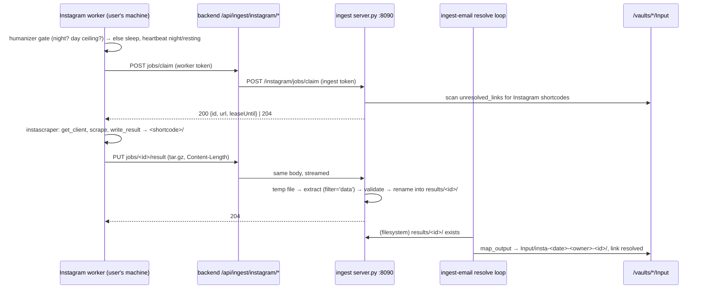

# Architecture: Instagram scraper worker

## Overview

Three parts change on the server (the ingest service's `server.py`, ingest-email, the backend's routing) and one
part is new (the worker). The vault-writing path, ingest-email's `map_output`, stays exactly as it is.

## Instagram worker (`tools/instagram-worker/`)

- **Package:** `pyproject.toml`, src layout, package `karpathy_instagram_worker`, console script
  `karpathy-instagram-worker`, `requires-python >= 3.11` (`tomllib`). Dependencies: only
  `instascraper @ git+https://github.com/tillg/instascraper@v1.1.0`, the same tag as `deploy/ingest/Dockerfile`'s
  `INSTASCRAPER_REF`. HTTP uses the stdlib (`urllib.request`, `http.client` for the streamed upload). Installed with
  `pipx install "git+https://github.com/tillg/karpathy.app@v<release>#subdirectory=tools/instagram-worker"`.
- **Config** `~/.config/karpathy-instagram-worker/config.toml`, mode 0600: `server` (e.g. `https://karpathy.<domain>`),
  `token`, `name` (default: the short host name), `poll_interval_s = 60`. `KARPATHY_WORKER_CONFIG` overrides the
  path (tests).
- **Modules:** `config.py` (load, save, validate), `client.py` (the job API), `upload.py` (tarball + streamed PUT),
  `scrape.py` (instascraper calls and error mapping), `loop.py` (one step, the loop), `service.py` (launchd /
  systemd), `cli.py` (argparse).
- **Commands:**
  - `configure [--server URL] [--token T] [--name N]`: asks for what is missing (the token with `getpass`), checks it
    with one heartbeat (`state: idle`, message `configured`), writes the config.
  - `login [--username U] [--browser safari|chrome|firefox]`: without `--browser`, instascraper's
    `login_interactive_free(username, password, code)`, with the password from `getpass` and the 2FA/challenge code
    read from stdin by the `code` callback. That works over SSH on a headless box. With `--browser` (desktops),
    instascraper's browser-cookie session. It remembers `IG_USERNAME` in instascraper's own
    `~/.config/instascraper/.env`, as `server.py` does for the server.
  - `doctor`: Python version, instascraper importable and its version, config present and 0600, the server reachable
    with the token (heartbeat), an Instagram session file present, `ffmpeg` on `PATH` (optional, for Reels), the
    service installed and running. Prints one line per check and exits 1 if a required one fails.
  - `once`: one loop step, then exit (exit 0 also for "no job").
  - `run`: the loop (below), until SIGTERM.
  - `service install|uninstall|status`, `version`.
- **Loop step** (`loop.step()`, all sleeps and clocks injected for tests):
  1. Open the account's `ActivityLedger(activity_path(username))` and build
     `Humanizer(BehaviorProfile(), ledger=ledger)` (one per job, as instascraper's CLI does per run).
     `humanizer.gate("post")`: on `STOP`, heartbeat `night` or `resting` with the gate's reason, sleep until the gate
     reopens (at most 30 min), claim nothing.
  2. Claim. On 204, heartbeat `idle` and sleep `poll_interval_s`.
  3. Heartbeat `scraping`. `get_client(humanizer=…)`, `scrape(…)`, `write_result(…)` into a temp dir.
  4. Upload `<shortcode>/` (below). On 204, pace with instascraper's `pace_between_posts` and go on.
- **Error mapping** (as instascraper's `cli.py` handles them):

  | Raised | Worker does | State |
  |---|---|---|
  | `MediaNotFound`, `ClientNotFoundError`, unknown shortcode | `failure {permanent: true}` | `idle` |
  | `LoginRequired`, `ClientLoginRequired`, `ChallengeRequired`, `SystemExit` from `get_client` | `release`, sleep 10 min | `needs-login` (message: "run karpathy-instagram-worker login") |
  | `PleaseWaitFewMinutes`, `ClientThrottledError`, HTTP 429 | `release`, sleep 30 min | `rate-limited` |
  | upload answered 413 or 422 | `failure {permanent: true, reason: <server message>}` | `idle` |
  | any other exception | `failure {permanent: false, reason: "<Type>: <message>"[:200]}` | `error`, then `idle` |
  | server unreachable / 5xx | keep the job, retry the call with backoff (1, 2, 5 min); the lease may lapse, which is fine | `error` (local log only) |
  | 401 from the server | stop the loop with "worker token rejected: run configure" (the service manager restarts it later) | — |

- **Upload:** `tarfile` gzip of the files directly inside `<shortcode>/` (flat, no directory entries, no links) into
  a temp file. Then a streamed `PUT` with `Content-Type: application/gzip` and `Content-Length`, read in 1 MiB chunks.
  The worker refuses locally (permanent failure) anything over 500 MB or over 40 files, so it never sends what the
  server would refuse.
- **Service:**
  - macOS: `~/Library/LaunchAgents/app.karpathy.instagram-worker.plist` (`ProgramArguments`: the absolute path of the
    pipx-installed command, `run`; `RunAtLoad`, `KeepAlive`; `StandardOutPath`/`StandardErrorPath` in
    `~/Library/Logs/karpathy-instagram-worker/`), loaded with `launchctl bootstrap gui/<uid>`, removed with
    `launchctl bootout`. A LaunchAgent runs only while the user is logged in, which is what a laptop wants.
  - Linux: `~/.config/systemd/user/karpathy-instagram-worker.service` (`ExecStart=<abs path> run`,
    `Restart=always`, `RestartSec=60`), `systemctl --user daemon-reload` + `enable --now`. On a headless box the guide
    adds `loginctl enable-linger <user>`.
  - `status`: loaded/active, PID, the last 20 log lines (`log show` is not needed: the log files on macOS,
    `journalctl --user -u … -n 20` on Linux).

## Job API

Public routes (backend, behind Caddy, prod tailnet-only) and the ingest service's internal ones are one-to-one; the
backend adds auth and streaming, nothing else.

| Public route | Internal route (`server.py`) | Request | Answers |
|---|---|---|---|
| `POST /api/ingest/instagram/jobs/claim` | `POST /instagram/jobs/claim` | `{name}` | `200 {id, url, leaseUntil}` · `204` no job · `409 {error: "not-worker-mode"}` in local mode |
| `PUT /api/ingest/instagram/jobs/:id/result` | `PUT /instagram/jobs/:id/result` | `application/gzip`, `Content-Length` required | `204` stored (or a result already exists) · `400 bad-id` · `404 unknown-job` (not wanted, no lease, no result) · `411 length-required` · `413 too-large` (> 500 MB) · `422 invalid-result {message}` |
| `POST /api/ingest/instagram/jobs/:id/failure` | `POST /instagram/jobs/:id/failure` | `{reason ≤ 200 chars, permanent: bool}` | `204` · `400` · `404 unknown-job` |
| `POST /api/ingest/instagram/jobs/:id/release` | `POST /instagram/jobs/:id/release` | — | `204` (also with no lease) |
| `POST /api/ingest/instagram/worker/heartbeat` | `POST /instagram/worker/heartbeat` | `{name, version, state, message?}` | `204` · `400` (unknown state, name not `^[A-Za-z0-9._-]{1,64}$`) |
| `GET /api/ingest/instagram` (existing, main token only) | `GET /instagram/status` | — | adds `source`, `workers`, `queue` (below) |

- `:id` is a shortcode, `^[A-Za-z0-9_-]{5,40}$`. Anything else is `400 bad-id` before it touches a path.
- `url` in a job is always `https://www.instagram.com/p/<id>/` (it serves Reels too).
- Job routes in local mode: claim answers 409, and result/failure answer `404 unknown-job` (nothing is wanted). A
  worker pointed at a local-mode server heartbeats and idles.

## Backend (`apps/backend/src/`)

- **Worker router** (`ingest-worker.ts`): an `express.Router` mounted with `app.use('/api/ingest/instagram', …)`
  **before** `app.use('/api', api)`. It handles exactly `POST /jobs/claim`, `PUT /jobs/:id/result`,
  `POST /jobs/:id/failure`, `POST /jobs/:id/release` and `POST /worker/heartbeat`. Every other path calls `next()`
  and falls through to the main router and its `bearerAuth`, so the worker token is refused everywhere else.
- **Auth:** `bearerAuthAny([workerToken, mainToken])` in `auth.ts`: the same constant-time comparison as
  `bearerAuth`, against each token. Without a configured worker token, only the main token works on these routes.
- **JSON routes** use `express.json({ limit: '16kb' })` and a small `forwardIngest(ep, req, res, path)` that passes
  the ingest service's status and body through (204 included). `callIngest`'s rules stay: unreachable → `503
  ingest-down`, an ingest 401/403 → `502 ingest-auth`.
- **Result route** streams: `fetch(\`${ep.url}/instagram/jobs/${id}/result\`, { method: 'PUT', body: req, duplex:
  'half', headers: { Authorization, 'Content-Type': 'application/gzip', 'Content-Length': req.headers['content-length'] } })`.
  No body parser, no buffering, a 10-minute timeout. A request without `Content-Length` gets `411` from the backend
  itself (chunked uploads are not supported). The answer is passed through.
- **Settings:** `settings.json` gains `ingest: { worker_token: { file: /run/secrets/ingest_worker_token } }`
  (optional). `loadBackendSettings` reads it into `workerToken`; `main.ts` passes it to `createApp`.
- **Status type:** `InstagramStatus` in `packages/shared` gains `source: 'local' | 'worker'`,
  `workers?: {name, version, state, message?, lastSeen}[]` and
  `queue?: {waiting, leased, backingOff, ready, failed}`.

## Ingest service (`deploy/ingest/server.py`)

- `Handler.protocol_version = "HTTP/1.1"`: every answer already sets `Content-Length`. A request body is read only up
  to its `Content-Length`, so keep-alive is safe.
- **Mode:** `INGEST_INSTAGRAM_SOURCE` (`local` default | `worker`) from the environment.
- **Job scan** (`jobs()`): the existing `Input/*/index.md` walk, collecting shortcodes of `unresolved_links` URLs with
  ingest-email's regex `instagram\.com/(?:p|reel|reels|tv)/([A-Za-z0-9_-]+)`. A claim takes the oldest wanted
  shortcode (by the item's mtime) that has no live lease, no result, no permanent marker and no running backoff, and
  leases it for 30 minutes to the claimer's name. All under `svc.lock`.
- **Result upload:** `Content-Length` missing → 411; > 500 MB → 413 without reading the body. The body is copied in
  1 MiB chunks to a temp file under `/state/instagram/incoming/` (removed in `finally`), then
  `tarfile.open(mode='r:gz').extractall(staging, filter='data')` into a staging dir on the same filesystem. Then it is
  validated: either flat files or one directory level `<shortcode>/` (flattened); at most 40 files; every name
  matches `^[A-Za-z0-9._-]+$` and is not `.`/`..`; regular files only; `metadata.json` (valid JSON, `shortcode` equal
  to the job id) and `post.md` present. Then `os.replace(staging, results/<id>)`. Any failure → 422 with a message
  naming the rule; a `tarfile` error → 422. The job must be wanted or leased; if `results/<id>/` already exists → 204
  at once (idempotent; a lease is not required, so a late upload after a lapsed lease still counts). Success removes
  a non-permanent failure marker and the lease.
- **Failure:** reads or creates `<id>.failed.json`, `count += 1`, `reason`, `at = now`;
  `permanent = permanent or count >= 5`. Written atomically (temp + replace). Ends the lease.
- **Backoff:** a non-permanent marker blocks claims until `at + min(count, 24) h`.
- **Heartbeat:** `workers[name] = {name, version, state, message, lastSeen}` in memory, written to
  `/state/instagram/workers.json` (atomic) at most once a minute per worker and on every state change; loaded at start.
- **Pruning:** on each claim, at most once an hour: result dirs and markers older than 7 days (mtime), workers not
  seen for 30 days.
- **Status** in worker mode: `source: "worker"`; `waitingLinks` = unresolved Instagram links by URL (not by reason);
  `workers` (seen in the last 30 days, newest first); `queue` = `{waiting, leased, backingOff, ready, failed}` by
  shortcode. `state` stays (`not-connected` unless a server session exists), and `expired` is computed only in local
  mode. Local mode is unchanged, plus `source: "local"`.
- Dockerfile: no change (`/state` is the existing volume; `server.py` creates `/state/instagram/*` with mode 0700).

## ingest-email (`tillg/ingest_email`, then `deploy/ingest/ingest-email.ref`)

- `Outcome.wait(reason)` in `resolvers/base.py`: status `UNRESOLVED`, `counts=False`. `resolve_source` keeps a
  waiting link in `unresolved_links` with its old `attempts` and the new `reason`.
- `resolve_source` writes `index.md` only when `unresolved_links`, `resolved_links`, `failed_links` or the body
  changed, so `updated` doesn't churn every minute while links wait. In local mode every retry changes `attempts`, so
  `server.py`'s `expired` check (which reads the item's mtime) keeps working.
- New profile settings: `instagram_source` (`local` default) and `instagram_results_dir`. `run.sh`'s `render()` sets
  `instagram_results_dir` to `$STATE/instagram/results` for every profile. That is container wiring, not a setting.
- `resolvers/instagram.resolve` in worker mode, after the shortcode check and before any instascraper import:
  `<dir>/<code>/` exists → `map_output(...)` into `index.unique_folder(...)`, as today → `as_source` (the result dir
  stays: `server.py` prunes it). `<dir>/<code>.failed.json` with `permanent: true` → `give_up(reason)`; with
  `permanent: false` → `wait(reason)`; nothing → `wait("worker")`. It never imports instascraper and never counts.
- Release a tag; bump `deploy/ingest/ingest-email.ref`.

## Settings, secrets, compose, Ansible

- **Schema** (`packages/settings/src/schema.ts`): `ingest.worker_token: secretRef.optional()`; a cross-field rule:
  `ingest.defaults.instagram_source` is `local` or `worker`, and no profile's `settings` sets it (one mode per
  service). `settings.yaml` declares `worker_token: { secret: ingest_worker_token }` and `instagram_source: local`.
  `hetzner.yaml` and `dev.yaml` set `defaults.instagram_source: worker`.
- **Renderer** (`render.ts`): `ingest_worker_token` joins `COMPOSE_SECRETS`; `renderBackendSettings` writes
  `ingest.worker_token`; `renderComposeEnv` writes `INGEST_INSTAGRAM_SOURCE`; `SECRET_INFO` names it
  `{component: 'backend', purpose: 'Instagram worker token'}` (before the generic `^ingest\.` entry). The ingest
  config keeps `instagram_source` in `defaults`, which reaches ingest-email.
- **Generated like `ingest_token`:** `deploy/dev.sh` and `just prodtest up` (`openssl rand -hex 24`), Ansible role
  `app` › "Ingest secrets" loop. `render-settings.sh` puts a placeholder into its temp store, as it does for
  `opencode_password`, so the manifest shows the generated secret as set.
- **Compose** (`deploy/compose.yml`): top-level secret `ingest_worker_token: { file: ./secrets/ingest_worker_token }`;
  the backend gets it (the ingest container doesn't: it never sees the worker token); `ingest.environment`
  gets `INGEST_INSTAGRAM_SOURCE: ${INGEST_INSTAGRAM_SOURCE:-local}`. `compose.prodtest.yml` maps the file like
  `ingest_token`.
- **`just instagram-worker-token <target>`** → `deploy/ansible/worker-token.sh`: `dev` prints this checkout's
  `deploy/secrets/ingest_worker_token`; `prodtest` prints `tmp/prodtest/secrets/…`; `hetzner` runs
  `ssh ops@karpathy sudo cat /opt/karpathy.app/shared/secrets/ingest_worker_token`. It prints the token to stdout
  (the worker host may be another machine than the Mac with the clipboard).

## Web (`apps/web/src/components/InstagramSettings.tsx`)

- `source === 'worker'`: instead of the Connect form, "Scraped by your worker(s)" with one row per worker: name, "last
  seen 3 min ago", state and message. `needs-login` is highlighted with "run `karpathy-instagram-worker login` on
  *name*". Below that, the counts "N waiting · N in progress · N backing off · N failed", a warning when two or more
  workers were seen in the last hour ("one Instagram account per worker"), and a link "Set up a worker" to
  `https://github.com/tillg/karpathy.app/blob/main/docs/instagram-worker.md`. The worker token's row is the
  existing Secrets table's (manifest), which only shows whether it is set.
- `InstagramNotice` (Vaults list): in worker mode "N Instagram links wait for a worker" when `waitingLinks > 0` and
  no worker was seen in the last hour, and "Instagram needs a login on *name*" when a worker reports `needs-login`.
  Local mode keeps the `expired` notice.

## Docs

- `docs/instagram-worker.md`: what it is; prerequisites (Tailscale on the worker host, because prod's proxy binds to
  the tailnet IP only; Python 3.11+; pipx; ffmpeg optional); on the Mac first `launchctl bootout
  gui/$(id -u)/com.tillg.ingest-email.all`; install with pipx from the release tag; `configure` (server URL, token from
  `just instagram-worker-token hetzner`, name); `login`; `doctor`; `once`; `service install`; status and logs;
  troubleshooting (needs-login, rate-limited, token rejected, nothing claimed in local mode); upgrade
  (`pipx install --force …@<new tag>`, `service install` again); uninstall; the one-account-per-worker rule.
- README › Ingest links to it; the app's Instagram panel links to it.
- ADR `docs/adr/0006-instagram-scraped-by-a-worker.md`.
- Demo run book chapter 17 (Ingest from the inbox): the worker line and a *Try it* step.

## Key decisions

| # | Decision | Alternatives | Why |
|---|---|---|---|
| D1 | The worker PUTs a tar.gz; the backend **streams** it to `server.py` (`duplex: 'half'`, `Content-Length` passed on); `server.py` speaks HTTP/1.1, caps at 500 MB, writes chunks to a temp file, extracts with `filter='data'`, validates, renames atomically. Oversize/invalid → 413/422, reported by the worker as a permanent failure | `express.raw` (500 MB in RAM); multipart (more parsing, no gain); mounting the ingest state into the backend (a second writer) | The backend stays thin and never touches the ingest volume; untrusted parsing stays in the ingest sandbox |
| D2 | ingest-email gains `Outcome.wait`, skips unchanged rewrites, and an `instagram_source: local\|worker` resolver that reads the dropbox | `server.py` writes items and edits frontmatter (duplicates `map_output`, races the resolve loop) | Naming, tags, dedup and the per-profile lock stay in one place; one writer of `Input/` |
| D3 | Deploy secret `ingest_worker_token` on a separate router mounted before `bearerAuth`; it accepts the worker or the main token; login/disconnect/code stay main-token only | UI-created hashed token (much more code); the main token (too powerful for a laptop) | A stolen worker token can only claim jobs and upload results; reuses the manifest and the Ansible flow |
| D4 | One `Humanizer` with the account's `ActivityLedger` per job; gate **before** claiming; pace between jobs | Gate after claiming (holds leases at night); no ledger (loses day ceilings across restarts) | Same pacing as instascraper's CLI; a resting worker holds nothing |
| D5 | One Instagram account per worker; the UI warns about two workers active within an hour; no locking | A server-side account registry with locks | Single user; a warning is enough |
| D6 | Failure markers `{reason, permanent, at, count}` in the dropbox; backoff `min(count, 24)` h; permanent after 5 (amended); pruned after 7 days | Count attempts in the frontmatter (retry storm, per-marker bookkeeping) | One counter per post across vaults; protects the account |
| D7 | Error mapping like instascraper's `cli.py`: not found → permanent; login/challenge → `needs-login`, release, sleep 10 min; rate limit → release, `rate-limited`, sleep 30 min; other → non-permanent. `login` via `login_interactive_free` (works headless), `--browser` optional | Shelling out to the `instascrape` CLI (loses typed errors) | Typed errors decide whether the post or the worker is the problem |
| D8 | `server.py` reads `INGEST_INSTAGRAM_SOURCE`; status adds `source`, `workers` (persisted to `workers.json`) and `queue`; `waitingLinks` by URL in worker mode; `expired` only in local mode | Reading the mode from `ingest.json` | Mode is a container fact for the endpoint; workers survive a restart |
| D9 | Leases in memory, 30 min; result PUT idempotent and lease-agnostic | Persisted leases | A restart freeing leases is harmless; a late upload is still useful |
| D10 | Job = `{id: shortcode, url: https://www.instagram.com/p/<id>/}`; dedup by shortcode across vaults | Mail URLs as jobs | Mail URLs (tracking parameters, share links) never leave the server; one scrape per post |
| D11 | `instagram_source` in `ingest.defaults` (hetzner and dev: `worker`); results dir fixed at `/state/instagram/results` | A per-profile mode; a configurable dir | One mode per service; the dir is container wiring |
| D12 | Tests: worker pytest (fake server, stubbed instascraper); `test_server.py`; backend route tests (streaming, auth scope); web component tests; one e2e spec playing the worker over HTTP | A real Instagram in CI | Everything but Instagram itself is tested; no account risk in CI |
| D13 | Setup guide `docs/instagram-worker.md` (Tailscale, pipx, stop the old agent, configure, login, service, troubleshooting, uninstall), linked from README and the app | Only `--help` | The user asked for good setup documentation |
| D14 | Python package in this repo, pipx from a git tag subdirectory, stdlib HTTP, config TOML 0600, launchd / systemd user service | A Docker image (heavy on a Mac, awkward interactive login); a separate repo | Calls instascraper as a library like ingest-email; native supervisors |
| D15 | Worker list, counts, guide link and warnings in Secrets & keys › Instagram; Connect hidden in worker mode; Vaults-list notice for "no worker for an hour" and `needs-login` | A separate admin section | The place users already look for Instagram |
| D16 | Delete `instagram-mac-relay`; its options table moves here with (a) chosen and (a′) rejected | Keep it as a fallback change | Two open changes for one problem confuse `/spec:overview`; history keeps it |

## Risks

- **No worker awake:** links wait indefinitely. Visible in the app (notice after an hour). Fallback without code
  change: a second worker on an always-on home device (Raspberry Pi, NAS).
- **Two workers, one account:** Instagram sees one account on two devices at once. Mitigated by the warning and the
  guide's rule; not enforced.
- **Dropbox disk use:** at most a day's ceiling (≈ 50 posts × ≤ 60 MB) per 7 days, ~20 GB worst case. Pruning keeps it
  bounded; the 500 MB cap stops a single runaway upload.
- **A malicious upload** (stolen worker token): `filter='data'`, name rules, 40 files and 500 MB limit what lands.
  Content reaches the vault only as an Instagram item that the user reviews in `/ingest`. The token can't read
  anything.
- **Dev in worker mode:** the dev stack's fake server login (`INGEST_FAKE_INSTAGRAM_LOGIN`) is no longer reachable from
  the UI. Its e2e spec `e2e/instagram.spec.ts` is replaced by the worker spec. Local mode stays covered by
  `test_server.py` and the component tests.
- **ToS:** unchanged (see the proposal); the account can still be flagged. instascraper's pacing stays on.

## Rollout

1. Release with everything in, `hetzner.yaml` still `instagram_source: local`: behaviour unchanged. The deploy
   generates `ingest_worker_token`.
2. On the Mac: `launchctl bootout gui/$(id -u)/com.tillg.ingest-email.all` (the old agent scrapes Instagram from
   the same account and would compete), and remove its plist.
3. `just instagram-worker-token hetzner`; then, per the setup guide: `pipx install …`, `karpathy-instagram-worker
   configure`, `login`, `doctor`, `once`, `service install`.
4. Set `ingest.defaults.instagram_source: worker` in `hetzner.yaml`; deploy. Links that wait with
   `no-session` today become jobs; the server's own Instagram session is no longer used (Disconnect it).
5. Watch Secrets & keys › Instagram for a day; then close #137 and #168.
