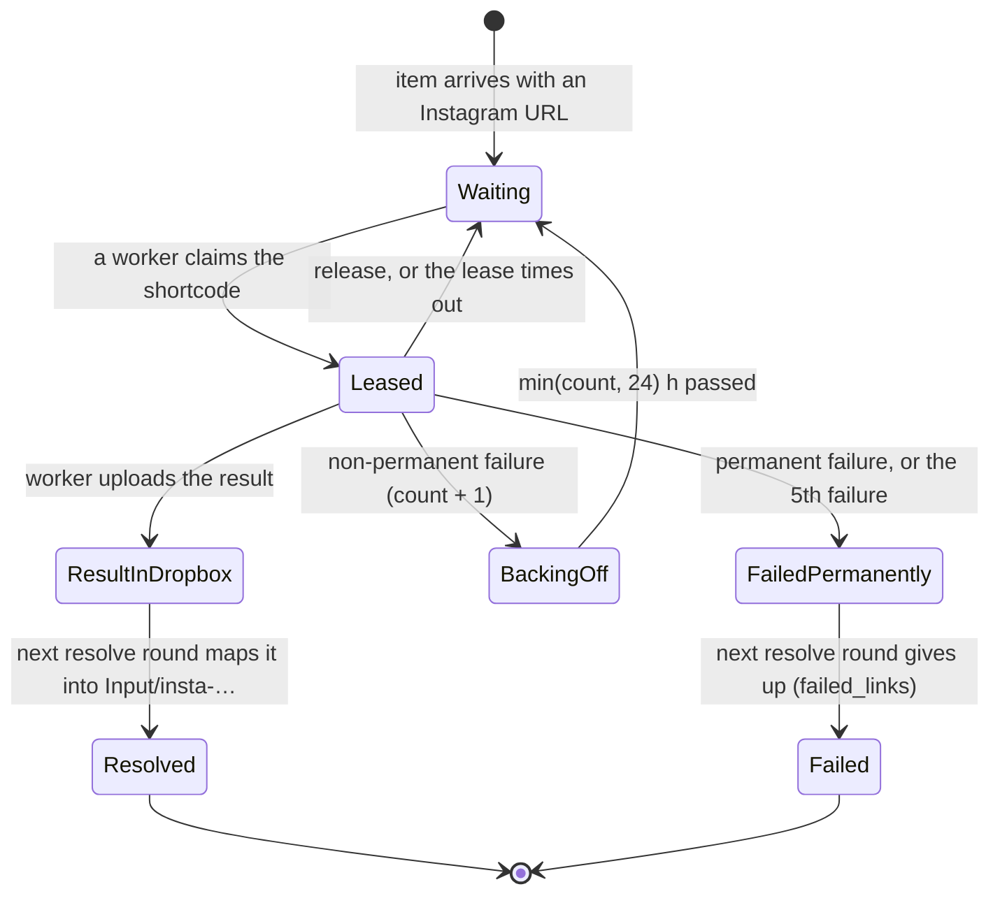
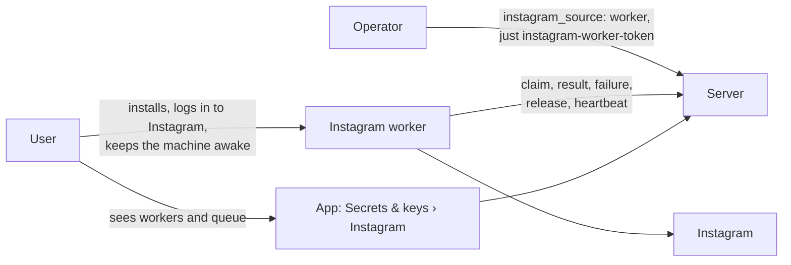

# Domain: Instagram scraper worker

## New and changed terms

| Term | Meaning | In code / config |
|---|---|---|
| **Instagram worker** | A service on a user's machine (macOS or Linux, home IP) that scrapes Instagram posts for the server, one at a time, with instascraper and its own Instagram session. It talks to the server only over HTTPS, as a client. A worker has a **name** (default: the host name) and exactly one Instagram account. | `tools/instagram-worker/`, command `karpathy-instagram-worker`, LaunchAgent `app.karpathy.instagram-worker`, systemd user unit `karpathy-instagram-worker.service` |
| **Instagram source** | Where the ingest service gets Instagram posts: `local` (today: ingest-email scrapes on the server) or `worker` (from the results dropbox). One value per target, for all profiles. | `ingest.defaults.instagram_source` in `deploy/settings/`; `INGEST_INSTAGRAM_SOURCE` for `server.py`; ingest-email profile setting `instagram_source` |
| **Job** | "Scrape this post." Derived on every claim from the vaults' `Input/*/index.md` `unresolved_links`, never stored. Identified by the post's **shortcode**, so the same post mailed into two vaults is one job. The worker sees only `{id, url}` with a URL rebuilt from the shortcode; the mail's own URL never leaves the server. | `server.py` job scan; `{ id, url, leaseUntil }` |
| **Wanted** | A shortcode is wanted while some item in some vault has it in `unresolved_links` and there is no result in the dropbox and no permanent failure marker. | `server.py` |
| **Lease** | A claimed job belongs to one worker for 30 minutes. Others don't get it meanwhile. A lease ends with a result, a failure, a release or the timeout. Leases live in `server.py`'s memory: a restart frees them all, which is harmless. | `server.py` `leases` |
| **Result** | A scraped post: instascraper's `<shortcode>/` directory (`post.md`, `metadata.json`, media), uploaded as a tar.gz and kept in the **dropbox** for 7 days, so another vault's mail with the same link reuses it. | `/state/instagram/results/<shortcode>/` (ingest container) |
| **Failure marker** | What the server knows about a post that couldn't be scraped: `{reason, permanent, at, count}`. A non-permanent failure blocks the job for a **backoff** of `min(count, 24)` hours; the 5th makes it permanent. Pruned after 7 days. | `/state/instagram/results/<shortcode>.failed.json` |
| **Release** | The worker gives a claimed job back without a verdict on the post (no session, night, rate limit). Counts nothing. | `POST …/jobs/:id/release` |
| **Heartbeat** / **worker state** | Every poll and every state change the worker reports `{name, version, state, message}`. States: `idle`, `scraping`, `night`, `resting` (day ceiling or pacing), `needs-login`, `rate-limited`, `error`. The server keeps the last heartbeat per name (persisted), so the app can say who scrapes and when it was last seen. | `POST …/worker/heartbeat`; `/state/instagram/workers.json` |
| **Worker token** | A deploy secret that is valid only on the job and heartbeat routes. It can't read or write a vault, chat, or change settings. One token for all workers of a target. | secret `ingest_worker_token`, settings `ingest.worker_token` |
| **Waiting link** *(changed)* | An Instagram link in `unresolved_links` that can't be resolved yet for a reason outside the post: in worker mode, `worker` (no result yet) or the reason of a non-permanent failure that is backing off. A waiting link keeps its `attempts`: **waiting is not trying.** | ingest-email `Outcome.wait(reason)` |
| **Attempt** *(changed)* | In worker mode ingest-email never counts attempts for Instagram links; the failure marker's `count` replaces them, one per post across all vaults. `resolve_max_attempts` no longer applies to them. In local mode nothing changes. | `attempts` in `unresolved_links` (local mode) |
| **Instagram connection** *(changed)* | In worker mode the server holds no Instagram session. Each worker logs in on its own machine. The app shows the workers instead of Connect. | `GET /api/ingest/instagram` › `source`, `workers`, `queue` |

## A link's life in worker mode

`Waiting`, `Leased`, `BackingOff` and `ResultInDropbox` are all the same thing in the mail's frontmatter: an entry in
`unresolved_links` with unchanged `attempts`. Its `reason` is `worker`, or the failure's reason while backing off. The
server tells them apart in its queue counts.

## Who is involved

In this single-user app the user and the operator are the same person. The roles differ in where they act: on the
worker machine, in the app, or in the deploy settings.

## Rules

- **ingest-email is the only writer of `Input/`.** The worker never sees a vault. `server.py` only reads `Input/` to
  derive jobs and writes only under `/state/instagram/`.
- **Never scrape on the server in worker mode.** If no worker runs, links wait. A session that alternates between a
  home IP and a data-centre IP is the pattern Instagram flags.
- **A session lives where it is used.** Each worker logs in on its own machine; its session never leaves it.
- **One Instagram account per worker.** Two workers with two accounts are fine. Two workers sharing one account look
  like one person on two phones at once: the app warns when two workers were active within an hour.
- **Pacing stays with instascraper on the worker:** the active hours, the day ceilings and the activity ledger are
  checked *before* a job is claimed, so a sleeping or resting worker holds no lease.
- **Waits never count.** Only the server's failure marker counts failures, once per post, with a backoff.
- **Uploads are untrusted.** Each one is checked for size, file count, names, links, its shortcode and the two
  required files before it reaches the dropbox. A bad upload is refused, never partly kept.
