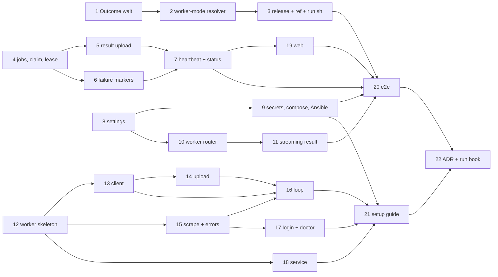

# Plan: Instagram scraper worker

Test commands: `npm test -w packages/settings`, `npm test -w apps/backend -- <file>`, `npm test -w apps/web -- <file>`;
the ingest endpoint `bash deploy/ingest/server.test.sh` (pytest in the ingest image's test stage); ingest-email's
own suite `pytest` in its checkout (`tmp/ingest_email-src`, the private repo `tillg/ingest_email`); the worker
`bash tools/instagram-worker/test.sh` (pytest in a `python:3.11-slim` container, the oldest supported Python,
instascraper stubbed); shell tests `bash deploy/<…>.test.sh`; e2e `just e2e <spec>`; everything `just check`.

No step changes model-facing text (prompt parts, tool descriptions), so no step needs `npm run test:llm`.

**Parallel start:** steps 1 (ingest-email), 4 (server.py), 8 (settings) and 12 (worker package) depend on nothing and
touch disjoint files. After them, the four sections run side by side until the web step (19) and the e2e step (20)
join them.

## ingest-email

- [ ] `Outcome.wait(reason)`: the link stays unresolved with its `attempts` unchanged; `resolve_source` rewrites `index.md` only when the links or the body changed (in `tillg/ingest_email`)
  - Depends on: none
  - Test first: ingest-email `tests/test_resolve.py` › "a wait outcome keeps attempts and sets the reason", "ten waits never move a link to failed_links", "a round in which every link only waits leaves index.md byte-identical and its mtime unchanged", "a retry still rewrites (attempts + 1)". Fail today: `Outcome` has no `wait`, and every round rewrites `updated`.
  - Verify: `cd tmp/ingest_email-src && pytest -q` → all green
- [ ] Instagram resolver in worker mode: result dir → `map_output` → resolved; permanent marker → `give_up(reason)`; non-permanent marker → `wait(reason)`; nothing → `wait("worker")`; never imports instascraper; new profile settings `instagram_source` (default `local`) and `instagram_results_dir`
  - Depends on: 1
  - Test first: ingest-email `tests/test_resolvers_instagram.py` › "worker mode maps a dropbox result like a local scrape (folder from taken_at and owner, media copied, hashtags not tags)", "worker mode leaves the result dir in place", "permanent marker gives up with its reason", "non-permanent marker waits with its reason", "no result waits with 'worker'", "worker mode never calls _scrape (it raises in the test)", "local mode is unchanged"; `tests/test_config.py` › "instagram_source defaults to local". Fail today: no worker mode, no settings.
  - Verify: `cd tmp/ingest_email-src && pytest -q` → all green
- [ ] Release the ingest-email tag, bump `deploy/ingest/ingest-email.ref`; `run.sh`'s `render()` sets `instagram_results_dir` to `$STATE/instagram/results` for every profile
  - Depends on: 2
  - Test first: `deploy/ingest/run.test.sh` › "every rendered profile carries instagram_results_dir under INGEST_STATE"; existing `run.test.sh` and `server.test.sh` cases pass before and after. Fails today: `render()` doesn't set it.
  - Verify: `bash deploy/ingest/fetch-source.sh && bash deploy/ingest/run.test.sh && bash deploy/ingest/server.test.sh` → ok

## Ingest service (`deploy/ingest/server.py`)

- [ ] HTTP/1.1, `INGEST_INSTAGRAM_SOURCE`, the job scan, `POST /instagram/jobs/claim` (oldest wanted shortcode, 30-minute lease to a name, 204 when none, 409 in local mode) and `POST /instagram/jobs/:id/release`; ids checked against `^[A-Za-z0-9_-]{5,40}$`
  - Depends on: none
  - Test first: `deploy/ingest/test_server.py` › "claim in local mode is 409 not-worker-mode", "claim returns the shortcode of an unresolved /p/ or /reel/ link with a synthesized /p/ url", "the same shortcode in two vaults is one job", "a leased job isn't handed out again until the lease ends", "release frees it at once", "an expired lease frees it", "no wanted link → 204", "a resolved or failed_links entry is no job", "a bad id is 400 before any path is built", "two requests on one keep-alive connection both answer". Fail today: no such routes, HTTP/1.0.
  - Verify: `bash deploy/ingest/server.test.sh` → all green
- [ ] `PUT /instagram/jobs/:id/result`: 411 without Content-Length, 413 over 500 MB without reading the body, chunked temp file, `extractall(filter='data')` into staging, validation (flat or one `<id>/` level, ≤ 40 files, safe names, regular files, `metadata.json` with the job's shortcode, `post.md`), atomic rename, 204 idempotent, 404 for an unwanted id
  - Depends on: 4
  - Test first: `deploy/ingest/test_server.py` › "a valid tarball lands in `results/<id>/` and the lease ends", "a second upload of the same id is 204 and changes nothing", "an upload after the lease lapsed still counts while the id is wanted", "no Content-Length → 411", "Content-Length 600 MB → 413 and the body isn't read", "absolute path, `..`, a symlink, a device file, 41 files, a name with a space, missing post.md, metadata shortcode ≠ id, not gzip → 422 and nothing in results/ or incoming/", "an id nobody wants → 404". Fail today: no route.
  - Verify: `bash deploy/ingest/server.test.sh` → all green
- [ ] `POST /instagram/jobs/:id/failure` writes `<id>.failed.json` `{reason, permanent, at, count}`; non-permanent backs off `min(count, 24)` h; the 5th failure is permanent; results and markers older than 7 days are pruned (at most hourly, on claim)
  - Depends on: 4
  - Test first: `deploy/ingest/test_server.py` › "a permanent failure is never claimed again", "a non-permanent failure is skipped for count hours, then claimable", "the 5th non-permanent failure turns permanent", "a later successful upload removes a non-permanent marker", "an 8-day-old result dir and marker are pruned, a 6-day-old one isn't", "reason is cut at 200 chars, a non-bool permanent is 400". Fail today: no route.
  - Verify: `bash deploy/ingest/server.test.sh` → all green
- [ ] `POST /instagram/worker/heartbeat` (persisted to `/state/instagram/workers.json`) and the worker-mode status: `source`, `waitingLinks` by URL, `workers`, `queue {waiting, leased, backingOff, ready, failed}`; `expired` only in local mode
  - Depends on: 5, 6
  - Test first: `deploy/ingest/test_server.py` › "heartbeat records name, version, state, message, lastSeen", "an unknown state or a bad name is 400", "workers survive a restart (new Service on the same state dir)", "worker-mode status counts waiting, leased, backing off, ready, failed by shortcode", "waitingLinks counts Instagram links whatever their reason", "local-mode status is unchanged plus source local". Fail today: no route, no fields.
  - Verify: `bash deploy/ingest/server.test.sh` → all green

## Settings, secrets, compose, Ansible

- [ ] Settings: `ingest.worker_token` secret reference; `ingest.defaults.instagram_source` must be `local` or `worker` and is not set per profile; rendered into `INGEST_INSTAGRAM_SOURCE` (`.env`), `ingest.worker_token` (backend `settings.json`, a compose secret) and the manifest row "Instagram worker token"; `settings.yaml` declares both, `hetzner.yaml` and `dev.yaml` set `worker`
  - Depends on: none
  - Test first: `packages/settings/test/schema.test.ts` › "instagram_source must be local or worker", "a profile setting instagram_source is an error naming the profile"; `render.test.ts` › ".env carries INGEST_INSTAGRAM_SOURCE (local by default)", "settings.json has ingest.worker_token as /run/secrets/ingest_worker_token", "the manifest names it Instagram worker token, component backend"; `repo-settings.test.ts` › "hetzner and dev use worker, prodtest local"; `apps/backend/test/settings.test.ts` › "ingest.worker_token is read from its file, absent is fine". Fail today: no such keys.
  - Verify: `npm test -w packages/settings && npm test -w apps/backend -- settings` → green; `just settings check` → ok
- [ ] The secret is generated like `ingest_token` (`deploy/dev.sh`, `just prodtest up`, Ansible role `app` › "Ingest secrets", a placeholder in `render-settings.sh`); compose gives it to the backend only and `INGEST_INSTAGRAM_SOURCE` to ingest; `just instagram-worker-token <target>` prints it
  - Depends on: 8
  - Test first: `deploy/ingest/compose.test.sh` › "the backend has ingest_worker_token, ingest does not", "ingest's environment has INGEST_INSTAGRAM_SOURCE"; new `deploy/ansible/worker-token.test.sh` (stub `ssh` on `PATH`) › "dev prints deploy/secrets/ingest_worker_token", "hetzner runs ssh ops@karpathy sudo cat …/shared/secrets/ingest_worker_token", "an unknown target fails with the list"; `deploy/justfile.test.sh` › "instagram-worker-token passes the target on". Fail today: no secret, script or recipe.
  - Verify: `bash deploy/ingest/compose.test.sh && bash deploy/ansible/worker-token.test.sh && bash deploy/justfile.test.sh` → ok; `grep -q ingest_worker_token deploy/dev.sh justfile deploy/ansible/roles/app/tasks/main.yml deploy/ansible/render-settings.sh deploy/compose.prodtest.yml` → exit 0; `just dev up` → stack healthy

## Backend

- [ ] Worker router mounted before the main `/api` router: `POST jobs/claim`, `jobs/:id/failure`, `jobs/:id/release`, `worker/heartbeat` accept the worker or the main token (`bearerAuthAny`), 16 kB JSON, status and body passed through (204 included); every other route still needs the main token
  - Depends on: 8
  - Test first: new `apps/backend/test/ingest-worker-routes.test.ts` (a local HTTP server as the ingest service, as `ingest-routes.test.ts` does) › "the worker token claims a job (200 body passed through)", "204 and 409 pass through", "the main token works on the worker routes", "the worker token gets 401 on /api/vaults, /api/ingest/instagram, /api/ingest/instagram/login and /api/settings/secrets", "without a configured worker token only the main token works", "the ingest service gets the ingest token, never the worker token", "a 20 kB heartbeat is 413", "ingest down → 503 ingest-down". Fail today: the routes are 404 and the worker token is 401 everywhere.
  - Verify: `npm test -w apps/backend -- ingest-worker-routes ingest-routes` → green; `npm test -w apps/backend` → all green
- [ ] `PUT jobs/:id/result` streams the body to the ingest service (`duplex: 'half'`, Content-Length passed on, no body parser), 411 without Content-Length, the answer passed through
  - Depends on: 10
  - Test first: `apps/backend/test/ingest-worker-routes.test.ts` › "a 60 MB body arrives byte-identical with its Content-Length", "the fake ingest service sees the first chunk before the client has sent the last (streamed, not buffered)", "no Content-Length → 411 and nothing reaches the ingest service", "413 and 422 with their messages pass through", "the worker token is accepted, a wrong one is 401 before any byte is forwarded". Fail today: no route.
  - Verify: `npm test -w apps/backend -- ingest-worker-routes` → green; `npm test -w apps/backend` → all green

## Worker package (`tools/instagram-worker/`)

- [x] Package skeleton: `pyproject.toml` (src layout, `karpathy_instagram_worker`, script `karpathy-instagram-worker`, Python ≥ 3.11, instascraper @ v1.1.0), `config.py` (TOML at `~/.config/karpathy-instagram-worker/config.toml`, 0600, `KARPATHY_WORKER_CONFIG`), `configure` and `version`; test harness `tests/` with a stub `instascraper` package and `test.sh`, added to `just check`
  - Depends on: none
  - Test first: `tools/instagram-worker/tests/test_config.py` › "configure writes server, token, name, poll_interval_s with mode 0600", "a missing token is asked with getpass, never echoed", "server must be https:// (http only for localhost)", "name defaults to the short host name", "version prints the package version". Fail today: no package.
  - Verify: `bash tools/instagram-worker/test.sh` → all green; `grep -q instagram-worker/test.sh justfile` → exit 0
- [x] `client.py`: claim, failure, release and heartbeat over stdlib `urllib` with the bearer token; 204 → no job; 401 → `TokenRejected`; unreachable or 5xx → retried with backoff (1, 2, 5 min, sleeps injected)
  - Depends on: 12
  - Test first: `tools/instagram-worker/tests/test_client.py` (a `http.server` fake on localhost) › "claim returns {id, url, leaseUntil}", "204 is None", "every call sends `Authorization: Bearer <token>`", "401 raises TokenRejected", "a 503 then a 200 retries once after the first backoff", "heartbeat sends name, version, state, message". Fail today: no client.
  - Verify: `bash tools/instagram-worker/test.sh` → all green
- [x] `upload.py`: a flat tar.gz of `<shortcode>/` (regular files only), streamed `PUT` with `Content-Length` in 1 MiB chunks; local refusal over 500 MB or 40 files; 413/422 → `ResultRejected(message)`
  - Depends on: 13
  - Test first: `tools/instagram-worker/tests/test_upload.py` › "the tarball holds exactly the dir's files, flat, no links", "the fake server receives Content-Length and the full body", "41 files → ResultRejected before any request", "a 422 with a message → ResultRejected carrying it", "a symlink in the dir is left out". Fail today: no module.
  - Verify: `bash tools/instagram-worker/test.sh` → all green
- [x] `scrape.py`: instascraper's `get_client`, `scrape`, `write_result` into a temp dir; error mapping (not found → permanent failure; login/challenge/`SystemExit` → needs-login; `PleaseWaitFewMinutes`/throttled/429 → rate-limited; other → non-permanent failure)
  - Depends on: 12
  - Test first: `tools/instagram-worker/tests/test_scrape.py` (stub instascraper raising each instagrapi-named exception) › "MediaNotFound and ClientNotFoundError → Permanent", "LoginRequired, ChallengeRequired and SystemExit from get_client → NeedsLogin", "PleaseWaitFewMinutes → RateLimited", "ValueError → Transient with 'ValueError: …' cut at 200", "success returns the `<shortcode>/` dir with post.md and metadata.json". Fail today: no module.
  - Verify: `bash tools/instagram-worker/test.sh` → all green
- [x] `loop.py` + `once`/`run`: per job one `Humanizer(BehaviorProfile(), ledger=ActivityLedger(activity_path(user)))`, gate before claiming (STOP → heartbeat `night`/`resting`, sleep, no claim); claim → heartbeat `scraping` → scrape → upload or failure or release; pace between jobs; idle poll; SIGTERM ends after the current job
  - Depends on: 13, 14, 15
  - Test first: `tools/instagram-worker/tests/test_loop.py` (fake server, stub instascraper, fake clock and sleep) › "a closed gate claims nothing and reports night", "no job → idle heartbeat and a poll_interval_s sleep", "success uploads and reports idle", "Permanent and ResultRejected → failure permanent true", "Transient → failure permanent false, state error then idle", "NeedsLogin → release, needs-login, 10-minute sleep", "RateLimited → release, rate-limited, 30-minute sleep", "TokenRejected stops run with exit 1", "once exits 0 after one step". Fail today: no loop.
  - Verify: `bash tools/instagram-worker/test.sh` → all green
- [ ] `login` (password from getpass, 2FA/challenge code from stdin via `login_interactive_free`'s `code` callback; `--browser`) remembering `IG_USERNAME`; `doctor` (Python, instascraper, config 0600, server + token, session, ffmpeg optional, service)
  - Depends on: 15
  - Test first: `tools/instagram-worker/tests/test_cli.py` › "login passes username, password and a code callback that reads stdin", "login writes IG_USERNAME to instascraper's .env", "the password never reaches stdout, stderr or any file", "doctor prints one line per check and exits 1 on a rejected token", "doctor treats a missing ffmpeg as a warning". Fail today: no commands.
  - Verify: `bash tools/instagram-worker/test.sh` → all green
- [ ] `service install|uninstall|status`: launchd LaunchAgent `app.karpathy.instagram-worker` on macOS, systemd user unit `karpathy-instagram-worker.service` on Linux, with the absolute path of the installed command
  - Depends on: 12
  - Test first: `tools/instagram-worker/tests/test_service.py` (stub `launchctl`, `systemctl`, `journalctl` on `PATH`, `HOME` in a temp dir, platform injected) › "macOS: the plist has RunAtLoad, KeepAlive, the absolute command + run, logs in ~/Library/Logs/karpathy-instagram-worker/, and `launchctl bootstrap gui/<uid>` is called", "uninstall calls bootout and removes the plist", "Linux: the unit has `ExecStart=<abs> run` and Restart=always; daemon-reload and enable --now are called", "install twice replaces, not duplicates", "status shows the last log lines". Fail today: no module.
  - Verify: `bash tools/instagram-worker/test.sh` → all green

## Web

- [ ] `InstagramStatus` gains `source`, `workers`, `queue`; Secrets & keys › Instagram in worker mode shows the workers (last seen, state, needs-login hint), the counts, the two-workers warning and the setup-guide link, and hides Connect; the Vaults-list notice covers "no worker for an hour" and `needs-login`
  - Depends on: 7
  - Test first: `apps/web/src/components/InstagramSettings.test.tsx` › "worker mode lists each worker with last seen and state", "worker mode hides the Connect form", "needs-login names the worker and the login command", "two workers seen within an hour show the one-account warning", "the counts line", "the guide link points at docs/instagram-worker.md", "local mode is unchanged"; the notice cases › "links waiting and no worker for an hour → notice", "a worker seen 10 min ago → no notice", "needs-login → notice naming the worker". Fail today: no worker mode.
  - Verify: `npm test -w apps/web -- InstagramSettings` → green; `npm test -w apps/web` → all green; `npm run typecheck` → ok

## End to end

- [ ] `e2e/instagram-worker.spec.ts` plays the worker over HTTP with the dev stack's worker token: put an item with an Instagram link into `Input/`, heartbeat, claim it, upload a fixture tar.gz, and see the worker and the counts in Secrets & keys › Instagram; the main-token-only routes refuse the worker token. `e2e/instagram.spec.ts` (server-side Connect, now hidden in dev) is removed
  - Depends on: 3, 7, 9, 11, 19
  - Test first: `e2e/instagram-worker.spec.ts` › "a worker claims, uploads, and the app shows it" (desktop project only; the fixture is `e2e/fixtures/instagram/<shortcode>.tar.gz` built by the spec from `post.md` + `metadata.json`), "the worker token can't list vaults". Fails today: the routes don't exist and dev is in local mode.
  - Verify: `just dev up && just e2e instagram-worker` → green; `just e2e --grep-invert @llm` → no new failures

## Docs

- [ ] Setup guide `docs/instagram-worker.md` (prerequisites incl. Tailscale, stop `com.tillg.ingest-email.all`, pipx install from the tag, configure with `just instagram-worker-token`, login, doctor, once, service, status/logs, troubleshooting, upgrade, uninstall, one account per worker); README › Ingest links to it
  - Depends on: 9, 16, 17, 18
  - Test first: none — documentation
  - Verify: `test -f docs/instagram-worker.md && grep -q "docs/instagram-worker.md" README.md && grep -q "loginctl enable-linger" docs/instagram-worker.md && grep -q "com.tillg.ingest-email.all" docs/instagram-worker.md` → exit 0; every command the guide names exists in `karpathy-instagram-worker --help` (`bash tools/instagram-worker/test.sh` › test_cli "help lists configure, login, doctor, once, run, service, version")
- [ ] ADR `docs/adr/0006-instagram-scraped-by-a-worker.md` (the worker pulls jobs, ingest-email stays the only writer, the scoped token, why not the relay); demo run book chapter 17 "Ingest from the inbox" in `~/git/karpathy_demo_wiki/Karpathy Demo.md` gets the worker line and a *Try it* step, `updated` bumped (pushed only after the release)
  - Depends on: 20, 21
  - Test first: none — documentation
  - Verify: `test -f docs/adr/0006-instagram-scraped-by-a-worker.md && grep -q "Instagram worker" ~/git/karpathy_demo_wiki/"Karpathy Demo.md"` → exit 0; `just check` → green

System docs are updated at `/spec:archive`.
