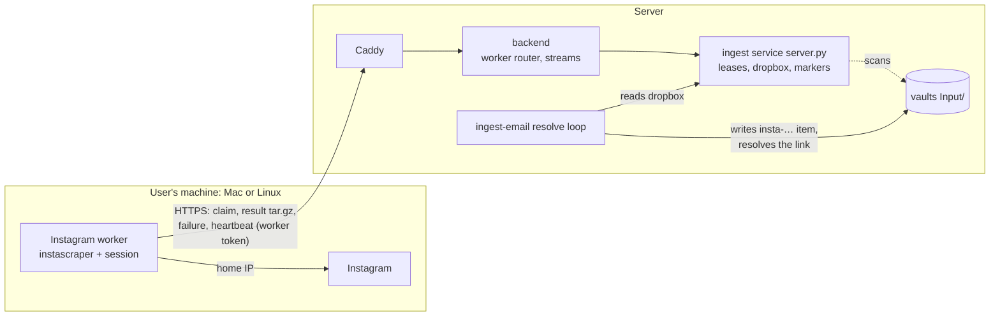

# Proposal: Instagram scraper worker

**Issue:** [#168](https://github.com/tillg/karpathy.app/issues/168) (fetch Instagram from the user's side)
**Issue:** [#137](https://github.com/tillg/karpathy.app/issues/137) (prod gets HTTP 429 from Instagram)

## TL;DR

Instagram blocks the server's data-centre IP, so the server stops scraping Instagram itself and hands the work to an
**Instagram worker**: a small service the user installs on a Mac or any other *nix machine with a home IP. The worker
asks the server for one post at a time, scrapes it there with the existing instascraper, and uploads the result. The
ingest service keeps a **dropbox** of uploaded results, and ingest-email turns each one into the same
`Input/insta-…/` item as today. Links **wait** while no worker runs; they never burn attempts. The worker gets its own
token, which is valid only on the job routes, and only needs outbound HTTPS to the server. Recommendation: build it as
planned. Server, settings and UI ship first and change nothing until a target sets `instagram_source: worker`. Then
install the worker on the Mac and switch prod.

## Why

The ingest service resolves Instagram links with instascraper (instagrapi's private mobile API, a logged-in session
minted on the server). Instagram challenges and blocks logins and fetches from the Hetzner data-centre IP: issue #137
(429 in prod), research ticket #168, and a known gap in `specs/system/functional.md` › Gaps › Ingest. The Mac's old
launchd agent (`com.tillg.ingest-email.all`) fetched Instagram from the home IP, and that worked.

The user's direction (2026-10-27):

> On my mac or some other machines (all *nix OS) I can install a service and configure it. This service calls our
> karpathy server and requests instagram posts / reels (one by one) or their ID. Then the service scrapes the posts
> and sends the result back to the karpathy server. The service uses the existing instagram scraper software.

That is option (a) below. The earlier change `instagram-mac-relay` recommended (a′) instead. It is withdrawn: the user
asked for the worker. A worker also needs only **outbound** HTTPS to the server, while a relay must be reachable *as a
server* from the Hetzner host through Tailscale and Docker's routing.

## Options considered

| Option | Works? | Effort | Reliability | Security | ToS / account risk | Fit with "browser is the client" |
|---|---|---|---|---|---|---|
| **Fetch from the PWA** (`fetch('https://www.instagram.com/…')`) | **No.** A cross-origin `fetch` can't read a response that has no CORS headers, and Instagram sends none for our origin. A credentialed request also needs an explicit `Access-Control-Allow-Origin`, and third-party-cookie rules still apply (MDN). Our own CSP is `connect-src 'self'`. instagram.com's `sessionid` is HttpOnly on another origin. | — | — | — | — | perfect, but impossible |
| **(a) Worker runs the scraper** (**chosen**): a service on the user's machine pulls jobs from the server, scrapes with instascraper and uploads the result | Yes | **Medium.** A job API on the server, a results dropbox, a `wait` outcome and a "worker" source in ingest-email, a pipx-installable worker with launchd/systemd units | Links wait while no worker runs. Results dedup by shortcode across vaults. The server counts failures and backs off | The Instagram session and a worker token live on the worker's machine. The token can only claim jobs and upload results, never read or write a vault | Same as today (personal use, humanized pacing), now from a residential IP | Not the browser: the user's machine. The browser keeps the UI (status, setup link) |
| **(a′) Mac relay** (withdrawn change `instagram-mac-relay`): the server's egress proxy forwards Instagram host names to a forward proxy on the Mac over Tailscale | Yes | Low | One scraper, one session | The session stays on the server; the Mac sees only `CONNECT` host names | Same as today | **Rejected:** the user asked for the worker architecture. It also needs the Mac reachable as a server over Tailscale, plus an untested Docker → tailnet route on the host |
| **(b) Browser extension** with `host_permissions` for instagram.com, using the user's own web session | Yes, on desktop Chrome. Safari needs a native app wrapper (Xcode, App Store / TestFlight) | **Very high.** Port the scraper to JavaScript against Instagram's undocumented web GraphQL, download media, upload to the backend, and keep it working as Instagram changes | Only while a browser with the extension is open; web endpoints change often | Runs as the user's **main** account with its real cookies | Highest: automated use of the user's own account | Closest to the browser |
| **(b′) iOS Shortcut / share sheet** fetching the post on the phone | Partly. Shortcuts' "Get Contents of URL" has no Instagram cookies, so it gets the logged-out page: a caption snippet and a thumbnail, not the Reel. iOS has no Web Share Target for PWAs | Medium | Poor content | Fine | Low | Phone, not browser |
| **(c) Residential proxy service** as the egress proxy's parent for Instagram | Yes, without a user machine | Low (Squid peer lines, a paid peer) | Good with a sticky IP. Rotating IPs make a session hop countries, a strong flag | A third party sees every Instagram host name; provider credentials on the server | Shared pool IPs often carry abuse reputation | Not the client at all |
| **(d) Official APIs** | **No.** The Basic Display API ended on 4 Dec 2024. The Graph API only serves professional accounts' **own** media. oEmbed returns embed HTML, and using its content "for other purposes is strictly prohibited" | — | — | — | Compliant, but can't read other people's posts | — |
| **(e) Phone share sheet → app with the content** | Only by hand: the Instagram app shares a URL, not the media | None | Manual | Fine | None | Phone |

Cost of (c), for the record: residential bandwidth lists at about $8/GB pay-as-you-go ($2.50–3.50/GB on monthly
plans). At instascraper's ceiling of 50 posts a day, with Reels at 10–30 MB, the worst case is tens of dollars a
month. It stays the fallback if no worker machine is awake often enough.

Every option except (d) is automated collection, which Instagram's Terms of Use forbid ("collecting information in
an automated way without our express permission"). That is already true of the ingest service and of instascraper,
which is why instascraper is deliberately not on PyPI. This change keeps that position. It only moves the scraping to
an address where the user's own use doesn't look like a data centre.

## What

- **Instagram worker** (`tools/instagram-worker/`, command `karpathy-instagram-worker`): installed with pipx from a
  git tag of this repo. `configure` sets the server URL, the worker token and a name. `login` logs in to Instagram
  on this machine. `doctor` checks the setup, `once` handles one job, `run` loops, and `service install|uninstall|status`
  sets up a launchd LaunchAgent (macOS) or a systemd user unit (Linux). One Instagram account per worker.
- **Job API** on the server, public only through the app's own domain (tailnet-only in prod):
  `POST /api/ingest/instagram/jobs/claim`, `PUT …/jobs/:id/result` (a tar.gz), `POST …/jobs/:id/failure`,
  `POST …/jobs/:id/release`, `POST /api/ingest/instagram/worker/heartbeat`. The backend streams the routes through to
  the ingest service.
- **Jobs are derived, not stored:** the ingest service scans the vaults' `Input/*/index.md` for unresolved Instagram
  links. The job id is the post's shortcode, so a post mailed into two vaults is scraped once. Leases last 30 minutes.
- **Results dropbox:** an upload is checked and extracted safely into `/state/instagram/results/<shortcode>/`; failures
  become `<shortcode>.failed.json` markers with a count and a backoff. Both are pruned after 7 days.
- **ingest-email stays the only writer of the vault.** With `instagram_source: worker`, its Instagram resolver maps a
  result from the dropbox exactly as it maps a local scrape today, gives up on a permanent failure, and otherwise
  **waits** without counting an attempt.
- **Worker token:** a deploy secret `ingest_worker_token`, generated on the target like `ingest_token`, accepted only
  on the job routes. `just instagram-worker-token <target>` prints it for the setup.
- **Settings:** `ingest.defaults.instagram_source: local | worker` (default `local`: today's behaviour). `hetzner` and
  `dev` use `worker`.
- **App:** Secrets & keys › Instagram in worker mode lists the workers (name, last seen, state), the waiting / in
  progress / backing-off counts and a link to the setup guide. The server-side Connect is hidden. The Vaults list warns
  when links wait and no worker was seen for an hour, or a worker needs a login.
- **Docs:** setup guide `docs/instagram-worker.md`, an ADR, the demo run book.

## Non-goals

- Scraping in the browser, a browser extension, an iOS app or Shortcut.
- A Docker image for the worker. pipx and the native service manager are the install path.
- Several Instagram accounts behind one server, or locking between workers. One account per worker; the app warns
  when two workers were active within an hour.
- Tokens created or rotated in the admin UI. Rotation means redeploy and reconfiguring the workers.
- A minimum-version handshake with the worker. The version is reported, nothing is enforced yet.
- Falling back to scraping on the server while no worker runs. Mixing a home IP and a data-centre IP on one account
  is the pattern Instagram flags.
- YouTube or other blocked sites through the worker. The job API is Instagram-only.

## Outcome

Instagram posts and Reels mailed to the ingest label land in `Input/` on the server, scraped from the user's home IP
by whichever worker is running. When none runs, the app shows what waits and why, and nothing is lost. The setup
guide gets a new machine from nothing to a running service in a few commands.

## Sources

- MDN, [Cross-Origin Resource Sharing (CORS)](https://developer.mozilla.org/en-US/docs/Web/HTTP/Guides/CORS).
- Chrome for Developers, [Cross-origin network requests](https://developer.chrome.com/docs/extensions/develop/concepts/network-requests).
- MDN, [`share_target`](https://developer.mozilla.org/en-US/docs/Web/Progressive_web_apps/Manifest/Reference/share_target).
- Meta, [Update on Instagram Basic Display API](https://developers.facebook.com/blog/post/2024/09/04/update-on-instagram-basic-display-api).
- Meta, [Instagram oEmbed](https://developers.facebook.com/docs/instagram-platform/oembed/).
- Instagram, [Terms of Use](https://help.instagram.com/581066165581870).
- Python, [`tarfile` extraction filters](https://docs.python.org/3/library/tarfile.html#extraction-filters) (`filter='data'`).
- Residential proxy prices (third-party summaries, August 2026): [casrai.org](https://casrai.org/guides/bright-data-pricing),
  [proxidize.com](https://proxidize.com/blog/bright-data-pricing/).
- Decision log: `DECISIONS.md` › run 2026-10-27 11:45 (entries 11:56 and 12:20).
- In this repo: `deploy/ingest/server.py`, `deploy/ingest/run.sh`, `apps/backend/src/ingest.ts`,
  `specs/system/architecture.md` › Ingest service. ingest-email: `src/ingest_email/resolvers/instagram.py`,
  `resolve.py`, `resolvers/base.py`. instascraper v1.1.0: `cli.py` (error handling), `behavior.py`, `activity.py`.
