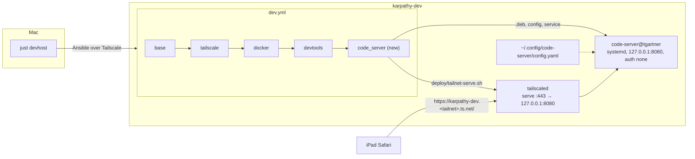
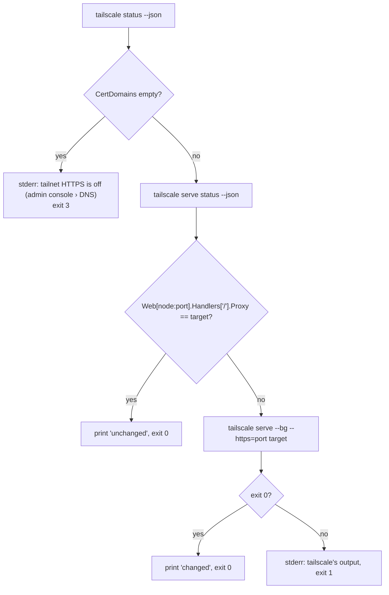
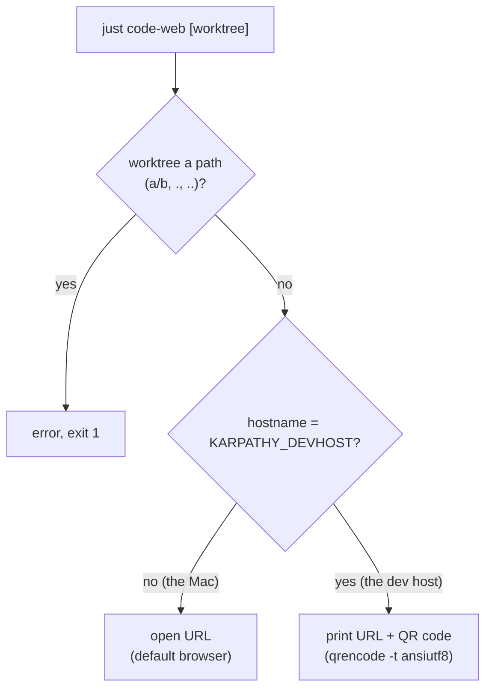
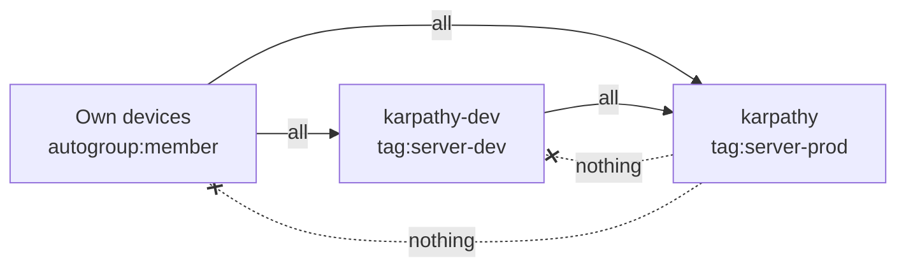

# Architecture: VS Code in the browser on the dev host

## Overview



Three pieces, all installed by Ansible on `just devhost`:

1. **code-server**, Coder's `.deb`, pinned, running as the developer's login user from the systemd template the
   package ships (`code-server@<user>`). It binds `127.0.0.1:8080` with `auth: none` and `cert: false`: nothing
   off the host reaches it directly.
2. **`tailscale serve`** terminates HTTPS on the tailnet IP, port 443, with a Let's Encrypt certificate for
   `karpathy-dev.<tailnet>.ts.net`, and proxies to `http://127.0.0.1:8080`. The serve config lives in `tailscaled`'s
   state and survives reboots.
3. **`deploy/tailnet-serve.sh`**, a small idempotent wrapper around `tailscale serve`, so Ansible gets a clear
   "changed / unchanged / tailnet HTTPS is off" and phase 2 (the dev stacks) can reuse it.

## The role `code_server`

A new role, not tasks in `devtools`. `devtools` holds tools a checkout needs; code-server is a network service with
its own exposure, and a role of its own keeps it easy to read and to switch off (`code_server_enabled`, default
`true`; `dev.yml` runs the role only when it's on). It runs after `devtools` (it needs `jq` for the serve script).
It is in `dev.yml` only, never in `site.yml` (prod).

`defaults/main.yml`:

| Variable | Default | Why |
|---|---|---|
| `code_server_enabled` | `true` | Switch the browser editor off without removing the role. |
| `code_server_version` | `4.141.0` | Pinned like `just` and Playwright; released 2026-10-08. Bumped by hand. |
| `code_server_arch` | `{aarch64: arm64, x86_64: amd64}[ansible_facts.architecture]` | `karpathy-dev` is arm64, CI's test container may be amd64. |
| `code_server_url` | `https://github.com/coder/code-server/releases/download/v{{ code_server_version }}/code-server_{{ code_server_version }}_{{ code_server_arch }}.deb` | Upstream's release asset. |
| `code_server_port` | `8080` | Loopback only; not one of the stack ports (80N0–80N9) or 8099 (`just site`). |
| `code_server_tailnet_serve` | `"{{ tailscale_enabled }}"` | Publish via `tailscale serve`. The test sets it on its own, with a fake `tailscale`. |

Tasks, in order:

1. **Package:** `ansible.builtin.apt: deb: "{{ code_server_url }}"`. The apt module installs the `.deb` only when
   that version isn't installed already, so a second run is `ok`.
2. **Config:** `~/.config/code-server/config.yaml` (owner the login user, mode 0600), from a template:

   ```yaml
   bind-addr: 127.0.0.1:8080
   auth: none
   cert: false
   disable-telemetry: true
   disable-update-check: true
   trusted-origins: [karpathy-dev.tailab154c.ts.net]   # only when code_server_tailnet_serve
   ```

   The name comes from `tailscale status --json` › `Self.DNSName` (without the trailing dot), read by the role.

   `disable-update-check`: updates come from bumping `code_server_version`, not from a banner. Notifies
   *Restart code-server*.
3. **Service:** `code-server@{{ admin_user }}` enabled and started (`ansible.builtin.systemd_service`). Handler
   *Restart code-server* restarts it after a config or package change.
4. **Tailnet URL:** when `code_server_tailnet_serve`, run `deploy/tailnet-serve.sh 443 http://127.0.0.1:8080` with
   `ansible.builtin.script` as root; `changed_when` on its `changed` line, `failed_when` on its exit code. On exit 3
   the task fails with the script's message: turn on *HTTPS Certificates* in the Tailscale admin console › DNS, then
   run `just devhost` again.

## `deploy/tailnet-serve.sh`

`tailnet-serve.sh <https-port> <target-url>`: makes `tailscale serve` publish `<target-url>` on
`https://<this node>:<https-port>/`, idempotently.



- Reads JSON with `jq` (installed by `devtools`).
- `tailscale serve --bg` is wrapped in `timeout 30`: when serve isn't allowed it prints a URL and waits for someone
  to approve it in a browser, which nobody does during an Ansible run.
- Only touches the one `<port>`; other serve entries (the stacks', later) stay.
- **Test:** `deploy/tailnet-serve.test.sh` puts a fake `tailscale` first on the `PATH`. The fake answers
  `status --json` and `serve status --json` from fixture JSON and logs every call, so the test checks the three
  outcomes and the exact `serve` arguments. In `just check`.

## `just code-web [worktree]`

Opens the browser editor on a checkout: the main clone, or `.worktrees/<worktree>`. A new recipe next to `just code`,
backed by the same script (`bash deploy/code.sh --web {{worktree}}`), which already knows the dev host
(`KARPATHY_DEVHOST`) and its checkout (`KARPATHY_DEVHOST_CHECKOUT`). It gains the editor's address:

| Variable | Default | Override for |
|---|---|---|
| `KARPATHY_DEVHOST_URL` | `https://karpathy-dev.tailab154c.ts.net` | another dev host or tailnet |

The URL is `$KARPATHY_DEVHOST_URL/?folder=$KARPATHY_DEVHOST_CHECKOUT[/.worktrees/<worktree>]`.



- On the dev host (herdr, tmux, SSH) there's no browser; the QR code is for the iPad's camera. `qrencode` is
  already installed there (`devtools`).
- No check that the worktree exists, as with `just code`: an unknown one opens an empty folder.
- The tailnet name `tailab154c` is in a public repo: it is public anyway once Tailnet HTTPS is on (Certificate
  Transparency), and it opens nothing outside the tailnet.
- **Test:** `deploy/code.test.sh` gains stubs for `open` and `qrencode` (it already stubs `code` and `hostname`).

## Test in `dev.test.sh`

The playbook test already runs `dev.yml` against a fresh Ubuntu 24.04 container with systemd, without Tailscale. It
gains:

- **A fake `tailscale`** in the container (`/usr/local/bin/tailscale`, the same fake as the script's test, with
  HTTPS on) and `code_server_tailnet_serve: true` in the extra vars, so the role's serve task runs for real and the
  test checks the logged `serve --bg --https=443 http://127.0.0.1:8080` call.
- `code-server --version` starts with the pinned version (from `defaults/main.yml`, like the Playwright check).
- `systemctl is-active` and `is-enabled` for `code-server@dev`.
- `curl -sf http://127.0.0.1:8080/healthz` answers, and `ss -ltn` shows `127.0.0.1:8080`, not `0.0.0.0:8080` or
  `*:8080`.
- The config file is mode 600, owned by the login user, and has `auth: none`.

## Key decisions

| Decision | Alternatives | Why |
|---|---|---|
| code-server | openvscode-server; VS Code Remote Tunnels | User's choice (2026-10-22): stays in the tailnet, no extra login, PWA-friendly. Tunnels relay through Microsoft. |
| No password, tailnet only | code-server password from the Ansible vault | User's choice: only tailnet devices reach it; one login fewer on the iPad. Risk below. |
| `tailscale serve` on 443 | A port like 8443; `tailscale serve --set-path /code` | 443 gives the shortest URL and is free on the dev host. A path prefix works with code-server but makes every URL longer and leaves `/` unused. |
| systemd template from the `.deb` | Own unit file; a Docker container | The package's unit runs as the user with the user's `$HOME`, so terminals, `~/.claude`, git credentials and `just` behave as over SSH. A container would need all of them mounted in. |
| `.deb` from GitHub releases | Coder's `install.sh`; npm | Pinned and idempotent through the apt module; `install.sh` picks the latest. |
| A new role `code_server` | Tasks in `devtools` | Separate exposure, separate switch (`code_server_enabled`). |
| A tailnet policy with explicit grants is part of this change; prod starts no connection on the tailnet | Docs-only recommendation; a header-checking proxy in front of code-server | Grilling 2026-10-22: prod needs to reach nothing on the tailnet, so the policy forbids it outright, which also protects SSH and the stacks, not just the editor. A proxy would guard only the editor. The policy's `tests` and a check from prod prove it. |
| One tag per server role: `tag:server-prod`, `tag:server-dev` | Keep the shared `tag:server`; address the dev host by IP or host name | Grilling 2026-10-22: with one shared tag, no rule can tell prod from dev. A rebuilt server gets a new tailnet IP, but a tag comes with its auth key. |
| The dev server may reach prod | Your own devices only | Grilling 2026-10-22: `just deploy` and Ansible run from the dev host too. |
| `just devhost` fails while Tailnet HTTPS is off | Skip the serve step with a warning | Grilling 2026-10-22: a green run means the editor is reachable. |
| `trusted-origins` set from the start, with the node's name from `tailscale status --json` | Add it only if the rollout shows "reconnecting" | Grilling 2026-10-22: harmless, and it saves a fix-and-rerun loop. |
| code-server offers the recommended extensions (`.vscode/extensions.json`), Ansible installs none | Ansible runs `code-server --install-extension` for each | Grilling 2026-10-22: one tap on first use; no second list to keep in sync. |
| The browser editor keeps its own user settings (`~/.local/share/code-server`) | Sync with the Mac's VS Code | Grilling 2026-10-22: code-server can't use Microsoft's Settings Sync; iPad settings differ anyway. Workspace settings in `.vscode/` apply to both. |
| The `tailscale` role knows each server's tag (`tailscale_tag`) and checks the node carries it | Rename the tag in comments only | Grilling 2026-10-22: a wrong tag silently changes what the policy allows; the next `just deploy` / `just devhost` should stop on it. |
| Rollout order: retag + policy, proof from prod, Tailnet HTTPS, then `just devhost` | Editor first | Grilling 2026-10-22: the password-less editor never runs while prod can reach it. |
| Prove prod → dev is blocked once, at rollout | A permanent probe from prod's monitoring (Gatus) that alerts when dev answers | Grilling 2026-10-22: the policy's own `tests` refuse any edit that reopens the path; a probe adds machinery for the same guarantee. |
| A recipe `just code-web [worktree]` | Only the URL; a `--web` flag on `just code` | Grilling 2026-10-22: the recipe knows the server's address, so nobody types or remembers it; a recipe of its own reads clearer than a flag. |
| `just code-web` opens the browser on the Mac, prints the URL and a QR code on the dev host | Print the URL everywhere | Grilling 2026-10-22: on the dev host there's no browser, but the iPad's camera reads the QR code. |

## Tailnet policy

Today the tailnet runs on Tailscale's default policy, "everyone may reach everyone", and both servers carry
`tag:server`. The change replaces it with explicit grants. A source without a grant can **start** no connection;
replies to connections it accepted still flow. The policy isn't managed as code (no GitOps for the tailnet):
`docs/dev-server.md` holds the canonical text, and the user pastes it into the admin console › Access controls.

```jsonc
{
  "tagOwners": {
    "tag:server-prod": ["autogroup:admin"],   // karpathy (prod)
    "tag:server-dev":  ["autogroup:admin"]    // karpathy-dev
  },
  "grants": [
    // the user's own devices (Mac, iPad, iPhone) reach everything
    { "src": ["autogroup:member"],  "dst": ["*"],               "ip": ["*"] },
    // the dev server deploys to prod (just deploy, Ansible)
    { "src": ["tag:server-dev"],    "dst": ["tag:server-prod"], "ip": ["*"] }
    // tag:server-prod has no grant: prod starts nothing on the tailnet
  ],
  "tests": [
    { "src": "tag:server-prod", "deny":   ["tag:server-dev:22", "tag:server-dev:443", "tag:server-dev:8010"] },
    { "src": "tag:server-dev",  "accept": ["tag:server-prod:22"] }
  ]
}
```



| From → to | Before | After |
|---|---|---|
| own devices → dev server, prod | ✅ | ✅ |
| dev server → prod | ✅ | ✅ |
| prod → dev server (editor, SSH, stacks) | ✅ | ❌ |
| prod → own devices | ✅ | ❌ |
| prod → the internet | ✅ | ✅ (not the tailnet policy's business) |

- **Tests in the policy:** the admin console runs `tests` on every save and refuses a policy that breaks them, so a
  later edit can't silently reopen prod → dev.
- **Retagging:** admin console › Machines › *Edit ACL tags*: `karpathy` → `tag:server-prod`, `karpathy-dev` →
  `tag:server-dev`, in the same session as the policy (the old `tag:server` then has no owner and goes). The
  connections stay up.
- **Rebuilds:** new auth keys are tagged with the server's own tag. Each inventory sets `tailscale_tag`
  (`tag:server-prod` in `hetzner`, `tag:server-dev` in `dev`); the `tailscale` role names it in its error message
  for a used key and, after `tailscale up`, asserts that `Self.Tags` of `tailscale status --json` contains it. The
  check is its own tasks file (`roles/tailscale/tasks/tag.yml`, included by `main.yml`), so
  `deploy/ansible/tailscale-tag.test.sh` can run it on localhost against a fake `tailscale`.
  `deploy/README.md` and the inventories' comments name the right tag.
- **Later:** `instagram-mac-relay` (proposed) needs prod → the Mac's relay port. That change adds one narrow grant
  when it ships; its `architecture.md` still says `tag:server`.

## Security

- **Exposure:** loopback + `tailscale serve` only. Off the tailnet, nothing changes: the Hetzner firewall still
  blocks all inbound traffic.
- **Who reaches it:** own devices only, by the [tailnet policy](#tailnet-policy). code-server without a password
  means a shell as the developer (sudo, Docker, GitHub token, dev API keys); prod, the one other machine in the
  tailnet and the only one facing the internet, can't start a connection to it.
- **Proof, not trust:** at rollout, from prod, connections to `karpathy-dev` on 22 and 443 time out.
- **Alternative kept in reserve:** `tailscale serve` sends a `Tailscale-User-Login` header only for requests from own
  devices. A tiny proxy that refuses requests without it would guard the editor even under a wrong policy. Not
  built: the policy covers SSH and the stacks too, and its tests keep it from regressing.
- **No new secrets:** code-server has no password, the certificate is Tailscale's.
- `specs/system/security.md` › Dev server says "its VS Code Server listens on no external port, and there is no relay
  or second login". At `/spec:archive` it gains the browser editor and its tailnet URL.

## Risks and open points

- **WebSocket origin check:** code-server refuses WebSockets whose `Origin` doesn't match the `Host` it sees. If
  `tailscale serve` rewrites `Host`, the editor loads but can't connect. `trusted-origins` is set from the start for
  this; the rollout confirms the editor connects.
- **Prod deploys stop until prod is retagged:** the `tailscale` role checks the node's tag, so `just deploy` fails on
  prod while it still carries `tag:server`. The rollout retags before anything else; the failure message says what
  to do.
- **Tailnet HTTPS is off today** (`CertDomains` empty on `karpathy-dev`, 2026-10-22). Until the user turns it on,
  `just devhost` fails at the serve task with the instruction. That is on purpose: a silent skip would leave an
  editor nobody can reach.
- **Two editors on one checkout:** the Mac's remote editor window and the browser editor may edit the same file;
  VS Code reloads files changed on disk, as it does for Claude's edits. No locking.
- **Memory:** code-server plus its extension host take a few hundred MB per open window; the CAX41 has 32 GB.
