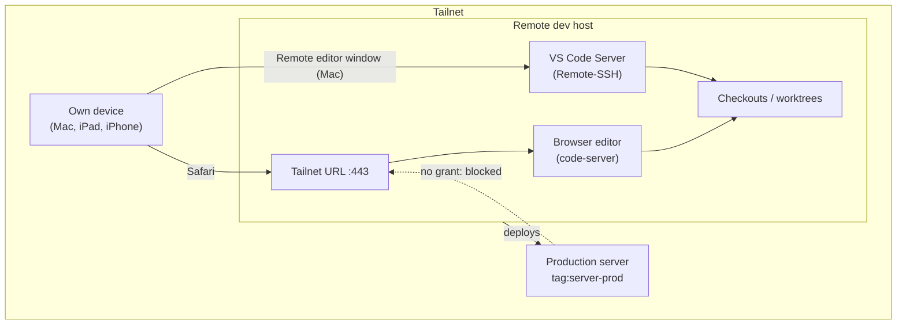
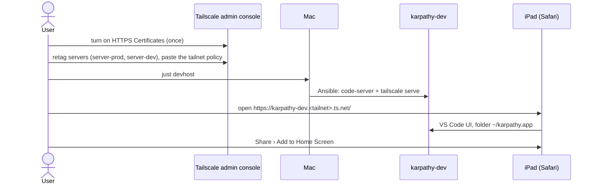

# Domain: VS Code in the browser on the dev host

New and changed terms in the dev-host part of the domain (`specs/system/domain.md`, "Dev hosts").

## New terms

| Term | Meaning | In code |
|---|---|---|
| **Browser editor** | VS Code running on the remote dev host and shown in a browser tab: code-server. Files, terminals, git and extensions run on the server, like in a remote editor window, but the client is any browser on a tailnet device, the iPad first. One service per dev host and user, not one per checkout: the folder is picked in the UI or in the URL (`?folder=`). A client of the dev host: it owns no stack. Not the **VS Code Server** (what Remote-SSH installs in `~/.vscode-server/`): a separate program with its own extensions and user settings. Opened with `just code-web [worktree]`, which knows the address. | role `code_server`, `just code-web` |
| **Tailnet URL** | An `https://<host>.<tailnet>.ts.net[:port]/` address that `tailscale serve` publishes on a dev host, with a certificate Tailscale gets from Let's Encrypt. Reachable from every device in the tailnet that the tailnet policy lets through, nowhere else. The browser editor is the first one (port 443); the dev stacks may follow (phase 2 of #171). | `tailscale serve status` |
| **Tailnet HTTPS** | The tailnet-wide setting (*HTTPS Certificates*, Tailscale admin console › DNS) that lets a node get `*.ts.net` certificates. Tailnet URLs need it. Only the tailnet owner can turn it on; turning it on puts node names into public Certificate Transparency logs. | `tailscale status --json` › `CertDomains` |
| **Own device** | A tailnet device logged in as the user (`autogroup:member`): the Mac, the iPad, the iPhone. The opposite of a **server**, which is tagged instead of owned. Only own devices reach the browser editor. | `autogroup:member` |
| **Server tag** | The tag that names a server's role in the tailnet: `tag:server-prod` for the prod server, `tag:server-dev` for the remote dev host. One tag per role, so the tailnet policy can tell them apart; a rebuilt server gets the same tag through its auth key, while its tailnet IP changes. Replaces the shared `tag:server`. | auth keys, admin console › Machines |
| **Tailnet policy** | The rules for who may **start** a connection to whom in the tailnet (admin console › Access controls). Explicit grants: own devices reach everything, the dev host reaches prod, prod reaches nothing. Its built-in tests refuse an edit that would let prod reach the dev host. Kept as text in `docs/dev-server.md`, pasted by the user; not managed as code. | admin console › Access controls |

## Changed terms

| Term | Change |
|---|---|
| **Remote editor window** | Still the Mac's VS Code over Remote-SSH (`just code`). Now one of two editors on the remote dev host; the browser editor is the other. Both may run at once, on the same checkout too: they share the files, not the editor state. |
| **Remote dev host** | Also serves the browser editor at its tailnet URL. Tagged `tag:server-dev` (was `tag:server`). |
| **Production server** | Tagged `tag:server-prod` (was `tag:server`). Starts no connection on the tailnet: the tailnet policy gives it no grant. |

## How the pieces relate

## Process: first use on the iPad

