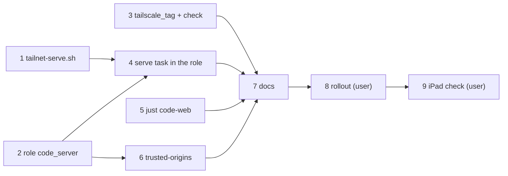

# Plan: VS Code in the browser on the dev host

Test commands: `bash deploy/tailnet-serve.test.sh`, `bash deploy/code.test.sh`,
`bash deploy/ansible/tailscale-tag.test.sh` (seconds each), `bash deploy/ansible/dev.test.sh` (the playbook against a
fresh Ubuntu container, a few minutes), everything `just check`.

## Scripts and roles

- [x] Add `deploy/tailnet-serve.sh <https-port> <target-url>`: exit 3 with the admin-console instruction when
  `CertDomains` is empty; `unchanged` when `serve status --json` already proxies that port's `/` to the target;
  otherwise `timeout 30 tailscale serve --bg --https=<port> <target>` and `changed`; exit 1 with tailscale's output
  when that fails. Add the test to `just check`.
  - Depends on: none
  - Test first: `deploy/tailnet-serve.test.sh` with a fake `tailscale` on the `PATH` (fixture JSON, call log) ›
    "HTTPS off → exit 3, no serve call", "already served → unchanged, no serve call", "other target on the port →
    `serve --bg --https=443 <target>`, changed", "serve fails → exit 1 with its output", "another port's entry is
    left alone" — fails today: the script doesn't exist.
  - Verify: `bash deploy/tailnet-serve.test.sh` → all passed; `grep -q tailnet-serve.test.sh justfile`

- [x] Add the role `code_server` to `dev.yml` (after `devtools`, `when: code_server_enabled`): the pinned `.deb` for
  the host's architecture, `~/.config/code-server/config.yaml` (127.0.0.1:13337, `auth: none`, `cert: false`,
  telemetry and update check off; mode 600) and `code-server@<user>` enabled and started, restarted by a handler on
  change.
  - Depends on: none
  - Test first: `deploy/ansible/dev.test.sh` › "code-server is the pinned version", "`code-server@dev` is active
    and enabled", "code-server answers /healthz on 127.0.0.1:13337", "code-server listens on loopback only", "config:
    mode 600, owner dev, auth none" — fails today: no role installs code-server.
  - Verify: `bash deploy/ansible/dev.test.sh` → all passed

- [x] Give each server its own tag: `tailscale_tag` in the `hetzner` (`tag:server-prod`) and `dev`
  (`tag:server-dev`) inventories; the `tailscale` role names it in the used-key message and asserts after `tailscale
  up` that the node carries it (`roles/tailscale/tasks/tag.yml`, included by `main.yml`). Replace `tag:server` in
  the inventories' comments and `deploy/README.md`.
  - Depends on: none
  - Test first: `deploy/ansible/tailscale-tag.test.sh` runs `tasks/tag.yml` on localhost with a fake `tailscale` ›
    "node has tag:server-dev → passes", "node has tag:server → fails naming tag:server-dev and the admin console",
    "node has no tags → fails" — fails today: `tasks/tag.yml` doesn't exist.
  - Verify: `bash deploy/ansible/tailscale-tag.test.sh` → all passed; `! grep -rnE 'tag:server([^-]|$)'
    deploy/ansible deploy/README.md --exclude='*.test.sh'` (the test names the old tag on purpose); `just check` → green

- [x] Publish code-server with `tailscale serve` from the role when `code_server_tailnet_serve` (default
  `tailscale_enabled`), through `deploy/tailnet-serve.sh 443 http://127.0.0.1:13337`; `changed_when` on `changed`,
  fail with the script's message on exit 3.
  - Depends on: 1, 2
  - Test first: `deploy/ansible/dev.test.sh` puts the fake `tailscale` (HTTPS on) into the container and sets
    `code_server_tailnet_serve: true` › "the role published code-server: serve --bg --https=443
    http://127.0.0.1:13337" — fails today: the role has no serve task.
  - Verify: `bash deploy/ansible/dev.test.sh` → all passed; `bash deploy/tailnet-serve.test.sh` → all passed

- [x] Add `just code-web [worktree]` (`deploy/code.sh --web`): the URL from `KARPATHY_DEVHOST_URL` (default
  `https://karpathy-dev.tailab154c.ts.net`) plus `?folder=<checkout>[/.worktrees/<worktree>]`; `open` it on the Mac,
  print it with a QR code (`qrencode -t ansiutf8`) on the dev host; reject path-like worktree names.
  - Depends on: none
  - Test first: `deploy/code.test.sh` with stubs for `open` and `qrencode` › "--web on the Mac opens the main clone's
    URL", "--web foo opens .worktrees/foo", "--web on the dev host prints the URL and calls qrencode with it, opens
    nothing", "KARPATHY_DEVHOST_URL overrides the address", "--web a/b is refused" — fails today: `code.sh` has no
    `--web`.
  - Verify: `bash deploy/code.test.sh` → all passed; `just --summary | tr ' ' '\n' | grep -qx code-web`

- [x] Set `trusted-origins` in the code-server config to the node's tailnet name (`Self.DNSName` of `tailscale status
  --json`, trailing dot removed) when `code_server_tailnet_serve`.
  - Depends on: 2
  - Test first: `deploy/ansible/dev.test.sh` › "config: trusted-origins is the fake node's name" (the fake answers
    `Self.DNSName: devtest.example.ts.net.`) — fails today: the template has no `trusted-origins`.
  - Verify: `bash deploy/ansible/dev.test.sh` → all passed

## Docs

- [x] Document the browser editor and the tailnet: an *iPad* section in `docs/dev-server.md` (rollout order, the
  tailnet policy text with its tests, the retag, Tailnet HTTPS, `just code-web` and the QR code, the `?folder=` URL,
  Add to Home Screen, keyboard and Esc, symptom rows in *When something goes wrong*), the table in *The picture*,
  and in `deploy/README.md` › Dev server and the prod setup: auth keys tagged `tag:server-prod` / `tag:server-dev`,
  both tags in `tagOwners`.
  - Depends on: 3, 4, 5, 6
  - Test first: none — docs only.
  - Verify: `grep -q 'just code-web' docs/dev-server.md && grep -q 'tag:server-dev' docs/dev-server.md && grep -q
    '"tests"' docs/dev-server.md && grep -q 'tag:server-prod' deploy/README.md`; `just check` → green

## Rollout (user)

- [x] Retag and lock down the tailnet, in this order: (1) Access controls: back up the policy, add the two new tags
  to `tagOwners` only (a tag can't be assigned before); (2) admin console › Machines › *Edit ACL tags*: `karpathy` →
  `tag:server-prod`, `karpathy-dev` → `tag:server-dev`; (3) replace the policy with the one from `docs/dev-server.md`
  (no allow-all `acls`, no `tag:server`; its tests must pass on save); (4) prove from prod that the dev host is
  shut; (5) turn on *HTTPS Certificates* (DNS page); (6) `just devhost` from the Mac; (7) `just deploy` to prod still
  works (tag check passes).
  - Depends on: 7
  - Test first: none — applies the tested roles and the documented policy to the real tailnet and hosts.
  - Verify: `ssh karpathy 'nc -zw5 karpathy-dev 22'` and `… 443` both fail; `ssh karpathy-dev 'nc -zw5 karpathy 22'`
    succeeds; `tailscale serve status` on `karpathy-dev` lists `https://karpathy-dev.tailab154c.ts.net` →
    `http://127.0.0.1:13337`; from the Mac `curl -sf https://karpathy-dev.tailab154c.ts.net/healthz` → JSON; a second
    `just devhost` → `changed=0`
  - Done (user, 2026-10-22, checked from `karpathy-dev` 2026-10-27): both tags in place, policy saved with its tests,
    prod → dev 22 and 443 blocked, dev → prod 22 open, serve and certificate live, `/healthz` 200. The `changed=1` of
    the second `just devhost` was fixed in de7b59e (`dev.test.sh` now runs the playbook twice, `changed=0`); the
    re-run itself needs the Mac. `just deploy hetzner`'s tag check passed; the deploy then stopped on the GitHub
    release lookup (rate limit), unrelated to this change.

- [x] Use it on the iPad: `just code-web` on the dev host, scan the QR code, open `~/karpathy.app`, edit a file, run
  `just --list` in the editor's terminal, install the offered extensions, sign in to the Claude Code extension, add
  the page to the home screen. From the Mac, `just code-web <worktree>` opens that worktree.
  - Depends on: 8
  - Test first: none — manual acceptance on the device the change is for.
  - Verify: each action works, and the editor never shows "reconnecting"; findings go into #171 and, if something
    fails, into a fix with a test first.
  - Done headless (2026-10-27, Playwright WebKit with the *iPad Pro 11 landscape* profile, from `karpathy-dev`):
    workbench and file tree load from the `?folder=` URL, a file opens, the terminal runs `just --list` after *Trust
    Folder & Continue* (now in the docs), the recommended extensions incl. Claude Code are installed, two minutes
    without a websocket close or "reconnecting". The on-device part (QR scan, Home Screen, Claude login) is the
    user's.

System docs are updated at `/spec:archive`.
