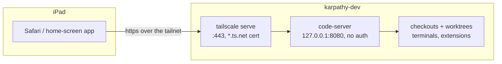

# Proposal: VS Code in the browser on the dev host

**Issue:** [#171](https://github.com/tillg/karpathy.app/issues/171)

## TL;DR

The iPad has no VS Code with Remote-SSH, so today it can't edit code on `karpathy-dev`. This change runs
**code-server** (VS Code in the browser, by Coder) on the remote dev host. It listens on the host's loopback only and
is published to the tailnet with **`tailscale serve`**, which gives it a real `*.ts.net` certificate:
`https://karpathy-dev.<tailnet>.ts.net/`. Safari on the iPad (or any tailnet device) opens it with no certificate
warning, and it can be added to the home screen as an app. There is no password: reaching the tailnet is the
login. Ansible installs it (`just devhost`), pinned like the other dev tools. This is phase 3 ("Editor") of the
[iPad research](../../research/ipad-dev/ipad-dev-report.md), brought forward on its own.

## Why

Issue #171 wants development from the iPad. The research found that the terminal and Claude (Remote Control) work
from the iPad already, but an editor doesn't: VS Code's Remote-SSH, which the Mac uses (`just code`), has no iPad
version. A browser VS Code is the only way to get the same editor, extensions and terminals on the iPad. Of the
options (code-server, openvscode-server, VS Code Remote Tunnels), code-server keeps the traffic inside the tailnet and
needs no extra login, and the user chose it.

## What changes

- **New Ansible role `code_server`** in `dev.yml`: the pinned code-server `.deb` for the host's architecture, its
  config (loopback, `auth: none`, no TLS of its own), the `code-server@<user>` systemd service, enabled at boot.
- **`tailscale serve`** for it, set up by the same role when Tailscale is on: HTTPS on 443 → `http://127.0.0.1:8080`.
  The role stops with a clear message while the tailnet's *HTTPS Certificates* setting is off (a one-time switch in
  the Tailscale admin console that only the user can flip).
- **`just code-web [worktree]`:** opens the browser editor on a checkout. On the Mac in the default browser; on the
  dev host it prints the URL and a QR code for the iPad's camera. The recipe knows the address
  (`KARPATHY_DEVHOST_URL` in `deploy/code.sh`, next to `KARPATHY_DEVHOST`), so nobody has to remember it.
- **Server tags and the tailnet policy:** `tag:server-prod` and `tag:server-dev` replace the shared `tag:server`; the
  `tailscale` role checks a server carries its tag. The policy text (grants plus tests) lives in
  `docs/dev-server.md`.
- **Tests:** `deploy/ansible/dev.test.sh` checks the installed version, the running service, the loopback-only bind,
  the config and the serve call. The serve script, the tag check and `just code-web` each get a test against fakes.
- **Docs:** an *iPad* section in `docs/dev-server.md` (rollout, URL, `just code-web`, home-screen app, keyboard, the
  policy), `deploy/README.md` (tags, the admin console switches).

## Scope

In scope:

- code-server on `karpathy-dev`, reachable from tailnet devices at `https://karpathy-dev.<tailnet>.ts.net/`.
- Opening any checkout or worktree there (`/?folder=/home/<user>/karpathy.app/.worktrees/<name>`).
- The repo's recommended extensions, as far as Open VSX has them (code-server offers them from
  `.vscode/extensions.json`).
- **The tailnet policy:** one server tag per role (`tag:server-prod`, `tag:server-dev` instead of the shared
  `tag:server`) and explicit grants: own devices reach everything, the dev server reaches prod, prod reaches nothing
  on the tailnet. The policy's tests and a check from prod prove it. The user applies it in the admin console; the
  repo holds the text and the renamed tags.

Out of scope (later phases of #171, or not at all):

- **The app preview over `tailscale serve`** (phase 2: the dev stacks' URLs, Caddy's site name, loopback port
  binding). code-server's own port proxy (`/proxy/<port>/`) is not a substitute: the app's absolute paths and service
  worker don't work under a path prefix.
- Terminal apps, Remote Control and other iPad docs from phase 1, except what the editor needs.
- code-server on the Mac, or on prod.
- A password or SSO in front of code-server (the user chose tailnet-only).
- Managing the tailnet policy as code (GitOps); grants for the Instagram relay (`instagram-mac-relay` adds its own).

## Expected outcome

- On the iPad: open `https://karpathy-dev.<tailnet>.ts.net/` in Safari, see VS Code with the last folder, edit,
  run `just check` in its terminal, use the Claude Code extension.
- `just code-web <worktree>` opens it on that worktree from the Mac, or shows a QR code for the iPad on the dev host.
- Prod can start no connection on the tailnet; the policy's tests keep it that way.
- `just devhost` from the Mac installs and later updates it; `changed=0` on a second run.
- `just check` (via `dev.test.sh`) proves the role on a fresh Ubuntu 24.04.

## Risks

- **No password + a flat tailnet:** today every device in the tailnet reaches code-server, and with it a shell as
  the developer (sudo, Docker, the GitHub token, the dev API keys), including the prod server `karpathy`. Hence the
  tailnet policy in scope: prod starts nothing on the tailnet, and the rollout proves it from prod.
- **Open VSX**, not Microsoft's marketplace: an extension missing there can't be installed. All six of
  `.vscode/extensions.json` are on Open VSX today (checked 2026-10-22); a future recommendation might not be.
- **Certificate Transparency:** enabling HTTPS certificates publishes `karpathy-dev.<tailnet>.ts.net` in public CT
  logs. Accepted in the research.
- **iPad Safari keyboard:** some shortcuts (Cmd+W, Cmd+N) go to Safari unless code-server runs as a home-screen app.
  Docs only.
