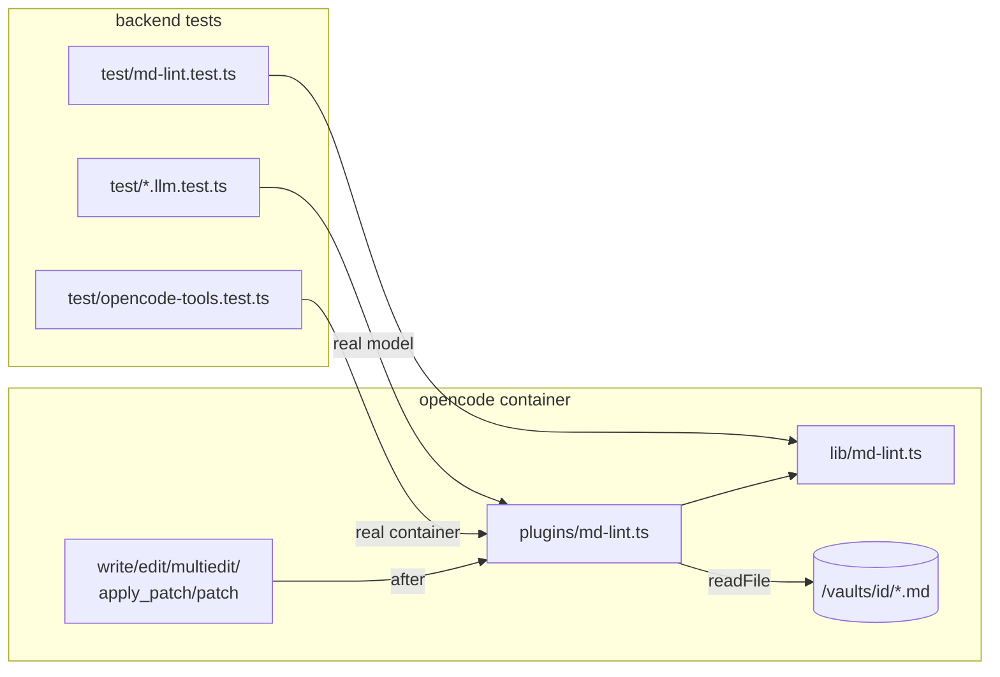

# Architecture: Markdown check as an opencode plugin

## Approach

A second baked-in opencode plugin, `md-lint`, beside `known-url`. It uses the same split: an import-free
library holds the logic, so the backend's vitest loads it directly, and a thin plugin wires it into
opencode's hook.

| File | Role |
|---|---|
| `deploy/opencode/lib/md-lint.ts` | `lintMarkdown(text): Finding[]`, `writtenFiles(tool, args, metadata): string[]`, `checkReport(path, findings): string` and the hook body `appendReport(directory, input, output)`. No opencode imports (only `node:fs`, `node:path`), so the backend tests load it. |
| `deploy/opencode/plugins/md-lint.ts` | Wires `appendReport` into `tool.execute.after` and logs `md-lint ready` on load. Nothing else is exported: opencode calls every export of a plugin module as a plugin. |
| `deploy/opencode/Dockerfile` | Nothing new to copy (`plugins/` and `lib/` are already copied). The bake loop also waits for `md-lint ready`. |
| `packages/shared/src/wikilink.ts`, `relink.ts`; `apps/web/src/lib/media.ts`, `cm.ts` | Accept `\|` as the alias separator: links, the rename rewrite, embeds, the editor's live preview. |



## The hook

opencode 1.18.25 (pinned) gives plugins
`"tool.execute.after"(input: { tool, sessionID, callID, args }, output: { title, output, metadata })`.
Changing `output.output` changes what the model gets as the tool result.

1. `input.tool` not in `edit`, `write`, `multiedit`, `apply_patch`, `patch` → return. `save_url` only saves
   media and PDFs.
2. Paths come from `writtenFiles(tool, args, metadata)`: `args.filePath`, plus `metadata.files[].filePath` and
   `movePath` for patch tools. These are the shapes `apps/backend/src/harness/map.ts` (`writtenPaths`)
   already reads. Keep only `.md`. Resolve relative paths against the plugin's `directory`. Checked in the
   container: this is the session's directory (`/vaults/<id>/<root>`), the same one the model's relative
   `filePath` refers to.
3. Per file: `readFile` (missing, e.g. a deleted file → skip), then `lintMarkdown`, then on findings append
   `\n\n` + `checkReport(vaultPath, findings)`.
4. Each file's read and check is in `try/catch`. A missing file or a directory is skipped silently; any other
   error is logged to stderr (`md-lint: <file>: …`) and leaves the output as it is. `writtenFiles` doesn't
   throw on odd input. The check never breaks a write.

Example report, as the model sees it:

```text
Markdown problems in Wiki/baerbel-we-2026/baerbel-we-2026.md (they render broken in Obsidian). Fix them now:
- line 31 [table-wikilink-pipe] `[[nadine-gartner|Nadine]]`: escape the pipe in a table row → `[[nadine-gartner\|Nadine]]`
- line 60 [wikilink-wrapped] `[[phi-hotel-canalgrande|Phi Hotel`: put the whole link on one line
```

The check reads the **whole file**, not just the changed lines, for two reasons. The tool output doesn't
reliably carry the new text for every tool (patch, multiedit). Older breaks in a file the AI touches
should heal too. The rules have no hits in clipped `Sources/`, so the whole-file check stays quiet there.

## Lint rules (implementation)

- Preprocess: CRLF becomes LF. Then what isn't rendered prose is blanked to spaces, keeping newlines and
  columns: the frontmatter, HTML comments (`<!-- … -->`, also across lines), fenced code blocks (```` ``` ```` /
  `~~~`; a closing fence has the same character, at least the same length and no info string) and inline
  code spans on one line. The fence rules repeat `codeRanges` in `packages/shared/src/relink.ts`, because
  the library is baked into the image on its own.
- `wikilink-wrapped`: `[[`, then one to three line breaks with no `[` or `]` in between, then `]]`. A blank
  line in between (also `>` only) is a paragraph break, so no finding: a lone `[[` in clipped prose. The
  finding's line is the line of `[[`, and `text` is that line's piece from `[[` on.
- `table-wikilink-pipe`: a table is a run of lines starting with `|` (after any `>` blockquote prefix) that
  contains a delimiter row (`|---|`). In each of its rows, every `[[…]]` whose inner text has a `|` not
  preceded by `\`. The fix escapes every such bar.
- Known limits (no finding): tables without a leading `|`, inline code spanning lines, indented code blocks,
  and `[[…]]` in clipped non-Markdown (e.g. Lua strings) outside code fences.

## Wikilink parser change

`parseWikilink(inner)`: if the first `|` is preceded by `\`, the separator is `\|` and the `\` is not part
of the target. The `WIKILINK_RE` match is unchanged (`[^[\]\n]` already allows `\`). In GFM tables
`marked` unescapes `\|` before inline tokenizing, so Read mode may already pass the plain form. The test
checks it either way. Callers in the backend (`relink.ts`, backlinks, graph) get the fix through the shared
parser. The rename rewrite must keep the `\|` spelling when it rewrites a link in a table.

## Key decisions

| Decision | Alternatives considered | Why |
|---|---|---|
| **After-hook + report to the model, no refusal** (grill Q1, revised during apply) | refuse every broken write (before-hook) from the start; refuse broken `write`s as an escalation (built and tested in step 7, then dropped) | Deterministic detection on every write. The model fixes the file with full context. In step 7 the dev model (qwen2.5:3b) ignored the report and also stopped after a refused `write`. With the refusal nothing was written at all, which is worse than a broken table. Whether the model acts on the report is checked against the prod model (GLM-5.3); the 3B tier only proves the report reaches the model. |
| **Whole-file check** (grill Q2; kept after the code review, which raised re-reports of old problems in clipped sources: `Sources/` has none today) | only lines the write changed | Old breaks heal as a side effect. Patch tools give no clean before/after. The AI may touch lines the user didn't ask about, and that shows in the uncommitted diff. |
| **Only AI writes are checked** (grill Q4) | also human saves in the app editor | The ask is "every time it's written by the AI". The editor would need new UI, which is a separate change. |
| **No up-front instruction to the model** (grill Q5) | a rule in the vault agent's `prompt`; a fixed per-turn `instructions` part | The check already catches the problem. A prompt rule costs tokens every turn, and `prompt` replaces opencode's default system prompt. |
| **Two own rules, no linter dependency** (grill Q3) | markdownlint as a library (MD056 + our rules as custom rules); markdownlint's broad rule set; rumdl; remark-lint + wiki-link extension; the Obsidian Linter plugin | State of the art, October 2026: no linter knows Obsidian wikilinks well enough to catch either defect. markdownlint's MD056 does fire on the table case (tested), but only as "Too many cells", and it misses rows whose cell count still matches. It has no rule for wrapped links. Its custom rules would be the same regexes. It costs about 9 MB (46 packages) in the image and flags the 32 clipped mail tables. rumdl (Obsidian flavor) has no custom rules and no Node API. The Obsidian Linter runs only inside Obsidian. Revisit markdownlint if general rules are ever wanted. |
| **Invisible to the user** (grill Q6) | a badge on the tool chip | A badge would need tool output in `mapPart` plus UI work. The correcting edit already shows as one more chip. |

Other options weighed:

| Option | Verdict | Why |
|---|---|---|
| Silent auto-fix in the plugin | rejected | The file changes behind the model, and its next `edit` `oldString` misses. Joining a wrapped alias can also change meaning in a blockquote. |
| Model-callable lint tool | rejected | Optional for the model, so not a check. |
| Instructions only (agent prompt) | rejected as the sole fix | Setting the vault agent's `prompt` replaces opencode's default system prompt. A short rule would also be followed unreliably by small models. The report teaches in context. |
| Backend post-turn check, warning in the UI | not now | It shows the problem to the user after the turn instead of letting the AI fix it during the turn. It could be added later. |

## Security

The plugin reads only files the write tool just wrote, inside the session's directory. It writes nothing
and adds no network access. Report text is built from the file content, which the model already has.

## Integration points

- Image bake: the readiness loop in `deploy/opencode/Dockerfile` must also grep `md-lint ready`, or a plugin
  that fails to load would pass the build silently.
- Tool chips (`apps/backend/src/harness/map.ts`): unchanged. `mapPart` doesn't carry tool output, so the
  report goes to the model only. The user sees the correcting edit as one more chip.
- Demo run book: a *Try it* step in `Karpathy Demo.md`.
