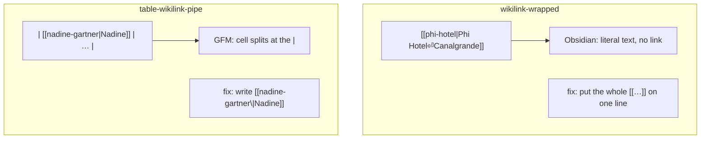
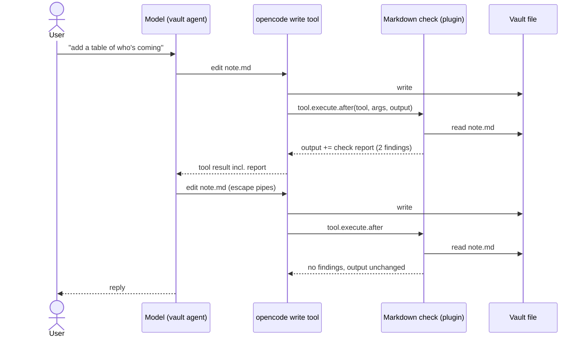

# Domain: Markdown check on AI writes

## New terms

| Term | Meaning |
|---|---|
| **Markdown check** | A deterministic pass over one `.md` file's text that returns its findings. It doesn't use an LLM and doesn't write files. It runs after every AI write of a `.md` file. |
| **Rule** | One kind of breakage the check knows, with an id, a message and a fix hint. Two rules exist: `wikilink-wrapped` and `table-wikilink-pipe`. |
| **Finding** | One hit of a rule: `{ rule, line, text, fix }`. `line` is 1-based, and `text` is the offending snippet, trimmed. |
| **Check report** | The text appended to a write's tool output when a file has findings: the vault path, one line per finding, and the instruction to fix them. Only the model reads it. Tool chips don't show tool output. |

## The two rules

Both mirror what Obsidian does. The app's renderer already behaves the same way for wrapped wikilinks
(`WIKILINK_RE` excludes `\n`).



- **`wikilink-wrapped`**: a `[[` whose closing `]]` comes after one or more line breaks, with no `[` or `]`
  in between. Continuation lines may start with `> ` (blockquote) or indentation (list), which is how the
  wrap usually looks. Restricting the text in between keeps clipped prose like ``Type [[ to link …``
  followed by a later `![[image]]` out. So does a blank line in between: a paragraph break.
- **`table-wikilink-pipe`**: a row of a GFM table and a `[[…|…]]` in it whose `|` is not escaped as `\|`.
  A table is a run of lines that start with `|`, also inside a blockquote (`> |`), and that has a
  delimiter row (`|---|`). A lone prose line starting with `|` is not a table.

Both rules skip what isn't rendered prose: the frontmatter, HTML comments, fenced code blocks
(```` ``` ````, `~~~`) and inline code spans. Dataview JS in code blocks contains `||` and `[[`. A file with
Windows line endings (CRLF) is checked like one with LF.

## Changed concept: wikilink syntax

`[[target#heading\|alias]]` is a valid wikilink: the table-safe spelling of `[[target#heading|alias]]`.
Every part of the app that parses wikilinks treats the `\` before the alias bar as part of the separator,
not of the target. Today `parseWikilink('nadine-gartner\\|Nadine')` yields the target `nadine-gartner\`,
which resolves to no note. This holds for Read mode, the editor's live preview, backlinks, the graph and the
link rewrite on rename or move.

## Who does what



- **The model** owns the fix: it gets the report and edits the file again.
- **The plugin** only reads and reports. It never writes, and it never fails the tool call: a check that
  crashes leaves the output as it is.
- **The user** sees nothing new. The correcting edit is an ordinary tool chip.
