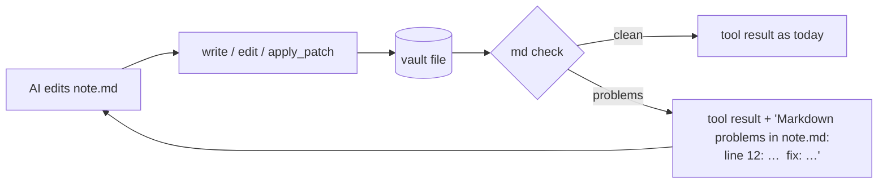

# Proposal: check every Markdown file the AI writes

**Issue:** [#118](https://github.com/tillg/karpathy.app/issues/118)

## What

Every time the AI writes or edits a `.md` file in a vault, a deterministic check reads the file and looks
for Markdown that Obsidian renders broken. If it finds any, the AI is told right away, in the result of the
same write, so it fixes the file in the same turn. The check is in the harness, not in the model's hands:
the AI can't skip it.

## Why

The AI writes Markdown that looks fine as text but doesn't render. Issue #118 names
`baerbel-we-2026.md` in the MyLife vault and "links with a line break in between". A survey of both
production vaults (`frechen_wiki`, 356 files; `mylife_wiki`, 3,869 files) found two breakage classes in
AI-written wiki pages. Neither appears in clipped raw sources:

| Class | What the AI wrote | What Obsidian shows | frechen_wiki | mylife_wiki |
|---|---|---|---|---|
| **Wrapped wikilink** | `[[phi-hotel-canalgrande\|Phi Hotel`⏎`Canalgrande]]`, also inside a blockquote (`⏎> Margherita]]`) | literal `[[…` text, no link | 2 | 5 |
| **Alias pipe in a table row** | `\| [[nadine-gartner\|Nadine]] \| …` with an unescaped `\|` | the cell splits, the table grows a column, the link target is mangled | 9 lines | 3 lines |

Cause: the model hard-wraps prose at ~80 columns and doesn't know two Obsidian rules. A wikilink can't
span lines, and a `|` inside a table cell must be written `\|`. Instructions alone don't make this
reliable: the model has to see the problem on the file it just wrote.

Other findings from the survey are **not** AI-made and are out of scope. They are mail-clipper metadata
tables with a `|` in the subject, mojibake from mail encodings, and Instagram clips' `#️⃣` lines (all in
`Sources/`). One table row in mylife_wiki lost its table after a blockquote. It is a single case, so it
gets no rule yet.

## Scope

- **In:**
  - A Markdown check with two rules (wrapped wikilink, unescaped alias pipe in a table row), run after
    every successful `write`, `edit`, `multiedit`, `apply_patch` or `patch` of a `.md` file.
  - Findings appended to that tool call's output, so the model sees them and fixes the file.
  - The app's own wikilink parser accepts the escaped form `[[target\|alias]]`. That is the form the
    check tells the AI to write, so it must resolve in Read mode, backlinks, the graph and the link rewrite
    on rename.
- **Out:**
  - A "lint tool" the model may call. The issue floats one, but a tool the model can skip is not a check.
    The user's ask is "every time it's written by the AI".
  - Auto-fixing the file behind the model's back. The model's view of the file would go stale, and its
    next `edit` would miss its `oldString`.
  - Repairing the pages that are already broken. That is vault content, not app code. It gets a one-off
    mechanical cleanup in `frechen_wiki` and `mylife_wiki` instead: join wrapped links, escape the pipes,
    one commit per vault, after the user has reviewed the diff (grill Q7). A future AI edit of a page
    reports old breaks too, so anything missed still heals.
  - Checking the user's own saves in the app editor (grill Q4). Telling the user that the check fired
    (grill Q6).
  - Markdown written by Claude Code on the Mac. Most broken files carry no karpathy.app agent trailer, so
    many were written there. This change only guards writes made through karpathy.app. Vault-side guards
    (a rule in the vault's `AGENTS.md`, an Obsidian linter) are the vault owner's call.
  - A general Markdown linter (markdownlint, rumdl, remark-lint, the Obsidian Linter). As of October 2026
    none of them catches either defect properly. markdownlint flags the table case only as "too many
    cells". The full comparison is in architecture.md, Key decisions (grill Q3).

## Expected outcome

- When the AI writes one of the two broken patterns, the write's tool result names the file, line and fix,
  and the AI corrects it in the same turn. An LLM test against the prod model proves this end to end. A
  small model may ignore the report: the 3B dev model does. The file then stays as written, which is still
  better than refusing the write (tried during apply, grill Q1 revised).
- `[[target\|alias]]` renders, resolves and shows in backlinks like `[[target|alias]]`.
- No new setting, no new UI. The tool chips stay as they are. A correcting second edit shows as one more
  chip.
