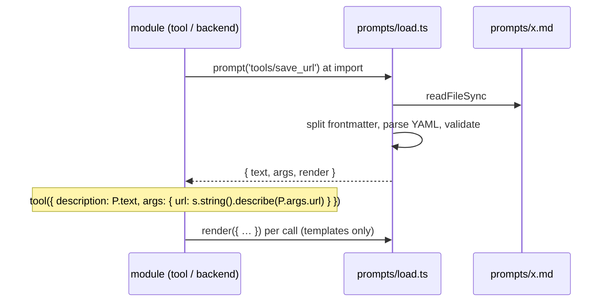
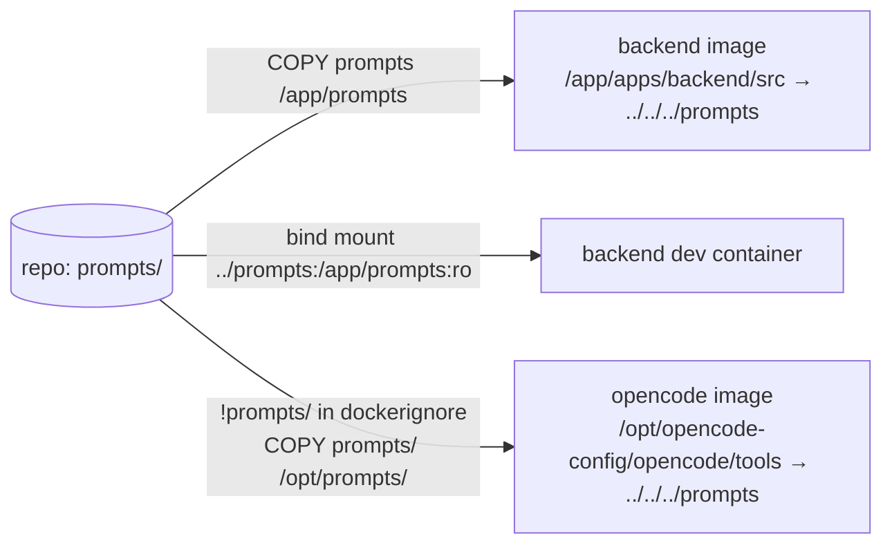

# Architecture: prompt files and their loader

## Layout

```text
prompts/
  load.ts                          # the loader (Node in the backend, Bun in opencode)
  local-time.md                    # backend: hidden line of every turn
  command-turn.md                  # backend: hidden wrapper of a command turn
  commit-message-request.md        # backend: user message of the commit-message turn
  look-at-image-question.md        # opencode lib: default question to the vision model
  agents/
    commit-message.md              # opencode.json agent prompt, via {file:…}; no frontmatter
  tools/
    suggest_next.md  current_page.md  open_note.md  open_url.md
    look_at_image.md  user_location.md  move_to_sources.md  save_url.md
```

The directory sits at the repo root, as the issue asks. Both consumers reach it by the same
relative path: `../../../prompts/load.ts` works from `apps/backend/src/…` and from
`deploy/opencode/{tools,lib}/` in the repo. It also works in both images, because each image puts the
directory where that path lands (see [Packaging](#packaging)).

## File format

The body is the exact text the model receives. It is sent verbatim, never rendered as Markdown;
`.md` is for reading and editing. Newlines at the very start and end of the body are trimmed. Every
other byte counts, so a one-paragraph description stays on one line.

The frontmatter is a **closed schema** with two keys, and both are optional:

| Key | Type | Used by |
|---|---|---|
| `variables` | list of names | templates. Every `{{name}}` in the body must be listed, and every listed name must appear in the body. |
| `args` | map of argument name → string | tool files only: the argument descriptions (`.describe(…)`) |

A tool file (`prompts/tools/suggest_next.md`):

```markdown
---
args:
  prompt: The suggested next user message, one line, at most 160 characters
---
Suggest the user's next message, shown greyed out in their chat box; … Never mention the suggestion in your answer.
```

A template (`prompts/local-time.md`):

```markdown
---
variables: [time, zone, offset, locale]
---
User's local time: {{time}}, {{zone}} ({{offset}}){{locale}}. (Context from the app, not part of the user's message: use it for 'today', 'now' and dates in note names instead of the server date; do not mention it unless asked.)
```

Variables hold values, never logic. Where today's code chooses between texts, the code passes a
ready-made value, for example `locale` is `''` or `', locale de-DE'`. The same goes for the commit
request: `files` is the joined `kind: path` lines, and `diff` already carries `[diff truncated]`.
These short connective fragments stay in code. Moving them out would need conditionals in the
template.

## The loader (`prompts/load.ts`)

```ts
export interface Prompt {
  text: string;                                       // body, for files without variables
  args: Record<string, string>;                       // tool argument descriptions ({} if none)
  render(vars: Record<string, string>): string;       // body with {{vars}} filled in
}
export function prompt(name: string): Prompt;          // 'tools/suggest_next', 'local-time', …
```

- **Synchronous, at module load.** Callers write `const P = prompt('local-time')` at the top level.
  A missing or invalid file then fails at import:
  - backend: the server doesn't start;
  - opencode: the tool doesn't load, so the image's **bake step fails the build**. Every tool is
    already checked there.
- **Path** from its own location: `readFileSync(new URL(`./${name}.md`, import.meta.url))`.
  `prompts/load.ts` must sit inside `prompts/`, the one place where that resolves the same way in
  every runtime.
- **YAML** is parsed by `globalThis.Bun?.YAML?.parse` in opencode (Bun 1.3.14 in the pinned image,
  checked) and by the `yaml` package in Node (`await import('yaml')`, top level, run only when Bun is
  absent). `yaml` becomes a direct dependency of `apps/backend`; the workspace already has it. The
  opencode image needs nothing new. We don't rely on its transitive `yaml`, which belongs to
  `@opencode-ai/plugin`.
- **Validation at load:** frontmatter keys ⊆ {`variables`, `args`}; `args` values are strings; the
  body's placeholders = `variables` exactly. At render: the keys of `vars` = `variables` exactly.
  Any mismatch throws with the file name.
- **Render** replaces `{{name}}` in one pass, so a value that contains `{{…}}` (a diff, a skill
  body) is not expanded again.



## The commit-message agent prompt

An agent's system prompt lives in `opencode.json`, which opencode reads, not our code. It becomes
`"prompt": "{file:/opt/prompts/agents/commit-message.md}"`: opencode's file substitution, resolved
when the config loads. The file has no frontmatter, because opencode inserts the whole file. The
loader's validation doesn't apply to it, but the guard test checks that it exists and has no `---`
header.

Rejected for this prompt:

- **opencode Markdown agents** (`agent/commit-message.md`). This moves the agent out of the
  managed config in `/etc/opencode`, the one layer a vault's own config can't override. It also
  splits its `permission: {"*": "deny"}` from the rest of the security config.
- **Passing it as `system` from the backend.** opencode *adds* a `system` value to the agent's
  prompt; it doesn't replace it. With no agent prompt, the model would get opencode's long default
  coding prompt plus ours. That is a behavior change.

The plan's first step is a spike that shows `{file:…}` resolves in the managed config of the pinned
opencode (1.18.25). If it doesn't, the fallback is to inline the text at image build. That would be a
`RUN` that writes the file's contents into `/etc/opencode/opencode.json`, so the prompt file stays the
source.

## Call sites

| Module | Before | After |
|---|---|---|
| `deploy/opencode/tools/*.ts` (8) | `description: "…"`, `.describe('…')` | `const P = prompt('tools/<name>')`, then `description: P.text` and `.describe(P.args.<arg>)` |
| `deploy/opencode/lib/save-url.ts` | `SAVE_URL_DESCRIPTION` | constant removed. `tools/save_url.ts` loads its file like every other tool. |
| `deploy/opencode/lib/look-at-image.ts` | `DEFAULT_QUESTION` literal | `prompt('look-at-image-question').text` |
| `apps/backend/src/harness/local-time.ts` | template literal | `P.render({ time, zone, offset, locale })` |
| `apps/backend/src/harness/command.ts` | `commandInstructions` literal | `P.render({ name, instructions: expanded })` |
| `apps/backend/src/commit-message.ts` | array joined inline in `run()` | `commitRequest(files, stat, diff)` (pure, exported), which renders `commit-message-request` |
| `deploy/opencode/opencode.json` | `agent.commit-message.prompt` string | `{file:/opt/prompts/agents/commit-message.md}` |

## Packaging



- **Backend image** (`deploy/backend/Dockerfile`): the prod stage gets `COPY prompts prompts`, which
  lands at `/app/prompts`.
- **Backend dev** (`deploy/compose.dev.yml`): bind-mount `../prompts:/app/prompts:ro`. nodemon gets
  `--watch ../../prompts` and `--ext ts,md`, so a prompt edit restarts the backend like a code edit.
- **opencode image**: add `!prompts/` to `Dockerfile.dockerignore`, then
  `COPY prompts/ /opt/prompts/` before the bake step, and make `/opt/prompts` read-only with
  `/opt/opencode-config`. The image has no dev bind mount, so a tool prompt edit needs an image
  rebuild in dev. That is the same as a tool code edit today; this change doesn't add hot reload.
- **Type check:** `apps/backend/tsconfig.json` includes `src` and `test`; the loader comes in through
  imports. `just check` must stay green.

## Keeping it that way

- **ADR 0006** (`docs/adr/0006-prompts-as-markdown-files.md`), in the house format: the decision as
  the H1, then one dense paragraph covering the rule, the mechanism, what was rejected and the
  re-check rule.
- **Guard test** `apps/backend/test/prompts-guard.test.ts`:
  1. No `deploy/opencode/tools/*.ts` has a string literal as `description:` or in `.describe(…)`.
  2. Every `agent.*.prompt` in `opencode.json` is a `{file:/opt/prompts/…}` reference to an
     existing file. The test runs on the host, so it maps `/opt/prompts/` to `<repo>/prompts/`.
  3. Every `prompts/**/*.md` is used: named by a `prompt('…')` call in `apps/` or `deploy/`, or by
     `opencode.json`. No orphans.
  4. Every prompt file loads, which runs the loader's validation.

  Backend string literals can't be classified mechanically. For them the ADR and review are the
  guard.
- **Packaging test**: the characterization test's final form. It compares what the running opencode
  container exposes with the prompt files: every tool's description and argument descriptions, and
  the commit-message agent's prompt. This catches a missing `COPY` or a wrong path.
- **CLAUDE.md**: the rule "model-facing changes put `npm run test:llm` in their `Verify:`" names
  prompt files (`prompts/`) explicitly.

## Proving byte identity

A characterization test is written first, from today's code:
`apps/backend/test/prompt-texts.test.ts` with `test/fixtures/prompt-texts.golden.json`. It records
every in-scope text:

- in-process:
  - `localTimeLine` for a fixed date, with and without a locale;
  - `commandInstructions`;
  - `commitRequest` on a small fixture, including the truncated case;
  - the vision request's default question;
- in the opencode container (default tier, `DEAD_MODEL`):
  - each tool module's description and argument descriptions;
  - the commit-message agent's resolved prompt.

Every migration step keeps it green. At the end the golden file is deleted and the test becomes the
packaging test: the expected values come from the prompt files.

## Tradeoffs considered

| Option | Why not |
|---|---|
| A `prompts/` per runtime (`deploy/opencode/prompts`, `apps/backend/prompts`) | Packaging would be simpler, but the issue asks for one place. Two directories would bring back the hunt. |
| Build-time codegen (`prompts/*.md` → a generated `.ts`) | A second copy of every prompt that has to stay in sync with the source. |
| A templating library (Mustache, Handlebars) | We only need `{{var}}` replacement, and logic in prompts is exactly what we want to keep out. |
| Tool output in prompt files too | Rejected in the scope question: it is data, not instruction, and it would add many small files. |
| A tiny hand-written frontmatter parser | Bun.YAML and `yaml` already exist in the two runtimes; real YAML costs nothing. |

## Risks

- **`{file:…}` in the managed config**: the spike settles this, and a fallback is defined.
- **Bun vs `yaml` parsing differences**: the schema is two keys of plain strings and lists. The
  in-container test catches any difference.
- **Long lines** in the prompt files, which have to stay byte-identical. The first edit that
  rewraps a prompt changes the model's input. That is acceptable, but it needs `npm run test:llm`,
  like any prompt edit.
