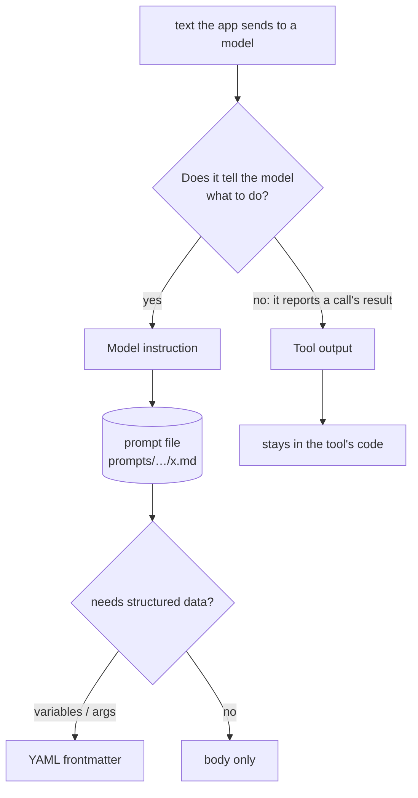
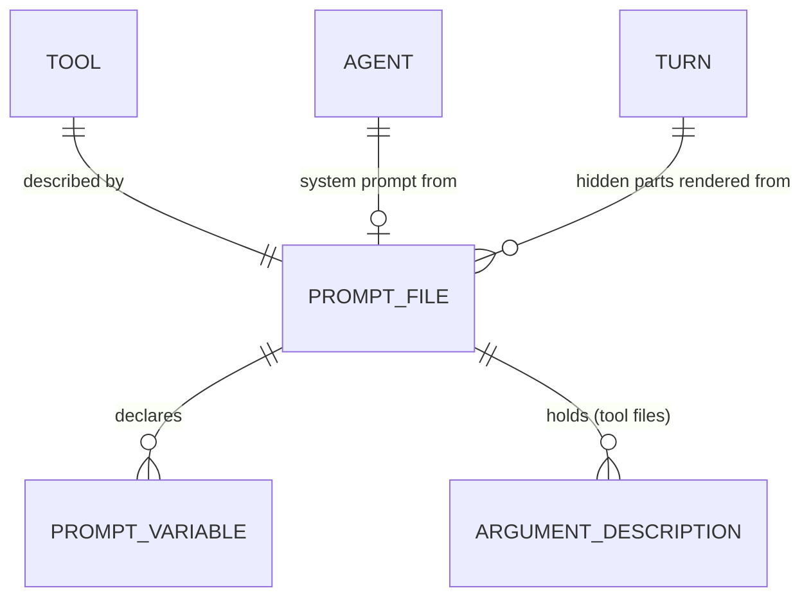

# Domain: prompt files

The domain already has **Prompt (body)**, which is what the web app posts to start a turn. The
terms below are about the other side: text that *the app* writes for a model. Their names keep the
two apart.

## New terms

| Term | Meaning | In code |
|---|---|---|
| **Model instruction** | Text the app writes to tell a model what to do or how to use something. This covers an agent's system prompt, a tool's description and argument descriptions, the hidden parts of a turn (local-time line, command-turn wrapper), the request text of a one-shot task (commit message) and the default vision question. *Avoid:* "prompt" on its own, which is the prompt body. | the `.md` files in `prompts/` |
| **Tool output** | Text a tool returns to the model as the result of a call, including error and refusal messages and the md-lint report. It is data about the call, not an instruction, so it stays in the tool's code. | `lib/*.ts` return values and `throw`s |
| **Prompt file** | One model instruction as one Markdown file in `prompts/`. The body is the text the model receives. Optional YAML frontmatter holds the structured data, and only that. A file has no frontmatter when the instruction needs none. | `prompts/**/*.md` |
| **Prompt variable** | A `{{name}}` placeholder in a prompt file's body. The caller fills it in on every use, with values such as the time, the command name or the diff. A file that has variables lists them in its frontmatter (`variables:`). The loader refuses a variable that is missing, undeclared or unused. Variables hold values, never logic: no conditionals or loops in a prompt file. | `prompt(name).render({…})` |
| **Argument description** | The model-facing description of one tool argument. It sits in the tool's prompt file under `args:`, keyed by the argument name. | `.describe(p.args.<name>)` |

## Rule

**Model instructions live only in prompt files.** Code loads them. Code never spells one out as
a string literal. Tool output is the stated exception. ADR 0006 records the rule, and a guard test
enforces it.

## Relationships

## Changed terms

- **Local time** (glossary): unchanged in meaning. The wording of the hidden line moves to
  `prompts/local-time.md`.
- **Suggestion / ghost text**: unchanged. The standing instruction for `suggest_next` is in
  `prompts/tools/suggest_next.md`.
