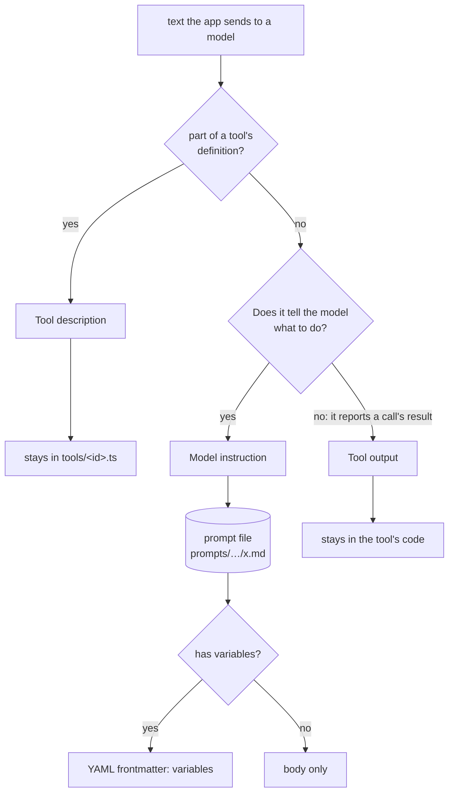
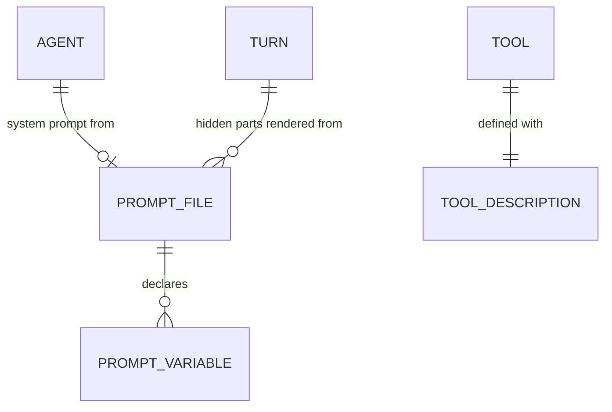

# Domain: prompt files

The domain already has **Prompt (body)**, which is what the web app posts to start a turn. The
terms below are about the other side: text that *the app* writes for a model. Their names keep the
two apart.

## New terms

| Term | Meaning | In code |
|---|---|---|
| **Model instruction** | Text the app writes to tell a model what to do: an agent's system prompt, the hidden parts of a turn (local-time line, command-turn wrapper), the request text of a one-shot task (commit message) and the default vision question. *Avoid:* "prompt" on its own, which is the prompt body. | the `.md` files in `prompts/` |
| **Tool description** | What the model reads about a tool: its description and the description of each argument. It also instructs the model, but it is part of the tool's **definition**, together with the signature (name, arguments, types), so it stays in the tool's code. It is not a prompt file. | `description:` and `.describe(…)` in `deploy/opencode/tools/<id>.ts` |
| **Tool output** | Text a tool returns to the model as the result of a call, including error and refusal messages and the md-lint report. It is data about the call, not an instruction, so it stays in the tool's code. | `lib/*.ts` return values and `throw`s |
| **Prompt file** | One model instruction as one Markdown file in `prompts/`. The body is the text the model receives. Optional YAML frontmatter holds the prompt variables, and only those. A file has no frontmatter when it has no variables. Its name is the topic: the agent id (`agents/commit-message.md`), otherwise kebab-case (`local-time.md`). The folder says who uses it. | `prompts/**/*.md` |
| **Prompt variable** | A `{{name}}` placeholder in a prompt file's body. The caller fills it in on every use, with values such as the time, the command name or the diff. A file that has variables lists them in its frontmatter (`variables:`). The loader refuses a variable that is missing, undeclared or unused. Variables hold values, never logic: no conditionals or loops in a prompt file. | `prompt(name).render({…})` |

## Rule

**Model instructions live only in prompt files.** Code loads them, and code never spells one out
as a string literal. Tool descriptions and tool output are not model instructions in this sense:
they belong to the tool and stay in its code. ADR 0006 records the rule, and a guard test enforces
it.

## Relationships

## Changed terms

- **Local time** (glossary): unchanged in meaning. The wording of the hidden line moves to
  `prompts/local-time.md`.
