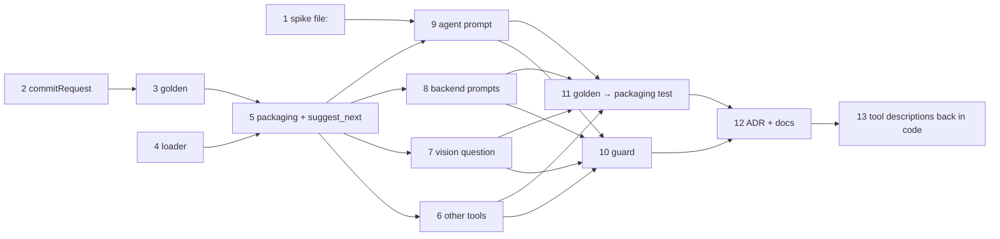

# Plan: AI prompts as .md files

First a characterization test freezes today's texts. Then the loader and the packaging come in,
and the prompts move one group at a time with the frozen texts staying green. A guard and the ADR
close the change. Commands: `npm test -w apps/backend -- <file>`, full suite `just check`, model tier
`npm run test:llm`. The opencode tests build the image themselves (`test/opencode-container.ts`).

## Ground work

- [x] Spike: `{file:…}` resolves in the managed config of opencode 1.18.25 (2026-10-21, by hand: `docker run` of the test image)
  - Result:
    - `{file:/vaults/spike.md}` in a mounted `/etc/opencode/opencode.json` resolves; `GET /agent` returns the file's text with the trailing newline trimmed (`"SPIKE line one\nline two"`).
    - In `OPENCODE_CONFIG_CONTENT`, the managed config's literal prompt wins. That's correct: it's the layer nothing overrides.
    - So `agents/commit-message.md` can end in `\n`. Step 9's test against the real file is the permanent check; no throwaway mount option was added to the test helper.
  - Depends on: none
  - Test first: `apps/backend/test/opencode-tools.test.ts` › "the commit-message agent's prompt comes from a {file:} reference".
    - Setup: use what `test/opencode-container.ts` already provides. Put the file in the `/vaults` mount (`/vaults/spike.md`, ending in `\n`). Override the agent through `OPENCODE_CONFIG_CONTENT` with `commit-message.prompt` = `{file:/vaults/spike.md}`.
    - Read the resolved prompt with `GET /agent`. If 1.18.25 doesn't expose it there, use `GET /config`, or read the system prompt of a `DEAD_MODEL` session's first message.
    - Assert **exact** byte equality with the file, so you learn whether the trailing newline is stripped. That decides how step 9 writes `agents/commit-message.md`.
    - The spike must also show that substitution runs for the managed `/etc/opencode/opencode.json`, not only for `OPENCODE_CONFIG_CONTENT`.
    - Fails today: no such file or reference. If opencode returns the literal `{file:…}`, switch to the fallback in architecture.md (inline it at image build) and adjust step 9 before going on.
  - Verify: `npm test -w apps/backend -- opencode-tools.test.ts` → green; the spike's own fixture is removed again in step 9
- [x] Extract the commit request into a pure `commitRequest(files, stat, diff)`
  - Depends on: none
  - Test first: existing `chat.test.ts` (commit fallbacks) and `api.test.ts:912` pass before and after; new `apps/backend/test/commit-message.test.ts` › "commitRequest lists files, stat and diff" and "a diff over MAX_DIFF ends in [diff truncated]". Fails today: no export.
  - Verify: `npm test -w apps/backend -- commit-message.test.ts chat.test.ts api.test.ts` → green
- [x] Characterization test: every in-scope text frozen in a golden file (written with `UPDATE_GOLDEN=1`; the truncated commit request is stored as length + end)
  - Depends on: 2
  - Test first: `apps/backend/test/prompt-texts.test.ts` + `test/fixtures/prompt-texts.golden.json`, captured from today's code.
    - In-process: `localTimeLine` (fixed `Date`, `Europe/Berlin`, with locale `de-DE` and without); `commandInstructions('query', 'BODY')`; `commitRequest` on a two-file fixture, short and truncated; the default question from `buildRequest` without `question`.
    - In the opencode container (`DEAD_MODEL`): one `opencode run` script imports each of the 8 tool modules and prints `description` plus every argument's `.description`; the commit-message agent's prompt via `GET /agent`.
    - It is red until the golden file is written once from the current output. Check by hand that the golden content matches today's sources, then it is green.
  - Verify: `npm test -w apps/backend -- prompt-texts.test.ts` → green; `git diff --stat` shows no source change
- [x] The loader `prompts/load.ts`
  - Depends on: none
  - Test first: `apps/backend/test/prompt-load.test.ts`, on fixture prompt files in a temp dir (the loader takes an optional base URL for tests):
    - "body without frontmatter is the text";
    - "leading/trailing newlines trimmed, inner bytes kept";
    - "args map read";
    - "unknown frontmatter key throws with the file name";
    - "placeholder not in variables throws";
    - "declared but unused variable throws";
    - "render with a missing or an extra key throws";
    - "a value containing {{x}} is not expanded again";
    - "missing file throws at prompt()".

    Fails today: no loader. Add `yaml` to `apps/backend` dependencies.
  - Verify: `npm test -w apps/backend -- prompt-load.test.ts` → green; `just check` → green

## Moving the prompts

- [x] Packaging for both images + the first prompt file: `suggest_next`
  - Result (2026-10-21):
    - Bake and golden green; nodemon restart seen on stack 3.
    - `test:llm` 30/32. The 2 `/research` misses passed on the re-run, on this tree and on `HEAD` (model flake).
    - `e2e/ai-suggest-next.spec.ts` **skipped**, agreed with the user: a local `ssh karpathy-dev` tunnel holds localhost:8010–8090, so the e2e run can't reach the stack.
    - Prod backend image (`--target prod`): `/app/prompts` is present, and `prompt()` loads the backend prompts with `yaml` from the prod deps.
  - Depends on: 3, 4
  - Steps:
    - Write `prompts/tools/suggest_next.md`, and load it in `tools/suggest_next.ts`.
    - opencode image: add `!prompts/` to `Dockerfile.dockerignore`, add `COPY prompts/ /opt/prompts/`, and make `/opt/prompts` read-only.
    - Backend: `COPY prompts prompts` in the prod stage, the dev bind mount `../prompts:/app/prompts:ro`, and nodemon with `--watch ../../prompts --ext ts,md`.
  - Test first: `prompt-texts.test.ts` stays green, which proves the text is byte-identical and the in-container import resolves `/opt/prompts`. Relocate `suggest-next-tool.test.ts` › "suggest_next description" to read `prompts/tools/suggest_next.md` instead of the tool source, with the same three assertions; the proposal approves this edit. It fails before the file exists.
  - Verify:
    - `npm test -w apps/backend` → all green; the image's bake step passes (all tools load);
    - `just dev up` → stack healthy; `touch prompts/tools/suggest_next.md` restarts the backend (nodemon log);
    - `npm run test:llm` → green;
    - `npx playwright test e2e/ai-suggest-next.spec.ts` → green.
- [x] The other seven tools, `SAVE_URL_DESCRIPTION` removed (files generated from the checked golden texts)
  - Depends on: 5
  - Test first: `prompt-texts.test.ts` stays green for every tool. Relocate `save-url.test.ts:80-82` to load `prompts/tools/save_url.md` (same substring assertions, approved in the proposal). It fails while the file is missing.
  - Verify: `npm test -w apps/backend` → all green; `grep -n "SAVE_URL_DESCRIPTION" -r deploy apps` → no match; `npm run test:llm` → green
- [x] Default vision question from `prompts/look-at-image-question.md`
  - Depends on: 5
  - Test first: `prompt-texts.test.ts` (default question) and `look-at-image-tool.test.ts` › "asks for a thorough description by default" stay green; the file is read through the loader.
  - Verify: `npm test -w apps/backend -- look-at-image-tool.test.ts prompt-texts.test.ts` → green; `npm run test:llm -- look-at-image` → green
- [x] Backend prompts: local-time line, command-turn wrapper, commit request
  - Depends on: 5
  - Test first: `prompt-texts.test.ts`, `local-time.test.ts`, `command.test.ts` and `commit-message.test.ts` stay green with `prompts/local-time.md`, `prompts/command-turn.md` and `prompts/commit-message-request.md` rendered through the loader.
  - Verify: `npm test -w apps/backend` → all green; `npm run test:llm` → green (includes the `/query`, `/research` and commit-message turns)
- [x] Commit-message agent prompt via `{file:/opt/prompts/agents/commit-message.md}`
  - Depends on: 1, 5
  - Test first: `prompt-texts.test.ts` (agent prompt from `GET /agent`) stays green after the literal leaves `opencode.json`. Replace the spike's fixture in `opencode-tools.test.ts` with the real file.
  - Verify: `npm test -w apps/backend -- opencode-tools.test.ts prompt-texts.test.ts` → green; `npm run test:llm -- -t "commit"` → green

## Keeping it that way

- [x] Guard test: no inline instruction text, no orphan prompt file
  - Result: each of the 4 mutations failed its rule; the clean tree is green.
  - `just check`: everything green except `deploy/stack.test.sh`'s "needs a free stack" cases. They fail the same way on `HEAD`, because the ssh tunnel makes every port look busy.
  - Depends on: 6, 7, 8, 9
  - Test first: `apps/backend/test/prompts-guard.test.ts` covers the five rules of architecture.md ("Keeping it that way"). Before writing the real test, check that it bites: temporarily add three things and see it fail for each, then remove them.
    - a literal `description: 'x'` in a tool;
    - an unused `prompts/tools/orphan.md`;
    - a 130-character literal passed as `instructions` in `chat.ts`.

    Also check that a tool file whose name isn't its tool id fails rule 3.
  - Verify: `npm test -w apps/backend -- prompts-guard.test.ts` → green; `just check` → green
- [x] Golden file → packaging test (a wrong `COPY` fails the image's bake step, so the test goes red)
  - Depends on: 6, 7, 8, 9
  - Test first: rewrite `prompt-texts.test.ts` so the expected values come from the prompt files (loader, rendered with the same inputs) instead of the golden JSON. Run it against a deliberately wrong `COPY` path once to see it fail. Then delete `test/fixtures/prompt-texts.golden.json`. It was scaffolding for this change, and the deletion is approved with this plan.
  - Verify: `npm test -w apps/backend` → all green; `ls apps/backend/test/fixtures/prompt-texts.golden.json` → no such file
- [x] ADR 0006, CLAUDE.md rule, README layout
  - Depends on: 10, 11
  - Test first: none, because these are docs. md2html lint and `grep` prove it.
  - Steps:
    - Write `docs/adr/0006-prompts-as-markdown-files.md` in the house format: the decision as the H1, then one paragraph with the rule, the mechanism (`prompts/load.ts`, `{file:}`), what is not a prompt file (tool output; app skills stay in `deploy/opencode/skills/`), the value-formatting line, the naming rule, what was rejected and the re-check rule (a new model-facing text means a new prompt file).
    - In CLAUDE.md, name "prompt files (`prompts/`)" in the `npm run test:llm` rule.
    - Add `prompts/` to README's Layout line.
  - Verify: `ls docs/adr/0006-*.md` → exists; `grep -n "prompts/" CLAUDE.md README.md` → both match; `just check` → green; `gh issue view 149` still open (it closes at `/spec:archive`)

## Correction after apply (2026-10-21)

- [x] Tool descriptions back into the tool files, next to the signature (user decision)
  - Depends on: 12
  - Test first: `prompts-guard.test.ts` › "tool descriptions stay in the tool code, next to the signature: no prompts/tools/, no prompt() in a tool". Red while `prompts/tools/` existed.
  - Steps:
    - Restore `deploy/opencode/tools/*.ts`, `lib/save-url.ts` (`SAVE_URL_DESCRIPTION`), `save-url.test.ts` and `suggest-next-tool.test.ts` from `HEAD`, byte for byte.
    - Delete `prompts/tools/`.
    - Drop the guard's one-to-one rule and its literal-description rule.
    - Shrink `prompt-texts.test.ts` to the agent prompt.
    - Drop the loader's `args:` key, which nothing uses any more.
  - Verify:
    - `npm test -w apps/backend` → all green; `npm run typecheck`, `npm run lint` → clean;
    - `git diff HEAD --stat -- deploy/opencode/tools deploy/opencode/lib/save-url.ts` → empty.

    No `test:llm` run: the tool texts are `HEAD`'s again, and the other prompts passed `test:llm` above.

System docs are updated at `/spec:archive`.
