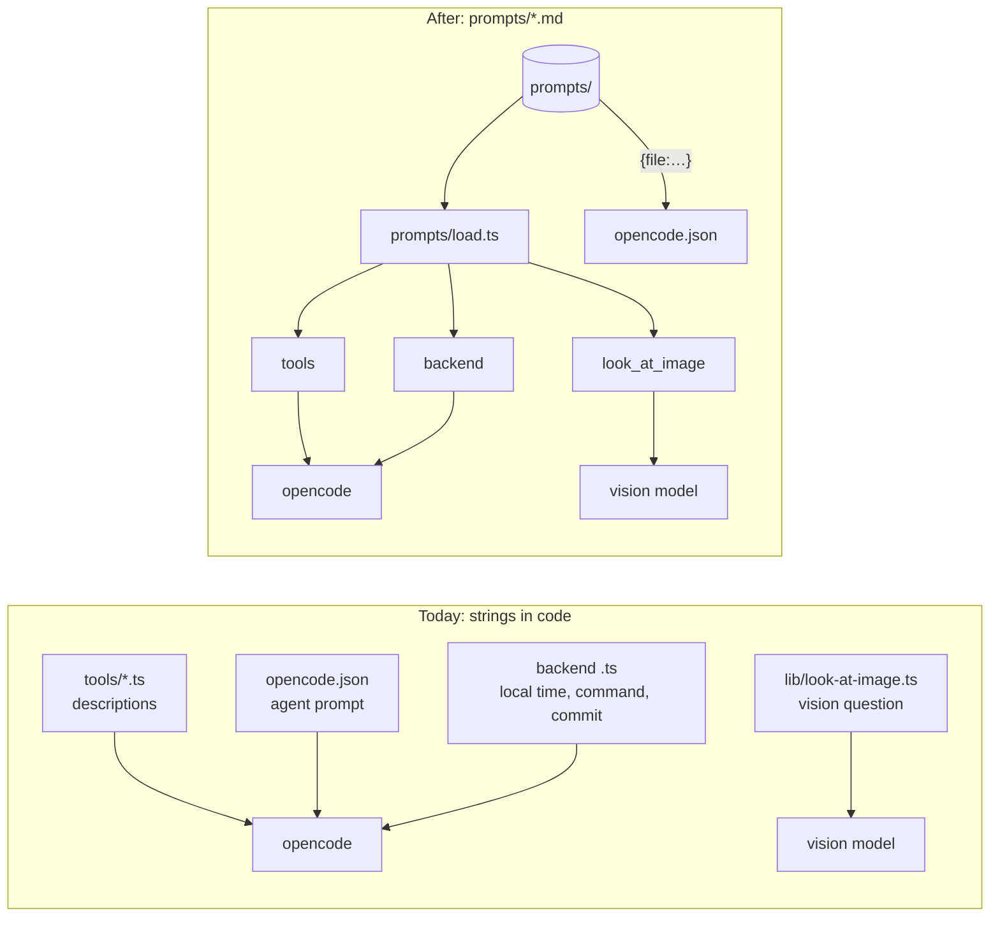

# Proposal: AI prompts as .md files

**Issue:** [#149](https://github.com/tillg/karpathy.app/issues/149)

## Why

The instructions the app gives the model are spread over TypeScript string literals and one JSON
value. They sit in eight tool files, three backend modules, the vision helper and `opencode.json`.
To read or tune what the model is told, you have to know where each one hides, and you have to edit
code to change it. Prompt work is the main tuning knob for small models, and the `@llm` tests often
fail for prompt reasons, so this matters a lot. The issue asks for one place, one file per prompt,
and an ADR so the rule sticks.

## What changes

- **One directory, `prompts/` at the repo root.** Every model-facing instruction text is one `.md`
  file in it. Structured data goes in YAML frontmatter, and only where a prompt needs it:
  - the template variables it takes;
  - a tool's argument descriptions.
- **One small loader, `prompts/load.ts`.** It reads a file once, at module load, and fills in
  `{{variable}}` placeholders. It refuses a missing, unknown or unused variable. Both runtimes use the
  same loader: the backend (Node) and the opencode container (Bun).
- **Every prompt in scope moves to its own file.** The model receives byte-identical text, so this is
  a refactor with no behavior change. A characterization test proves it.
- **ADR 0006** records the rule: model-facing instruction text lives in `prompts/*.md` and never as an
  inline string. A guard test enforces it mechanically.

### In scope (agreed: "instructions to the model")

| Prompt | Today | New file |
|---|---|---|
| Tool descriptions + argument descriptions (8 tools: `suggest_next`, `current_page`, `open_note`, `open_url`, `look_at_image`, `user_location`, `move_to_sources`, `save_url`) | `deploy/opencode/tools/*.ts`, `SAVE_URL_DESCRIPTION` in `lib/save-url.ts` | `prompts/tools/<tool>.md` |
| Commit-message agent's system prompt | `opencode.json` → `agent.commit-message.prompt` | `prompts/agents/commit-message.md` |
| Commit-message request (files, stat, diff) | `apps/backend/src/commit-message.ts` | `prompts/commit-message-request.md` |
| Local-time line | `apps/backend/src/harness/local-time.ts` | `prompts/local-time.md` |
| Command-turn wrapper around the skill text | `apps/backend/src/harness/command.ts` | `prompts/command-turn.md` |
| Default vision question | `deploy/opencode/lib/look-at-image.ts` | `prompts/look-at-image-question.md` |

### Out of scope

- **Tool output text**, which a tool *returns* to the model as data: the md-lint "Fix them now"
  report, the known-url refusals, and the result and error messages of `save_url` and `open_page`.
  These are tool results, not instructions. The ADR names them as the line.
- **Chat titles.** Our code makes none with an LLM. `titleFromFirstPrompt` copies the first prompt,
  and opencode's internal title agent uses opencode's own prompt. The issue's example doesn't exist in
  our code.
- **Skills and vault instructions.** The app skill `deploy/opencode/skills/research/SKILL.md` is
  already Markdown, and opencode discovers it there. A vault's `AGENTS.md`, `CLAUDE.md` and skills
  belong to the vault.
- **Rewording any prompt.** Better prompts come later, and they will be easy once the prompts live
  in files.

## Tests that change by design

Two existing tests assert prompt text in its *current location*, so they have to follow the text.
That is a relocation, not a weakening. They keep the same assertions against the new file:

- `apps/backend/test/suggest-next-tool.test.ts` › "suggest_next description" reads
  `deploy/opencode/tools/suggest_next.ts` as text. It will read `prompts/tools/suggest_next.md`.
- `apps/backend/test/save-url.test.ts` imports `SAVE_URL_DESCRIPTION`. It will load
  `prompts/tools/save_url.md`.

Approving this proposal approves those two edits. The temporary golden fixture of the
characterization test is also removed at the end (plan, last step).

## Expected outcome

- `ls prompts/` lists every instruction the app gives a model, and editing one is a Markdown edit.
- Every existing test stays green, including `npm run test:llm`, with no change to the text the
  model sees.
- A new inline tool description or prompt string fails `just check`.
- ADR 0006 is in `docs/adr/`.
