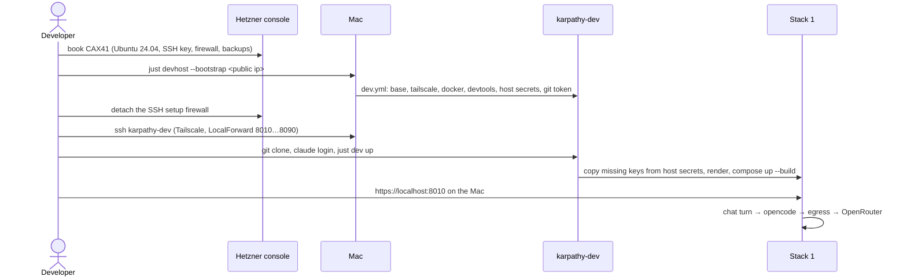

# Architecture: develop on a remote dev host

## Files

| File | Role |
|---|---|
| `deploy/ansible/dev.yml` | Playbook for a dev host: roles `base`, `tailscale`, `docker`, `devtools`. No `vaults_fs`, `app`, `monitoring`. |
| `deploy/ansible/inventories/dev/` | `hosts.yml` (host `karpathy-dev`, `ansible_user` = the developer's login), `group_vars/all/main.yml`, `group_vars/all/vault.yml` (Ansible Vault: OpenRouter and Exa keys, GitHub token, Tailscale auth key). Vault password from the Keychain item `karpathy-ansible-dev` through `vault-pass-client.sh`. |
| `deploy/ansible/roles/base` | Gets a switch for a dev host: the login user takes uid/gid 1000 with sudo and the docker group, and no `deploy` user is created. Prod is unchanged. |
| `deploy/ansible/roles/tailscale` | Hostname from a variable (`karpathy-dev` here). |
| `deploy/ansible/roles/devtools` | New. Pinned Node 22, `just`, ripgrep, jq, netcat, `gh`, the Claude Code CLI, Playwright Chromium with its system deps. Writes the host secrets to `~/.config/karpathy/secrets/` (mode 600) and the GitHub token as the login user's git credential. |
| `deploy/devhost.sh` | Behind `just devhost [--check] [--bootstrap <ip>]`: runs `dev.yml` against the `dev` inventory, the first run as root on the public IP. |
| `deploy/dev.sh` (or `stack.sh`) | Host-secrets fallback: a key missing in the checkout's `deploy/secrets/` is taken from `~/.config/karpathy/secrets/`. |
| `deploy/README.md` | "Dev server": booking (CAX41, Ubuntu 24.04, SSH key, firewall rules, backups on), Tailscale tag, vault, `just devhost`, the `~/.ssh/config` entry. |

## Decisions

### Key decisions

| Decision | Alternatives considered | Why |
|---|---|---|
| The remote dev host is our own server (Hetzner), not a GitHub Codespace (grill 2026-10-21) | GitHub Codespaces (dev container already written) | Always on, no per-core-hour billing, reachable from the Mac over Tailscale like prod. We accept running it ourselves. |
| The app is opened from a Mac (or laptop) through a `localhost` forward; iPad/phone-only use is out of scope | A host-agnostic Caddy dev site plus Vite live reload behind a public URL | Nothing in the proxy or Vite changes. On an iPad you get the shell and `claude`, not the running app. |
| Claude Code logs in with the subscription (`claude` login once per dev host) | `ANTHROPIC_API_KEY` (per-token API billing) | Uses the existing subscription. The API key stays an optional fallback. |
| No personal `~/.claude` config on the dev host: the project's `CLAUDE.md` and plugins are enough | A dotfiles repo with a portable subset; copying `~/.claude` in at create time | Simplest. A dotfiles repo is the follow-up if the personal rules are missed. |
| `remove-ollama` merges to `main` first; this change follows after its smoke test | Merge both together | `remove-ollama` is nearly done and this change builds on it (OpenRouter only). |
| A separate dev server, not the prod server | Dev stacks on prod (`app.karpathy.app`) | Prod stays a box nobody logs into: agents with a shell, Docker and a GitHub token stay away from prod's data, and `e2e` doesn't compete with prod. Prod (CPX22) is too small anyway. |
| Reached over Tailscale only: SSH (terminal or VS Code Remote-SSH) plus `ssh -L 80N0:localhost:80N0` for the app; no public ports | Public SSH; Tailscale to the app port directly | Same model as prod. Caddy's dev site answers only for `localhost`, so the tunnel keeps proxy and Vite unchanged. |
| Always on | Created from a snapshot on demand and deleted afterwards | Clones, stacks and Claude sessions persist; a few euros a month, no create/delete scripting. |
| One developer, several agents in parallel worktrees, sized for about 3 stacks plus `e2e` (≈ 8 vCPU / 32 GB) | One stack only; multi-user | Matches how the Mac is used; the existing stack rules (`just dev up`, 1–9) apply unchanged. |
| Change renamed `codespaces-dev` → `remote-dev` | Keep the name | It's no longer about Codespaces. |
| Set up by Ansible as a new target `dev`: roles `base`, `tailscale`, `docker` plus a new `devtools`; not `app`, `monitoring`, `vaults_fs` | A standalone shell or cloud-init script | Same tool and tested roles as prod. |
| On the dev server the developer user has uid 1000 (docker group) and there is no `deploy` user | Keep `deploy` at 1000, set `APP_UID` in `dev.local.yaml` | `compose.dev.yml` runs the web container as `APP_UID` (default 1000) over bind mounts; the dev server holds no prod vaults. `base` needs a switch for this. |
| The server is booked by hand in the Hetzner console, documented in `deploy/README.md` next to prod | hcloud script, Terraform | Created about once a year, the same way as prod. |
| API keys come from a `dev` Ansible vault (password in the Keychain item `karpathy-ansible-dev`) into `~/.config/karpathy/secrets/`; `dev.sh` falls back to that folder for a key missing in the checkout | Copy keys by hand into every checkout | New worktrees work without copying, on the Mac too. |
| The Codespaces work is deleted: `.devcontainer/`, the README section, the `CLAUDE.md` note. `just resume` stays; the missing-secret hints move to where keys are filled | Keep it as a second, untested option | One remote path, nothing half-maintained. |
| `devtools` installs pinned Node 22, `just`, ripgrep, jq, netcat, `gh`, the Claude Code CLI, Playwright Chromium with system deps. Mac-only hints get Linux wording or a fallback only where they would mislead | Install by hand | Everything `just check`, `just dev up` and `just e2e` need. |
| GitHub access with a fine-grained token limited to `karpathy.app`, `karpathy_demo_wiki` and `ingest_email`, from the `dev` vault | `gh auth login` with the full account; SSH agent forwarding | Narrow, survives disconnects, same vault as the API keys. |
| Hetzner backups on | Off | The server holds unpushed and uncommitted work. |
| Server type CAX41 (ARM, 16 vCPU, 32 GB) | CCX33 (dedicated AMD, x86 like prod, about twice the price); CPX51-class | Cheapest fit; arm64 like the Mac, where dev runs today, so the dev images, opencode and Playwright Chromium already run on it. `prodtest` there tests arm64, not prod's x86. |
| `just devhost [--check]` runs a `dev.yml` playbook against the `dev` inventory; the first run goes to the public IP, like `--bootstrap` | `just deploy dev` through `deploy.sh` | `deploy` keeps meaning "release the app to a target"; no prod-only steps. |
| Connect through a documented `~/.ssh/config` entry `karpathy-dev` (Tailscale hostname, `LocalForward` 8010…8090, `ServerAliveInterval`), then `ssh karpathy-dev` or VS Code Remote-SSH | Forward ports by hand per session | Stacks 1–9 open on the Mac at `https://localhost:80N0`. A Mac dev stack on the same port blocks that forward: work on one dev host at a time. |
| No monitoring or alerts for the dev server | Beszel/Gatus/heartbeat like prod | Automatic updates come from `base`; an outage shows when you connect. |

### Host secrets fallback

`dev.sh up` renders the settings with the checkout's `deploy/secrets/`. Before that, for each key a setting names
(`openrouter_api_key`, `exa_api_key`), a file missing in the checkout is copied from `~/.config/karpathy/secrets/`
(mode 600). A file the checkout already has wins. When neither has the OpenRouter key, the render fails with the
existing missing-secret error, which also names the host-secrets folder. Copying (not reading through) keeps the render
and the settings package unchanged.

### Ansible: one `base`, two kinds of host

`site.yml` (prod) keeps `deploy` at uid 1000 without login and `ops` at 1001. `dev.yml` sets the switch so the login
user (`ansible_user`, the developer) is created at uid/gid 1000 with sudo and the docker group, and the uid-1000 guard
checks that user instead. Hardening (no root login, no passwords), automatic updates and the timezone are shared.
`tailscale` and `docker` are reused unchanged apart from the hostname variable.

### Resuming Claude after a reconnect

An SSH session ends with the connection, and `claude` with it. `just resume` runs `claude --continue`, which picks up
this checkout's last session. It works on the Mac too. Borrowed from ai-sandbox-manager's attach command.

### Reaching the app: localhost forward only

`Caddyfile.dev` serves `https://localhost` with the internal CA, and Vite's HMR client connects to `wss://<host>:80N0`.
The SSH `LocalForward` from the Mac's `localhost:80N0` to the server's `localhost:80N0` keeps both true, so nothing in
the proxy or Vite changes. The server's dev stacks bind only to its loopback; Tailscale carries only SSH.

### Claude Code

`devtools` installs the CLI. The project's `SessionStart` hook installs the plugins in the first session, which needs
the marketplaces on GitHub; the server has internet access. Login once with the subscription; it persists on the
always-on server.

## Sequence: first start

## Risks

- **Agents with a GitHub token on an internet-facing box**: the token is limited to three repos, there are no public
  ports, and SSH is Tailscale-only after bootstrap.
- **arm64 vs prod's x86**: a bug that shows only on amd64 isn't caught by `prodtest` there; CI and the release build
  still cover amd64.
- **Port clash with Mac stacks**: documented; one dev host at a time.
- **Plugin install on first session** depends on GitHub reachability of the marketplaces, as on the Mac.
