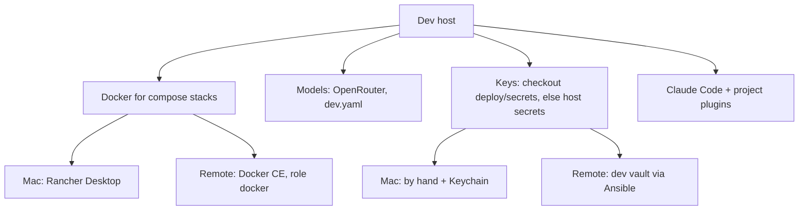

# Domain: develop on a remote dev host

## New terms

| Term | Meaning |
|---|---|
| **Dev host** | The machine a checkout and its dev stacks run on. Until now always the Mac. Now also the remote dev host. Every dev host runs stacks with `just dev up` and owns stacks 1–9 on its own ports. Stacks on different dev hosts never collide. |
| **Remote dev host** | A dev host that isn't the Mac: our own server `karpathy-dev` (Hetzner), separate from prod, always on, reached only over Tailscale. One developer, several agents in parallel worktrees, each with its own stack. Replaces the earlier Codespace idea. |
| **Host secrets** | The API keys a dev host keeps once for all its checkouts, in `~/.config/karpathy/secrets/`. A checkout's own `deploy/secrets/<name>` wins; a key missing there comes from the host secrets. Filled by Ansible on the remote dev host, by hand on the Mac. |
| **Port forward** | How the Mac's browser reaches a remote dev host's stack: the SSH entry's `LocalForward` maps the remote 80N0 to the Mac's `localhost:80N0`. |

Changes no system term. The `dev` Ansible target (inventory, vault, `dev.yml`) is new next to `hetzner`, but a dev
host is not a **deploy target**: it gets tools, not a release.

## What a dev host provides

## Scenarios

- **New worktree on the remote dev host**: `git worktree add .worktrees/x`, `just dev up` → stack 2, with no key
  copied: the OpenRouter key comes from the host secrets.
- **Checkout with its own key**: `deploy/secrets/openrouter_api_key` exists → that one is used, the host secrets are
  not read for it.
- **Mac and remote both run stack 1**: the forward for 8010 fails while the Mac's stack holds the port. Work on one dev
  host at a time, or use different stack numbers.
- **SSH drops mid-run**: `claude` in that session ends; `just resume` continues it. Stacks keep running.

## Unchanged

- Stack numbering, ownership (`tmp/dev/stack`) and the `just` commands.
- Settings layering: `settings.yaml` ← `dev.yaml` ← `dev.local.yaml`. The remote dev host writes none of them.
- Provider-agnostic AI: the gateway comes from settings, never from code. Every dev host uses OpenRouter.
