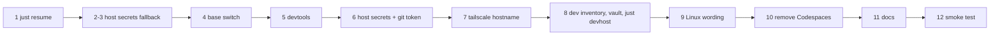

# Plan: develop on a remote dev host

Before this plan continues, the change that removed the local model server is merged to `main` (dev on OpenRouter
only). The Codespaces steps of the
earlier version are gone; only `just resume` stays from them.

The logic with a local runtime gets tests that run in `just check`: the host-secrets fallback (shell test) and the
`dev.yml` playbook, run against a throwaway Ubuntu 24.04 container. Booking and the real server are proven by the
smoke test at the end.

- [x] `just resume`: continue the last Claude session after a reconnect
  - Test first: none — a one-line recipe
  - Verify: `just --dry-run resume` prints `claude --continue`
- [x] `dev.sh up` copies a key missing in the checkout from `~/.config/karpathy/secrets/` (mode 600); a checkout's own key wins
  - Test first: `deploy/stack.test.sh` (temp `HOME` and checkout) › "a missing openrouter_api_key comes from the host secrets" › "the checkout's own key is kept" › "the copy is mode 600" — fails today: no fallback exists
  - Verify: `bash deploy/stack.test.sh` → all ok; `just check` green
- [x] Without the OpenRouter key in either place, `dev.sh up` fails and names both places
  - Test first: `deploy/stack.test.sh` › "no key anywhere: the error names deploy/secrets and ~/.config/karpathy/secrets" — fails today: the message names only the checkout
  - Verify: `bash deploy/stack.test.sh` → all ok
- [x] `base`: on a dev host the login user gets uid/gid 1000 with sudo and the docker group, and no `deploy` user exists; prod unchanged
  - Test first: `deploy/ansible/dev.test.sh` runs `dev.yml` (without `tailscale`) against a fresh `ubuntu:24.04` container (privileged, systemd, its own `ubuntu` user removed) over the docker connection › "login user has uid 1000" › "no deploy user" › "login user is in the docker group" › "login user may sudo without a password" › "login user can use Docker" — fails today: `dev.yml` doesn't exist
  - Verify: `bash deploy/ansible/dev.test.sh` → all ok; `ansible-playbook --syntax-check deploy/ansible/site.yml`; `just deploy-check hetzner` shows no change in `base`
- [x] `devtools` role: pinned Node 22, `just`, ripgrep, jq, netcat, `gh`, Claude Code CLI, Playwright Chromium with system deps
  - Test first: `deploy/ansible/dev.test.sh` › "node is v22" › "just, rg, jq, nc, gh, claude answer --version" › "Playwright's Chromium is installed" — fails today: no `devtools` role
  - Verify: `bash deploy/ansible/dev.test.sh` → all ok
- [x] `devtools` writes the host secrets (`~/.config/karpathy/secrets/`, mode 600) and the GitHub token as the login user's git credential
  - Test first: `deploy/ansible/dev.test.sh` with test vault values as extra vars › "openrouter_api_key and exa_api_key in ~/.config/karpathy/secrets, mode 600" › "git credential for github.com returns the token" — fails today: nothing writes them
  - Verify: `bash deploy/ansible/dev.test.sh` → all ok
- [x] `tailscale` role: hostname from a variable (`karpathy` for prod, `karpathy-dev` for dev)
  - Test first: none — the role needs a real tailnet; prod's value stays the default (`tailscale_hostname` already was a role default; only the dev inventory sets it)
  - Verify: `ansible-playbook --syntax-check` on `site.yml` and `dev.yml`; `just deploy-check hetzner` shows no tailscale change
- [x] `dev` inventory and vault, `deploy/devhost.sh`, `just devhost [--check] [--bootstrap <ip>]`; `just secrets dev` fills the vault
  - Test first: none — wiring; the playbook itself is covered by `dev.test.sh`
  - Verify: `ansible-inventory -i deploy/ansible/inventories/dev --list` lists `karpathy-dev`; `bash -n deploy/devhost.sh`; `just --show devhost`; `ansible-vault view` of the dev vault works with the Keychain password
- [x] Linux wording for the Mac-only hints that would mislead: the "restart Rancher" hint (`check-preflight.sh`, `e2e/helpers.ts`), `brew install jq` (`stack.sh`), `just ntfy-topic` without the Keychain
  - Test first: `deploy/check-preflight.test.sh` › "on Linux the hint doesn't name Rancher" — fails today: the hint always names Rancher
  - Verify: `bash deploy/check-preflight.test.sh` → ok; `just check` green
- [x] Remove the Codespaces work: `.devcontainer/`, its line in `just check`, the README section, the `CLAUDE.md` note
  - Test first: none — removal
  - Verify: `! test -e .devcontainer && ! git grep -qi codespace -- README.md CLAUDE.md justfile`; `just check` green
- [x] Document the dev server: `deploy/README.md` (booking, Tailscale tag, vault, `just devhost`, `~/.ssh/config` entry with `LocalForward` 8010…8090, the port clash with Mac stacks), a pointer in `README.md`, a short note in `CLAUDE.md` (the remote dev host is a dev host; same stack rules)
  - Test first: none — docs
  - Verify: `grep -q 'Dev server' deploy/README.md && grep -q karpathy-dev README.md CLAUDE.md`
- [x] Found in the smoke test: `devtools` installs Ansible and sets the login user's git identity (`devtools_git_user`); `stack.test.sh` passes on Linux (GNU `stat` first, own git identity for its commit)
  - Test first: `deploy/ansible/dev.test.sh` › "ansible answers --version" › "git user.name" › "git user.email" — failed: the role installed neither
  - Verify: `bash deploy/ansible/dev.test.sh` green; `just check` green on `karpathy-dev`
- [ ] Smoke test on the real server
  - Test first: none — needs the booked server
  - Verify: `just devhost --bootstrap <ip>` then `just devhost` green; `ssh karpathy-dev` over Tailscale; in a fresh clone `just check` green, `just dev up` prints stack 1, https://localhost:8010 on the Mac loads and one chat turn is answered; a second worktree's stack 2 starts without copying keys; `just e2e` green; `claude` lists the project plugins; after reconnecting, `just resume` continues the session

System docs are updated at `/spec:archive`.
