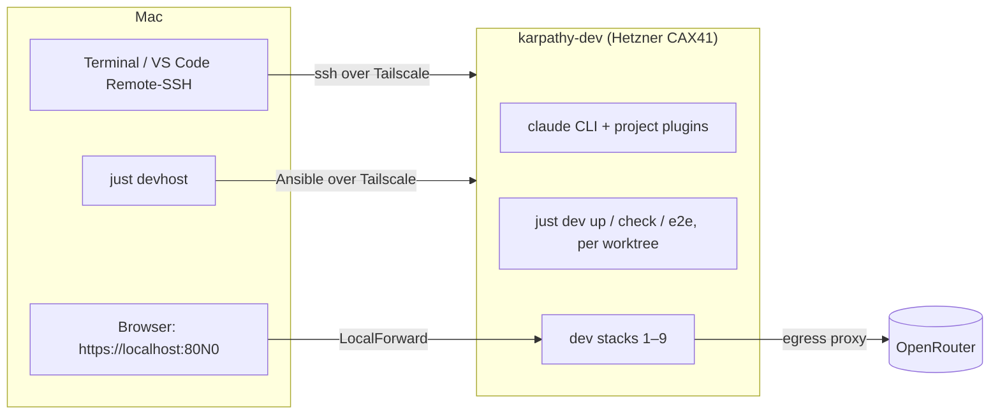

# Proposal: develop on a remote dev host

## Why

Development needs the Mac today: dev stacks run in Rancher Desktop, and the Claude Code setup (plugins, skills,
`CLAUDE.md`) lives in the local clone. Long agent runs block the Mac, and away from it there is only Claude Code on the
web, which can't run a dev stack.

A **remote dev host** is our own always-on server: a Hetzner VM, separate from prod, reached only over Tailscale. It is
one more dev host next to the Mac. `ssh karpathy-dev`, then `just dev up`, `just check`, `just e2e` and `claude` work
as they do on the Mac, in several worktrees at once. Its stacks open on the Mac at `https://localhost:80N0` through SSH
port forwards.

An earlier version of this change used GitHub Codespaces. The grill on 2026-10-21 replaced it with our own server:
always on, no per-core-hour billing, set up like prod.

## What changes

- **A dev server, booked by hand** in the Hetzner console (CAX41: ARM, 16 vCPU, 32 GB; Ubuntu 24.04; backups on),
  documented in `deploy/README.md` next to prod.
- **Set up by Ansible** as a new target `dev`: `just devhost [--check]` runs `deploy/ansible/dev.yml` with the roles
  `base`, `tailscale` and `docker` (shared with prod) and a new `devtools` role (Node 22, `just`, ripgrep, jq, netcat,
  `gh`, the Claude Code CLI, Playwright Chromium). The developer's login user has uid 1000, so bind-mounted sources fit
  the containers' `APP_UID`.
- **Secrets from a `dev` Ansible vault** (password in the Keychain, like prod): the OpenRouter and Exa keys go to
  `~/.config/karpathy/secrets/`, and a fine-grained GitHub token for `karpathy.app`, `karpathy_demo_wiki` and
  `ingest_email` goes to the login user's git config. `dev.sh` falls back to `~/.config/karpathy/secrets/` for a key
  that a checkout doesn't have, so new worktrees work without copying keys, on the Mac too.
- **Connecting**: a documented `~/.ssh/config` entry `karpathy-dev` (Tailscale hostname, `LocalForward` 8010…8090).
  Terminal or VS Code Remote-SSH. `just resume` continues the last Claude session after a reconnect.
- **Claude Code** logs in once with the subscription. No personal `~/.claude` config is copied.
- **Linux wording** for the Mac-only hints that would mislead there (restart Rancher, `brew install jq`, the Keychain
  in `just ntfy-topic`).
- **The Codespaces work is removed**: `.devcontainer/`, the README section and the `CLAUDE.md` note.

## Out of scope

- iPad or phone as the only device: the shell and `claude` work from any SSH client, but the app opens only through a
  `localhost` forward, so it needs a Mac or laptop. A host-agnostic dev site is a follow-up.
- Dev stacks on the prod server.
- Monitoring and alerts for the dev server.
- Personal `~/.claude` config (global `CLAUDE.md`, RTK, memory). A dotfiles repo is the follow-up if it's missed.
- Several developers on one dev server.
- Scripted server creation (hcloud, Terraform).

## Expected outcome

After booking the server and running `just devhost`: `ssh karpathy-dev` logs in over Tailscale; in a fresh clone
`just check` passes, `just dev up` starts stack 1, https://localhost:8010 on the Mac loads the app and a chat turn is
answered by the OpenRouter model, and `just e2e` passes. A second worktree's stack 2 runs at the same time without
copying keys. `claude` starts with the project plugins, and `just resume` continues it after a reconnect.
